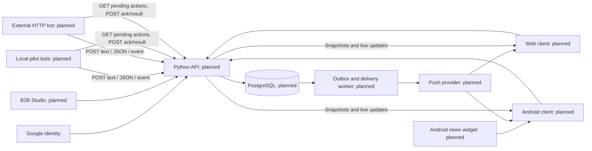

# MarkeTOB — предлагаемая архитектура

Статус: проект, реализация не начиналась. Актуально на 19 октября 2026. Окончательный клиентский стек выбирается в PM-002. Текущие ответы владельца имеют приоритет над прежним исследованием.

## Компоненты

Предлагается модульный Python-backend (FastAPI), PostgreSQL как источник истины и отдельный worker из того же репозитория. API читает сохранённые данные; клиенту не нужно опрашивать каждого бота. Redis/отдельный брокер добавляются только при доказанной необходимости; надёжная очередь/outbox не должна существовать только в памяти. Bot SDK и примеры — Python. UI на Python/Flet проверяется первым кандидатом; другой стек и нативный Android-код разрешены владельцем при улучшении качества. Выбор ещё не сделан.

[Официальная документация Flet](https://flet.dev/docs/publish/) описывает упаковку Web, Android, iOS и Windows; это основание для проверки, а не доказательство пригодности для всех наших сценариев. Для виджета нужен отдельный интеграционный spike по [Android App Widgets](https://developer.android.com/develop/ui/views/appwidgets/overview). Docker-поставка API ориентируется на [руководство FastAPI](https://fastapi.tiangolo.com/deployment/docker/). Версии фиксируются после практической проверки, не по этому документу.

Все блоки planned; готова только документация. Диаграмма показывает логические потоки, не требует отдельного микросервиса на каждый модуль. Пилотные боты — отдельные процессы/контейнеры с тем же публичным контрактом, без доступа к БД платформы.

## Ответственность модулей

| Модуль | Ответственность | Основные задачи |
|---|---|---|
| Identity / access | Google-вход, сессии, организации, роли, доступ к страницам | PM-006 |
| Bot registry | Регистрация, одноразовые credentials, рабочие ключи, ротация и отзыв | PM-007 |
| Ingestion | Проверка text/data/event, снимки, revision, дедупликация | PM-008 |
| Pages / rendering contracts | Каналы, версии страниц, блоки, data bindings, публикация | PM-004, PM-009 |
| Actions / delivery | Проверка действия, очередь бота, GET, ACK, result, retry | PM-010 |
| Consumer workspace | Избранное, личные страницы и ссылки на разрешённые блоки | PM-015–017 |
| Updates / notifications | Изменения открытым клиентам и push по выбору пользователя | PM-018 |
| Clients | Web, Android, B2B Studio, My Space, локальный кеш | PM-013–020 |
| Operations | Docker, хранение, резервные копии, метрики и выпуск | PM-021–024 |

## Ключевые сущности

| Сущность | Ключевые данные / инвариант |
|---|---|
| User / Identity / Session | Стабильный user_id, Google subject, отзываемая сессия; email не единственный идентификатор |
| Organization / Membership | B2B владелец и участники; доступ только по проверенной роли |
| Bot / RegistrationCredential / BotKey | bot_id, owner, scopes, expiry; индивидуальная регистрация, рабочий ключ хранится в виде хеша |
| Channel / PageVersion | Владелец, slug, visibility, draft/published version; публикации версионируются |
| Block / DataBinding | news, product или chart; явная связь с разрешённым источником и полями |
| Message / Record / DataRevision | bot_id+message_id для дедупликации, актуальный снимок, порядок обновлений |
| ActionDefinition / ActionRequest | Серверно разрешённое действие, ресурс, пользователь, idempotency key, состояние |
| BotEvent / DeliveryReceipt / Outbox | Надёжная доставка at-least-once; повтор не создаёт второй бизнес-эффект |
| Grant / Favorite | Явное право чтения/редактирования отдельно от избранного |
| PersonalPage / BlockReference | Оформление и ссылки на источники; не копия полномочий владельца |
| SharedTemplate | Неизменяемый шаблон, код, срок/отзыв; не содержит токены и данные источника |
| Device / NotificationPreference | Доставка конкретному пользователю/устройству по выбранным событиям |
| AuditEntry | Кто/что/когда; без секретов и полного приватного payload |

## Поток данных и действий

1. B2B пользователь входит через Google, регистрирует бота и получает его ключ через доверенный flow. Новый владелец может сделать это самостоятельно.
2. Бот отправляет валидированное сообщение с устойчивым message_id. API проверяет ключ и принадлежность источника, сохраняет snapshot/revision и outbox в одной транзакции.
3. Web/Android получает опубликованную схему и разрешённые данные; renderer использует только поддерживаемые компоненты. Live-соединение сигнализирует обновления, при пропуске событий выполняется resync.
4. Нажатие Buy создаёт **заявку**, а не оплату. Сервер проверяет action, source и права, записывает событие. Повторный запрос с тем же ключом не создаёт дубль.
5. Бот читает GET pending events, выполняет идемпотентную операцию, подтверждает доставку и отдельно сообщает бизнес-результат. ACK доставки не означает успешную заявку. После сбоя возможна повторная доставка.
6. Клиент видит Request sent / Processing / Confirmed / Failed. Success определяется подтверждённым результатом бота, а не HTTP 202.

## Личная страница и обмен

Конструктор хранит допустимый layout, theme, тип отображения и ссылки на блоки разных каналов. Выбор нового типа допускается только при совместимых данных. Объединение данных разных источников в произвольную вычислительную модель не входит в пилот.

Ответ владельца: передавать оформление и ссылки, права проверять отдельно. Предлагаемый короткий код — случайный идентификатор серверного неизменяемого шаблона с отзывом/optional expiry. Кодирование, подпись и шифрование — разные операции: Base64 не даёт конфиденциальности; подпись защищает от подмены, но не скрывает содержимое. Если позднее нужен автономный зашифрованный код, потребуется отдельная модель распределения ключей. Текущий пилот не обещает такой режим.

При импорте создаётся новая личная страница; отсутствующий доступ даёт Access required. Отзыв ссылки прекращает новые импорты, но не стирает уже скопированный интерфейс. Доступ к данным проверяется при каждом чтении, действии и подписке.

## Надёжность и эксплуатация

Проектный профиль: 100 ботов, 10 000 MAU, до 1 000 входящих сообщений/мин (примерно 16,7/с в среднем). Это ориентир входного потока, а не оценка peak/RPS всей системы. Профиль одновременных пользователей, burst, размер сообщения и хранение уточняются в PM-001/004. Цель «за секунды» превращается в измеримый SLO, проверяемый PM-022; произвольное число миллисекунд пока не согласовано.

База и очередь переживают рестарт; сроки хранения ограничены. Кеш ключуется с учётом доступа; private ответы не попадают в общий публичный кеш. Не использовать секрет бота в клиенте или виджете. Новостной виджет имеет последнее время обновления и TTL; Android может ограничивать фоновые обновления, поэтому частота виджета не равна частоте открытого приложения.

Docker требует вычислительной среды (VPS/VM/managed containers); облачное объектное хранилище само по себе не запускает контейнеры. Поставляются Dockerfile/Compose и инструкции, но фактический облачный запуск зависит от выбранного сервера, домена и credentials. Никакого хостинга ещё не куплено/создано.
