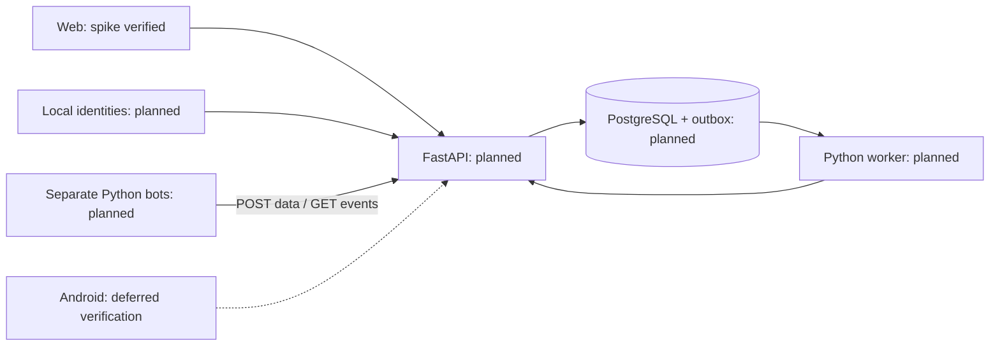

# ADR-0002 — Локальный Python backend

Дата: 21 октября 2026. **Принято как проектное решение; реализация не начата.** PM-002.

## Решение и причины

Модульный FastAPI backend, PostgreSQL и отдельный worker из общей Python-кодовой базы. API/worker и пилотные боты — разные процессы. Один HTTP-контракт обслуживает локальные и внешние боты. До 1 000 входящих сообщений/мин само по себе не оправдывает отдельный брокер/микросервис на каждый модуль; это проектное допущение, проверяемое нагрузкой в PM-022.

PostgreSQL хранит пользователей, grants, реестр ботов, версии страниц, snapshots, idempotency records и transactional outbox. Сохранение данных и outbox выполняется в одной транзакции. Worker забирает работу с ограниченными lease/retry; GET-очередь бота не удаляет событие до ACK. Redis/Kafka не являются обязательными компонентами пилота. SQLite допустим для изолированного теста, но не считается проверкой транзакций/очереди PostgreSQL.

Локальные аккаунты и серверные сессии отделены от будущего identity-provider. UI не передаёт доверенные роли/tenant. Google и push-provider пока не подключаются. Открытый Web клиент получает разрешённые revisions через SSE или обоснованный polling; окончательный транспорт и reconnect проверяются в PM-018.

## Модули и границы

Identity/access → bot registry → ingestion/snapshots → pages/layouts → actions/events → live updates. Общие схемы версионируются отдельно от реализации. Боты имеют доступ только к HTTP шлюзу, не к таблицам платформы.

## Поставка и эксплуатация

Dev-запуск на Windows (PM-005); Dockerfile/Compose с Linux containers, локальными volumes и backup/restore (PM-021). По умолчанию порты слушают loopback; БД не публикуется наружу. Никаких Firebase credentials, облачной VM или внешнего CDN для локального запуска. Интернет нужен при установке зависимостей.

Версии backend-зависимостей и контейнеров закрепляются при проверке PM-005. Python 3.14 доступен в текущем окружении; совместимость БД-драйвера и контейнеров ещё не проверена. Docker сейчас не установлен: документация не считается успешно запущенной поставкой. На PM-022 фиксируются CPU/RAM, профили и измеренные ограничения; MAU не подменяет concurrency.

## Альтернативы

SQLite-only упрощает установку, но не даёт эквивалентную проверку конкурентной очереди PostgreSQL. Redis/Celery/Kafka добавляют процессы и операционные требования до доказанной необходимости. Облачные identity/push отложены прямым указанием владельца. Отдельный worker можно масштабировать позднее без изменения Bot API.
