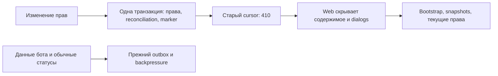

# ADR-0016 · отзыв прав независимо от ёмкости outbox

PM-023, 24 октября 2026. Разрешение D45 на реализацию
[предложения](../proposals/PM-023-queue-safety.md). Тесты и ограничения — в
[отчёте исправления](../task-results/PM-023-queue-fix.md).

## Проблема и граница

Общая очередь ограничена 20 000 pending / 250 000 total. До исправления изменение
прав в той же транзакции вставляло hints по каналам и затронутым заявкам. Отказ
admission откатывал и отзыв прав. Удаление только fanout membership недостаточно:
та же зависимость есть в grants, удалении аккаунта/бота/канала, narrowing через
publish/rollback и `reconcile_access`.

## Решение

`access_changes.invalidate_access(connection)` после изменения прав и reconciliation
в той же транзакции обновляет единственную существующую строку `delivery_state`:

```sql
UPDATE delivery_state
SET watermark=watermark+1, retention_floor=watermark+1;
```

Это атомарная инвалидация cursor, не строка события. Один marker на фактическую
операцию, независимо от числа каналов/заявок. No-op grant/membership и повторные
удаления не создают marker. Неуспешная авторизация, version conflict и ошибка БД
не публикуют его. Отзыв и marker либо фиксируются вместе, либо вместе откатываются.

Dispatcher использует тот же row lock. Поздно зафиксированное событие получает
delivery ID выше marker. Cleanup старого prefix использует `greatest` для floor,
чтобы не возвращать действительность уже отозванным cursors. Пропуски в delivery
IDs допустимы; backup/restore уже поддерживает watermark выше максимального ID
сохранённой строки. Миграции и формат Bot API не меняются.

`reconcile_access` сохраняет прежние состояния, но не создаёт N hints: вызывающий
маршрут делает один marker. Обычный отзыв отменяет unACKed requests, ACKed остаются
unknown; при выключении источника `disabled=True` все незавершённые остаются unknown.
Терминальные заявки и заявки пользователя с альтернативным доступом сохраняются.
ACK сам по себе не означает состояние processing. Обычный bot result/timeout
по-прежнему создаёт `request.status`, сообщение бота — прежний outbox/receipt.

Public → selected через общий `publish` не вставляет ни предварительный
`channel.changed`, ни revoke hint. Rollback использует ту же ветку. Обычные
публикации, включая selected → public, сохраняют прежний backpressure.

## Клиент и компромисс

Старый cursor получает существующий `410 resync_required`. Web уже обрабатывает
его: скрывает содержимое и dialogs, получает новый cursor, затем snapshots,
текущие статусы и избранное. Сохранённый layout не меняется. Явный `watch` продолжает
выдавать минимальное `access.revoked` для недоступного источника без новых строк.



Инвалидация глобальная: даже незатронутые открытые сессии перечитывают snapshots.
Частые реальные изменения прав повышают нагрузку. При resync старые hints могут
не повториться как toast; это согласуется с отсутствием durable inbox/exactly-once
toast. Состояние восстанавливается через snapshots/GET. Полный L2 отложен, новый
SLO не заявлен; отдельные workspace/user epochs возможны следующим этапом при
измеренной необходимости.

## Альтернативы

- Исключение revoke hints из admission оставляет неограниченный fanout, особенно
  через reconciliation, и не устраняет источник исчерпания ресурсов.
- Удаление чужих уведомлений ради освобождения места нарушает независимость
  уже принятых данных и не гарантирует атомарный отзыв.
- Отдельная очередь/epoch по workspace требует новых persistence и client rules.
  Для локального пилота используется уже проверяемый контракт 410/resync.
