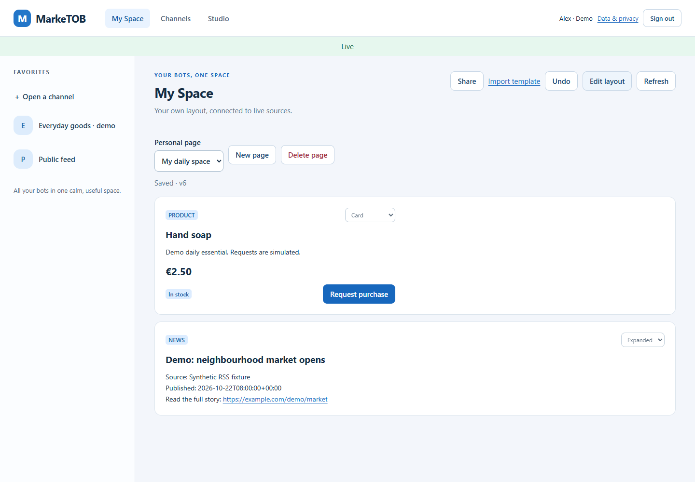

# MarkeTOB: товары и новости в My Space

8 ноября 2026 · **76 секунд**, без звука, с русскими пояснениями.

[Смотреть видео](marketob-my-space.webm). Файл можно скачать и открыть в браузере.
Интерфейс приложения — на английском.

Это запись настоящего Web/API и двух Python-ботов на отдельной Docker-копии
поставки 68958f1. Товары и RSS-новость демонстрационные. Нижняя тёмная плашка —
пояснение к видео, а не часть приложения. HTTP-ответы и статус заявки не подменялись.

| Время | Действие |
| --- | --- |
| 00:00–00:24 | Открываем два доступных канала по ссылкам, добавляем в избранное |
| 00:25–00:39 | Создаём My daily space, добавляем Hand soap и новость |
| 00:40–00:49 | Меняем товар на Card, меняем порядок, используем Undo |
| 00:50–00:55 | Смотрим собранную страницу в Preview |
| 00:56–01:06 | Request purchase → подтверждение одной единицы → Send request |
| 01:07–01:16 | Получаем Confirmed от исходного Python-бота |



## Повторить самостоятельно

Откройте [локальный MarkeTOB](http://127.0.0.1:19000/app/). Если аккаунт и
каналы уже есть, переходите к шагам ниже. Для первой подготовки двух
демонстрационных ботов выполните команды из [инструкции владельцу](../../setup/PILOT_HANDOFF.md#первый-опыт-товары-и-новости).
Она создаёт отдельный аккаунт с выбранным вами паролем и две закрытые страницы.

1. Войдите в свой локальный аккаунт. Откройте ссылку на каждый канал через
   **＋ Open a channel**, нажмите **Add to favorites**.
2. Перейдите в **My Space → Create My Space**. Введите название и нажмите **Create page**.
3. В **Source channel** выберите каталог. В новой версии Block catalog найдите
   карточку Hand soap и нажмите **Add to My Space**. Ролик записан до этой доработки
   и показывает прежние Block to add / Add block.
4. Так же добавьте новость из Public feed. Можно изменить вид товара на **Card**,
   передвинуть блоки **Move up / Move down** и отменить последнее изменение через **Undo**.
5. Нажмите **Preview → Request purchase**. Проверьте товар и количество 1,
   затем **Send request**. Оплаты и отправки товара в демонстрации нет.
6. Дождитесь **Confirmed**. **Check status** проверяет существующую заявку;
   **New request** создаёт новую и для проверки первой не нужна.

Для проверки отказа используйте Paper towels в каталоге: бот возвращает Declined.
Этот дополнительный сценарий не включён в короткое видео. Если ответ не приходит,
проверьте, что catalog-бот продолжает работать; не отправляйте заявку повторно.

## Проверка и повторная запись

В [result.json](result.json) сохранены пять проверок сценария, отсутствие page errors
и результат SQL: **ровно одна заявка в состоянии confirmed**.
Запись: Edge 157.0.4341.42, Playwright 1.62.1, 1440×1000, VP8/WebM, 25 кадров/с,
76,36 с. Просмотрены кадры редактора, подтверждения и фактический финальный экран.
Пароли, ключи ботов и содержимое других аккаунтов в артефакты не включены.
Временные API, бот, контейнеры и том удалены после записи; ссылки из видео
принадлежат временному стенду и не служат входом в постоянный пилот.

Для повторной записи в настроенной среде разработки нужны Playwright и его FFmpeg
(`node apps/client/node_modules/playwright/cli.js install ffmpeg`). Из корня проекта:

```powershell
$env:MARKETOB_BROWSER_CHANNEL = 'msedge'
.venv-dev/Scripts/python.exe -m scripts.record_demo --wsl Ubuntu --release 68958f1 --output .local/my-space-demo-new
```

Docker-образы указанной версии должны быть собраны заранее; каталог вывода — новым.
Для native dev PostgreSQL вместо `--wsl/--release` предусмотрен
`--connection-file .local/postgres-dev/connection.json`; этот вариант текущей записи
не использовался из-за недоступности native БД из среды запуска.

SHA-256 видео: `16053db8964a9d57b450330049a0466a477c4c03b6e0978192060d985d2da485`.
Эта демонстрация закрывает S09, но не заменяет личную приёмку владельцем,
Android или полный нагрузочный тест. Полная PM-024 остаётся открытой.
