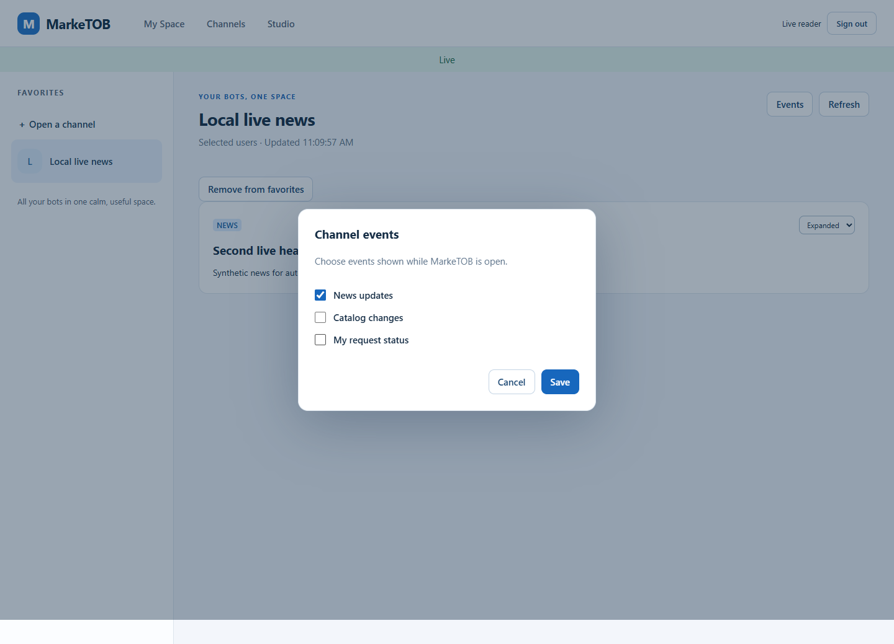
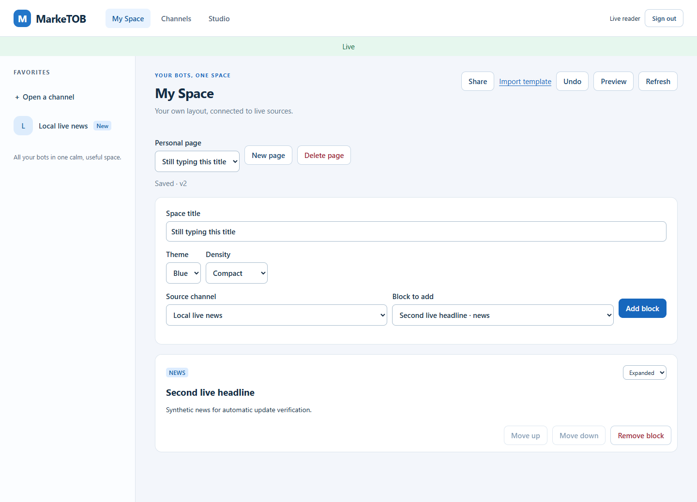
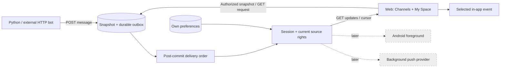

# PM-018 · предварительный макет

23 октября 2026, рабочий дизайн перед реализацией. Текущая плотность сохраняется.

```text
My Space                       Live
[Share] [Undo] [Preview] [Refresh]
Space title: My daily space
[News article — updates automatically]
[Product list — current availability]

Channel                        [Events]
  [ ] News updates
  [ ] Catalog changes
  [x] My request status
                         [Save]
```

Polling каждые 2 секунды в открытом клиенте. Данные обновляются отдельно от
редактируемого оформления и заголовка. Собственные статусы заявок выбраны по
умолчанию; остальные события включаются для канала. Toast содержит только общий
тип события. Browser Notification permission не запрашивается.

При сбое: Reconnecting · Content hidden. Затем bootstrap cursor, актуальный snapshot
и продолжение. Недоступные источники остаются placeholders. Logout/скрытие вкладки
останавливают доставку. Background push и Android сейчас не заявляются.

## Фактический результат





Синтетические данные реального локального API, Edge1440×1000. Проверена также
ширина360px. По визуальной проверке флажки выровнены с подписями; активное
соединение отмечено зелёным Live. При загрузке Events controls заблокированы,
чтобы ответ сервера не перезаписывал сделанный пользователем выбор.

Отличие от макета: Live находится общей полосой под navigation, Events открывает
modal. Существующая плотность и структура My Space сохранены. Быстрый
revoke/restore/revoke потребовал отдельного повторного скрытия содержимого даже
при одинаковом hint; dedup подавляет только повторные fetch/toast.



[Замер L1](../task-results/PM-018-LOAD.md), [пояснительная записка](../task-results/PM-018.md).
