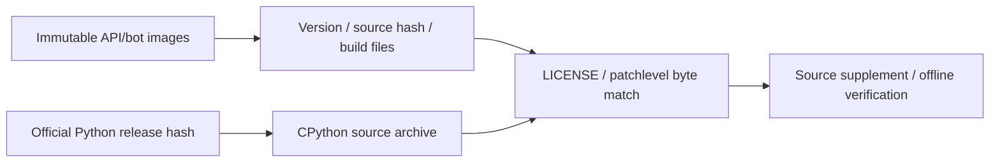

# PM-023-CPY · Исходники установленного CPython

24 ноября 2026 · P1 · issue #28 · после PM-023-PY/PGDG.

## Порядок и критерии

- [x] Снять ограниченные version/hash/build/license сведения из двух immutable
  API/bot images без сети и пользовательских volumes.
- [x] Сопоставить source hash с официальным release Python 3.14.9; получить
  исходный архив, сверить LICENSE и Include/patchlevel.h с установленными.
- [x] Подготовить отдельный комплект и standalone verifier без сторонних библиотек.
- [x] Проверить отрицательные случаи и настоящий комплект на Windows/Linux, CI.
- [x] Обновить журнал, статус, отчёт, инструкцию и GitHub.

Параметры компиляции и хеши бинарников — наблюдения, не доказательство
воспроизводимой сборки. Go, compiler/build dependencies, native linking и
полная приёмка остаются открытыми. Установленные images и исторические kits
не заменяются; 19/24, Android/облако/L2 сохраняют прежний статус.

[Локальный результат](../task-results/PM-023-cpython-20261124.md): 51 тест и offline Windows/Linux PASS; Все четыре jobs CI 45402033433 на e3b1e6d PASS; 447 Python-тестов, Web/Docker/restore. Windows/Linux повторные сборки дают один manifest hash e2afec94….
