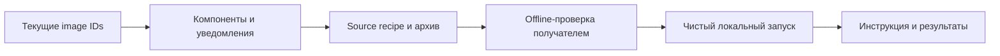

# Три подзадачи текущей поставки · 9 ноября 2026

Основание: «продолжай делать следующие 3 задачи» после исправления схем API.
Это доступные части PM-023/024, а не три принятые PM-задачи. Глобальный счётчик
19/24; G05 ещё не наступает. Android, облако, полный L2 и личная приёмка отложены.

| ID | Порядок / приоритет | Связь | Результат / приёмка |
| --- | --- | --- | --- |
| PM-023-R1 | 1 / P0 | #28, установленная schema-20261109 | Проверенные immutable IDs API/bot/DB/proxy, сравнение компонентов и notice/source bindings. Совпадение только версии не заменяет проверку материалов; gaps сохраняются |
| PM-023-R2 | 2 / P0 | #28, R1 | Новый source recipe и архив для текущих образов; самостоятельная offline-проверка на Windows/Linux, отрицательные тесты привязки. Исторический комплект 68958f1 сохраняется |
| PM-024-R1 | 3 / P1 | #29, R1/R2 | Чистый запуск текущих образов на отдельной Docker-копии, Web/API/Python-бот сценарий и инструкция получателя с точными артефактами, командами и ограничениями |

## Последовательность

Работа не меняет интерфейс продукта и не требует переноса рабочей БД.
Проверки поставки выполняются в отдельных контейнерах/каталогах. В Git попадают
код, синтетические данные и проверочные метаданные; credentials, backups и
настоящие новости остаются приватными. Полная готовность внешнего релиза не заявляется.

## Состояние

- [x] PM-023-R1: реестр и привязка.
- [x] PM-023-R2: исходный комплект 1a3dd882…, после исправления различия LF/CRLF.
- [x] PM-024-R1: чистый запуск и передача.

Результаты: [R1](../task-results/PM-023-release-binding-20261109.md),
[R2](../task-results/PM-023-source-kit-20261109.md),
[R3](../task-results/PM-024-clean-delivery-20261109.md).
34 focused tests, Windows/Linux offline verification, 5 Web-проверок и CI
42663866512 на итоговом коде ca772a3 PASS. Первый архив заменён из-за выявленного CI хеша CRLF/LF;
для передачи используется только квитанция 1a3dd882….

Перед каждым пунктом повторно читаются AGENTS.md и WORKING_AGREEMENT.md.
Для каждого пункта сохраняются CHANGELOG, пояснительная записка, проверки и issue.
