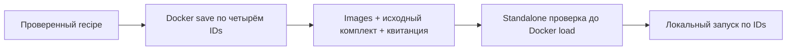

# PM-024-R2 · Переносимый локальный Docker-комплект

10 ноября 2026. Следующий пункт по команде владельца «делать следующую задачу».
Приоритет P1, issue #29; после PM-023-R1/R2 и PM-024-R1.
Цель — перенести четыре проверенных Linux/amd64 images без повторной сборки.

## Результат и приёмка

- [ ] Экспорт четырёх immutable IDs schema-20261109, без mutable tags и volumes.
- [ ] Комплект с recipe/source receipt, исходным архивом, инструкцией и standalone
  verifier на Python. Внешний SHA-256 квитанции связывает весь состав.
- [ ] Положительные и отрицательные проверки целостности, image IDs и состава.
- [ ] Реальный Docker load, запуск по IDs и подтверждение сохранности рабочего пилота.
- [ ] CHANGELOG, STATUS, отчёт, GitHub и команды получателя обновлены.

База пользователей, bot keys, локальные env и CA не переносятся. Набор содержит
исполняемые Linux/amd64 images, а не Windows/Android приложения. Публичная
публикация больших архивов не входит в задачу; они остаются локальными.
Coverage исходников partial и прежние gaps явно переносятся в квитанцию.
Полная PM-024 и счётчик 19/24 не меняются. Отсрочки Android/облака/L2 сохраняются.
