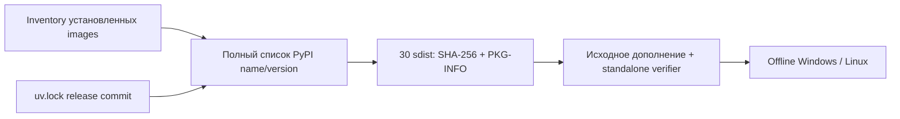

# PM-023-PY · Исходные архивы Python runtime

24 ноября 2026. Приоритет P1, issue #28. После PM-023-R1/R2 и PM-024-R2.
Следующая независимая часть `remaining-source-inputs`: все сторонние PyPI
пакеты установленной Linux/amd64 schema-20261109, без dev-only зависимостей.

## Порядок и приёмка

- [x] Сопоставить полный inventory API/бота с uv.lock установленного commit.
- [x] Получить каждый sdist, сверить URL/размер/SHA-256 и корневой PKG-INFO.
- [x] Собрать отдельное дополнение, проверяемое без сети/Git/Docker.
- [x] Проверить реальные архивы на Windows/Linux и отрицательные сценарии.
- [x] Обновить инструкцию, CHANGELOG, STATUS, отчёт и GitHub.

Архивы читаются как данные; build scripts не исполняются. Сбор не доказывает
воспроизводимость бинарников и полноту build dependency closure. CPython, Go,
native link map и прежние gaps остаются отдельной работой. Исторические
комплекты и рабочий runtime сохраняются. Полная PM-023 открыта, 19/24;
Android/облако/L2 отложены согласно ответам владельца.

[Отчёт и квитанции](../task-results/PM-023-python-sources-20261124.md). Все четыре jobs CI 45396695801 на fc40c24 PASS.
