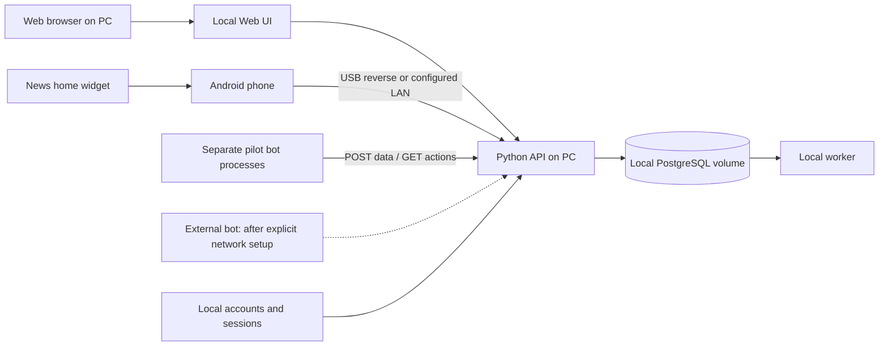

# Локальный пилот MarkeTOB

Решение владельца от 21 октября 2026: первый запуск на его компьютере. Текущий host — Windows. API-контракт сохраняет возможность переноса на Linux VPS/container host.

## Схема запуска (целевая, ещё не развёрнута)

Python API, worker и отдельные боты могут разрабатываться в изолированном окружении. Итоговая поставка — Dockerfile/Compose с PostgreSQL, Web/API/worker и optional bots. Браузер находится на компьютере, Android-приложение — на телефоне. Запущенный на Windows сайт не считается отдельным Windows desktop app.

## Два адресных режима

1. **Компьютер:** Web и API доступны на loopback. Внешний порт БД не публикуется по умолчанию; credentials находятся в локальном исключённом из Git конфиге.
2. **Телефон:** начать с USB debugging + `adb reverse` для debug-прототипа. Для LAN-пилота нужен явный адрес компьютера и доверенный HTTPS. Не включать широкие firewall-правила или public tunnel автоматически. `localhost` на телефоне указывает на телефон, если USB reverse не настроен.

Точные порты задаются в PM-005; предварительно UI 5173/8550 и API 8000 не являются обещанием уже работающих адресов. Cleartext допускается лишь в ограниченной debug-конфигурации на loopback; release APK должен использовать HTTPS. Для Web Push и production OAuth применяются требования выбранных провайдеров/браузера, проверяемые по официальной документации на момент реализации.

## Что остаётся внешним

По последнему ответу владельца внешний identity/push не входит в текущий запуск: Google/Firebase отложены. Для проверки ролей предусмотрены локальные аккаунты; в spike используются явно отмеченные demo-профили. Подробности и границы — [LOCAL_MODE.md](LOCAL_MODE.md). Скачивание SDK/пакетов при сборке не означает облачное размещение приложения.

Внешний бот не сможет подключиться к loopback компьютера из интернета. Для ранней приёмки «внешний» означает отдельный процесс/устройство в доступной доверенной сети с тем же HTTP-контрактом. Доступ из интернета подключается отдельной настройкой с авторизацией владельца.

## Повторяемая поставка

PM-005 даёт dev-запуск, PM-021 — полный локальный runbook с prerequisites, migration, backup/restore, restart и portable Docker. PM-024 проверяет установку владельцем на компьютере и телефоне. Покупка хостинга, публичный ingress и размещение в Play не включаются автоматически.

Нагрузочные профили и retention: [PILOT_TARGETS.md](PILOT_TARGETS.md). Сценарии: [USER_STORIES.md](USER_STORIES.md).
