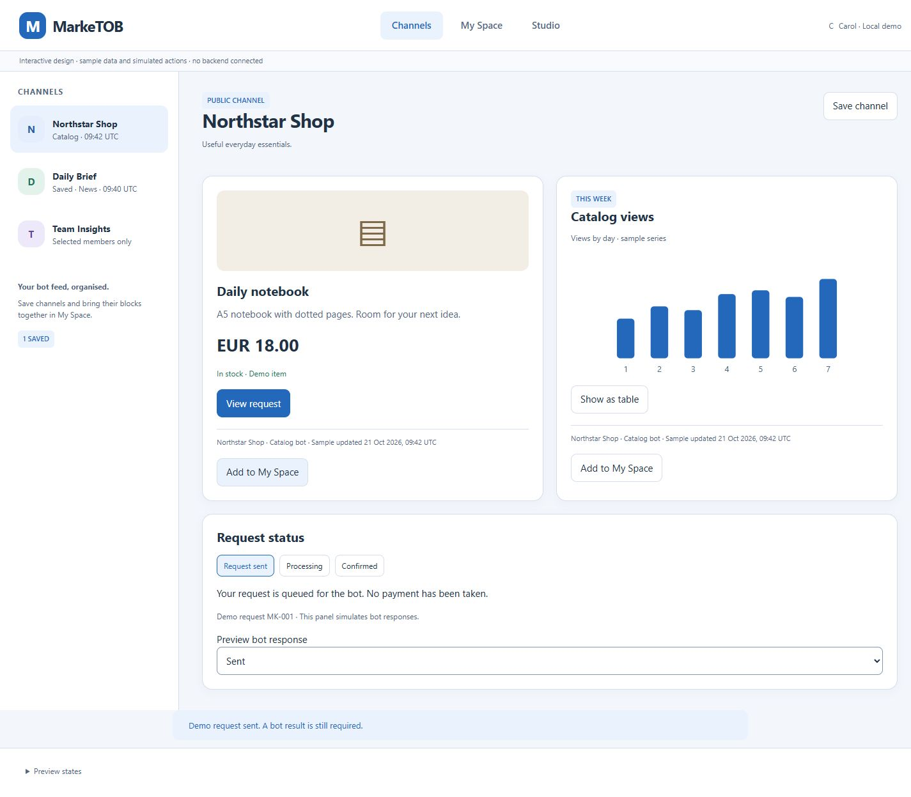
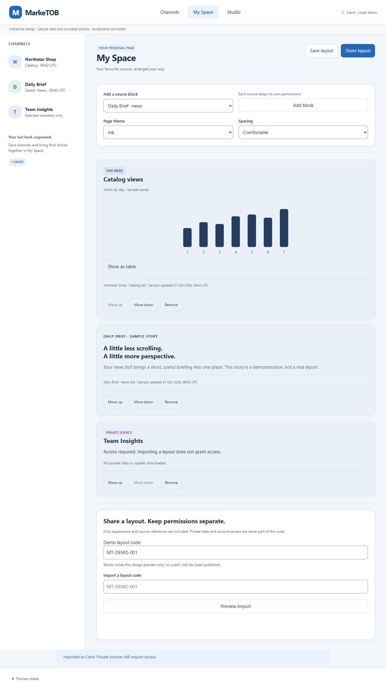
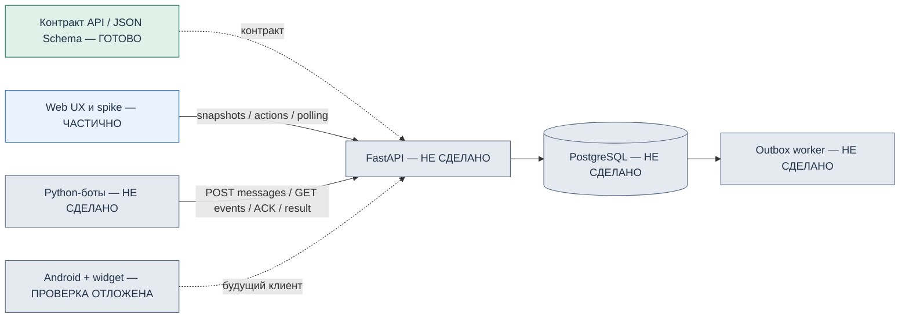

# G01 — первые четыре задачи MarkeTOB

21 октября 2026. Завершены PM-001–004 в зафиксированном объёме. PM-002 принят по Web после прямого решения владельца отложить Android-сборку и подключение телефона. Проверка APK и настоящего виджета остаётся обязательной в PM-019/020.

Презентация: [PowerPoint](MarkeTOB-G01.pptx) · [PDF](MarkeTOB-G01.pdf). [Вопросы](questions.md) · [Ответы и разрешение продолжить](answers.md).

## Что готово

| Задача | Результат | Доказательства |
|---|---|---|
| PM-001 | 30 требований, 16 историй, SLO/профили и локальная схема | [Отчёт](../../task-results/PM-001.md), проверка покрытия 17 ответов PASS |
| PM-002 | Сравнение Flet и Web, выбор HTML/CSS/JS, Python backend ADR | [Отчёт](../../task-results/PM-002.md), Web build/offline/mobile проверены, 14 тестов модели Flet |
| PM-003 | Английский интерактивный UX, темы/блоки/импорт/Studio/заявки | [Отчёт](../../task-results/PM-003.md), desktop/mobile сценарии, 12 пар контраста PASS |
| PM-004 | API1.0, 64 схемы, 44 операции, 20 примеров | [Отчёт](../../task-results/PM-004.md), валидный OpenAPI, 25 контрактных тестов PASS |

Это завершение этапа требований, технических проверок и проектирования. Backend с БД, рабочие пользовательские сессии, настоящие боты, Docker-образ и APK ещё не созданы. 4/24 задач не означает 1/6 готовности продукта по трудозатратам.

## Как выглядит приложение

Запуск [интерактивного прототипа](../../../design/prototype/README.md) на компьютере: `python -m http.server 8554 --bind 127.0.0.1 --directory design/prototype`. Адрес http://127.0.0.1:8554/. Данные синтетические, изменения живут только до перезагрузки.

Channels сохраняет привычную структуру списка витрин. Внутри канала находятся карточки товаров, новости и графики. Save channel добавляет источник в избранное, Add to My Space переносит ссылку на блок в личную страницу. Send request показывает очередь, после чего View request открывает существующую заявку. Подтверждение покупки/оплаты не выводится из транспортного ответа.

My Space позволяет менять порядок, оформление и совместимую визуализацию. Share layout копирует оформление/ссылки. В демонстрации Carol импортирует страницу Bob и видит Access required у закрытого блока. Время обновления и данные этого источника отсутствуют. Реальный код будет указывать на immutable шаблон на сервере, без прав доступа и секретов.

Studio показывает путь владельца от регистрации бота до публикации. Placeholder ключа скрывается после первого показа. До первых данных Publish недоступна. Это демонстрация интерфейса, не регистрация настоящего бота. Android news widget пока показан HTML-макетом.

## Система и статус компонентов

Линии показывают целевую архитектуру, пока без работающего соединения UI с backend. API и worker используют общую Python-кодовую базу. PostgreSQL должен хранить снимки и outbox в одной транзакции. Боты работают отдельными процессами и не получают доступ к таблицам. Для текущего пилота Google/Firebase/облачные push не требуются.

## Код и сущности

- `design/prototype/prototype.js`: fixture-данные, маршруты и имитация действий. `styles.css`: адаптивность, токены, focus и размеры controls. Это исследовательский UI, который предстоит подключить к API и разделить на продуктовые модули.
- `contracts/build_contract.py`: источник 64 схем и 44 операций. Генерирует OpenAPI/JSON Schema; тест ловит рассинхронизацию с JSON-файлами. В схемах нет произвольного executable layout.
- `contracts/reference_model.py`: небольшая модель повторов, source revisions, ACK/results и отзыва доступа. Она работает в памяти и не реализует настоящую аутентификацию или транзакции.
- `contracts/tests/test_protocol.py`: ошибки и восстановление на уровне контракта. Те же сценарии будут повторены против HTTP/PostgreSQL.
- Будущие сущности: User/Session, Bot/RegistrationCredential/BotKey, Channel/Grant/PageVersion, Message/Record, ActionRequest/BotEvent, PersonalPage/SharedTemplate. Их инварианты описаны в [протоколе](../../api/PROTOCOL.md), но рабочие таблицы ещё отсутствуют.

## Что проверено и что остаётся

Web-spike собирается, открывается offline и сохраняет demo-избранное. UX пройден в desktop1440 и mobile360, дополнительно каталог320 без горизонтальной прокрутки. Клавиатурный Skip и основные touch targets проверены. Нет заявления о полном аудите доступности или реальном Android.

OpenAPI/JSON Schema и 25 контрактных сценариев проходят. Модель показывает, почему GET не равен ACK, а ACK не равен бизнес-успеху. Незавершённые ACKed заявки доступны для сверки. Отозванные права не обходятся повтором старого idempotency key.

Нужно проверить реальные сессии, транзакции, конкурентные гонки, потери соединения, restart recovery, cursor expiry и квоты. Цели до1000 сообщений/мин и live p95≤3с остаются **целями**, не замерами. Docker отсутствует в текущей среде. SDK-лицензии не приняты, APK не собран, телефон не подключён.

## Следующие задачи и причина порядка

1. PM-005: каркас, зависимости, локальное окружение и CI. Это основа воспроизводимых проверок.
2. PM-006: реальные локальные аккаунты и права B2B/B2C. Без них нельзя честно проверять закрытые источники.
3. PM-007: индивидуальная регистрация/ключи ботов. Это граница доверия для входящих данных.
4. PM-008: приём и долговечное хранение сообщений. После этого появятся первые реальные snapshots.

После PM-008 — G02. До PM-005 требуется ответить на отдельные вопросы G01 либо явно разрешить продолжить с записанными допущениями. Основание: [регламент, пункт7](../../WORKING_AGREEMENT.md). Это предусмотренная владельцем контрольная точка.

## Форматы презентации

PPTX содержит редактируемые текст, таблицы и системную схему. Все 9 слайдов отрисованы и просмотрены; структура, геометрия и повторный импорт прошли проверку. Нативный PowerPoint не открывался. PDF — растровая копия для чтения: штатный экспорт столкнулся с отсутствующим встроенным шрифтом, поэтому использованы проверенные PNG слайдов. Все 9 страниц PDF также отрисованы и просмотрены. [Сводка проверки](verification.json).
