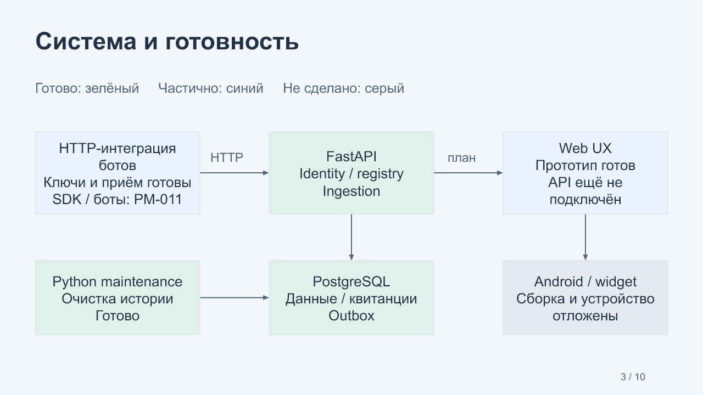
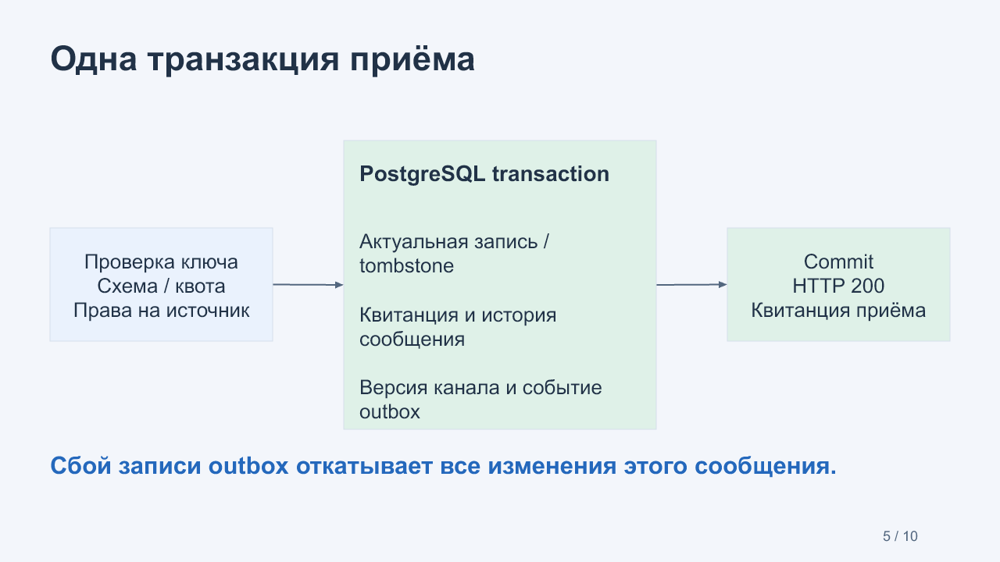

# G02 · Локальный backend MarkeTOB

22 октября 2026. Реализован этап PM-005–008. Все четыре задачи приняты. [Итоговый CI](https://github.com/Villentretermert/ProjectMarket/actions/runs/39802915693): все четыре jobs PASS. 12 отдельных вопросов отправлены, ответы ожидаются перед PM-009.

[Редактируемая презентация PPTX](MarkeTOB-G02.pptx) · [PDF для чтения](MarkeTOB-G02.pdf)
· [12 отдельных вопросов](questions.md) · [Ответы](answers.md).

PDF содержит изображения проверенных слайдов. Для редактирования и выделения
текста используйте PPTX. Встроенный PDF export недоступен в этой среде.

## Что работает

| Задача | Полученный результат | Доказательства |
|---|---|---|
| PM-005 | Python workspace, FastAPI, health, Docker/CI | [Отчёт](../../task-results/PM-005.md), commit d4a24d8 |
| PM-006 | Локальные аккаунты, сессии, B2B workspace, grants | [Отчёт](../../task-results/PM-006.md), commit 94a2cf3 |
| PM-007 | Bootstrap, индивидуальные ключи, scopes, rotation/revoke | [Отчёт](../../task-results/PM-007.md), commit ab48d25 |
| PM-008 | Draft-create, сообщения, версии, snapshots, receipts/outbox | [Отчёт](../../task-results/PM-008.md), commits 6fd3574, 534b227, 6f62ac5 |

Владелец регистрирует локальный аккаунт и включает личный B2B workspace. Затем
создаёт бота и передаёт ему одноразовый регистрационный код. Бот обменивает код на
рабочий ключ, а владелец создаёт канал-черновик. Text/data/event/delete поступают
через общий HTTP-шлюз и сохраняются в PostgreSQL. Страница пока не публикуется:
чтение пользователем и публикация относятся к PM-009.

## Системный дизайн

Зелёным отмечен реализованный backend. Синим отмечены компоненты, готовые частично:
есть шлюз для внешних HTTP-ботов и отдельный UX-прототип, но SDK/пилотные боты и
интеграция клиента ещё предстоят. Android и настоящий домашний виджет отложены
владельцем. Линии от API к Web и от Web к Android показывают целевую интеграцию.

Outbox уже атомарно хранит update hints. Отправка этих hints открытым клиентам
ещё не реализована. Maintenance очищает историю; очередь бизнес-действий PM-010
будет отдельным назначением worker. У приложения нет внешних облачных зависимостей.

## Ключевые компоненты кода

| Файл | Ответственность | Сущности |
|---|---|---|
| `database.py` / `migrate.py` | Короткая транзакция и неизменяемые миграции | SchemaMigration |
| `identity.py` / `auth_routes.py` | Argon2id, сессии, CSRF, деактивация | User, Session, Organization, Membership |
| `access.py` | Owner/read policy в транзакции запроса | ChannelAccess, Grant |
| `bot_identity.py` / `bot_routes.py` | Однократный обмен, scoped key, отзыв | Bot, Registration, Key |
| `payloads.py` / `quotas.py` | Схема, Unicode, валюта/точки, token buckets | Message, RateBucket |
| `ingestion.py` | Snapshot, receipt, history, revision и outbox одним commit | ChannelContent, SourceRecord, Receipt, Outbox |
| `maintenance.py` | 7d history / 30d receipts, проверяемый heartbeat | IngestHistory, MessageReceipt |

Файлы находятся в `apps/api/src/marketob_api/`. [Машиночитаемый контракт](../../../packages/contracts/src/contracts/openapi.json)
содержит 69 схем и 50 плановых операций. Runtime `/openapi.json` перечисляет
только реализованные маршруты. Канонические JSON Schema используются API при
проверке входящих сообщений; тестовая reference model в runtime-образ не входит.

## Почему повтор или сбой не создаёт лишние данные

Ключ и текущие права на источник проверяются до возврата старой квитанции.
`(bot_id, message_id)` связывается с fingerprint исходного JSON. Повтор того же тела
возвращает ту же квитанцию, изменение тела даёт 409. `source_revision` управляет
порядком ресурсов; дата сообщения не позволяет перезаписать более новую запись.
Удаление сохраняет tombstone с версией, поэтому поздний повтор не восстанавливает
удалённый товар. Более высокая версия может создать его заново явно.

База фиксирует snapshot, receipt, историю и outbox вместе. Искусственная ошибка
INSERT outbox в тесте откатила всю транзакцию, включая revision канала. Отдельный
HTTP smoke подтвердил идентичный receipt после настоящего перезапуска процесса API.

## Измерения и проверки

- Общий локальный прогон: **73 passed**, 39.88s, Windows/Python 3.14.7/PostgreSQL 18.6.
- Ruff/format и strict mypy: PASS, 34 файла.
- Два одновременных bootstrap exchanges выдают ровно один рабочий ключ.
- Чужой bot/channel, суженный scope, истёкший или отозванный credential отклоняются.
- Конкурентные сообщения, idempotency conflict, stale revision, rollback,
  durable quotas и ограниченная retention проверены на настоящей PostgreSQL.
- [Короткий HTTP-замер](../../task-results/assets/PM-008/ingestion-burst.json):
  100 сообщений, 4 бота/клиента, 3.384s, **29.55 req/s**, p95 **222.53ms**, 0 errors.
- Новый heartbeat maintenance прошёл локальные проверки fresh/stale/missing.

Короткий burst не подтверждает steady-state 1 000 сообщений/мин или live-задержку
пользовательского интерфейса. Docker установлен только в CI, не на компьютере
владельца. Тестовые данные синтетические. Временные API/worker остановлены, их
изолированные схемы удалены. Локальный PostgreSQL остаётся для следующих проверок.

## Что ещё предстоит

Публикация и snapshots, заявки/GET/ACK/result, SDK и два самостоятельных бота,
Web-интеграция, личные страницы, обмен и обновления. APK/устройство/виджет,
Google/Firebase и облачная установка остаются отложенными. Деактивация аккаунта
уже отзывает доступ, но полное физическое стирание и backup rotation ещё не готовы.
Скриншот Studio на слайде 9 — существующий PM-003 demo, его UI сейчас не изменялся.

## Следующий этап после обратной связи

1. **PM-009:** публиковать каналы и отдавать разрешённые snapshots. Это делает
   принятые данные доступными будущему клиенту.
2. **PM-010:** передавать заявку пользователя боту через durable очередь,
   отдельные GET/ACK/result и достоверный статус.
3. **PM-011:** Python SDK и локальные каталог/новости-боты, чтобы интеграции имели
   запускаемые примеры и не требовали ручного SQL.
4. **PM-012:** сквозная backend-проверка с перезапусками и нештатными случаями
   перед подключением продуктового Web-интерфейса.

По пункту 7 [регламента](../../WORKING_AGREEMENT.md) PM-009 начинается после ответов
G02 либо нового явного разрешения продолжить с записанными допущениями.
