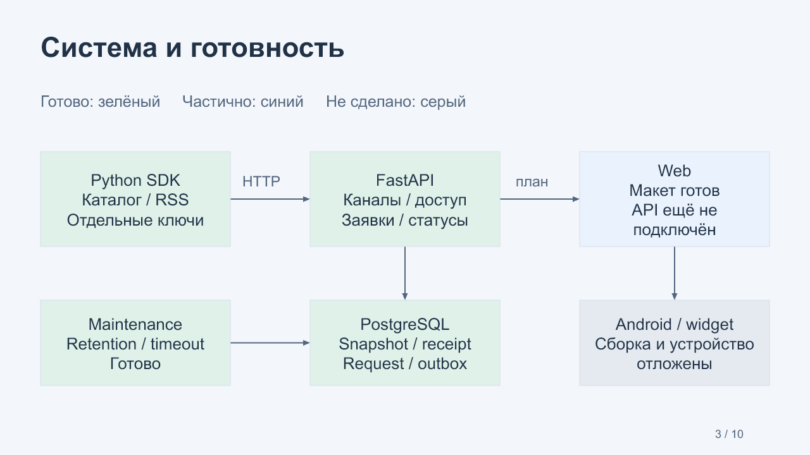

# G03 · каналы, заявки и боты

22 октября 2026. Завершены **PM-009–012**, всего **12 из 24** задач пилота.
Материалы предназначены для обсуждения перед PM-013. G03 остаётся открытой до
ответов владельца или явного разрешения продолжить с допущениями.

[Редактируемая презентация](MarkeTOB-G03-reviewed.pptx) ·
[PDF для просмотра](MarkeTOB-G03.pdf) · [13 вопросов](questions.md) · [Ответы](answers.md).
PDF содержит растровые копии слайдов; текст, таблицы и схемы редактируются в PPTX.

## Что теперь работает

| Задача | Поведение | Доказательства |
| --- | --- | --- |
| PM-009 | Черновик, публикация и откат оформления; чтение живых данных с проверкой доступа | [Отчёт](../../task-results/PM-009.md), CI 39825150008 |
| PM-010 | Request purchase, GET события, ACK, результат и восстановление заявки | [Отчёт](../../task-results/PM-010.md), CI 39828592091 |
| PM-011 | Python SDK, каталог и RSS/Atom бот, разные ключи, отдельные процессы и контейнеры | [Отчёт](../../task-results/PM-011.md), CI 39833237430 |
| PM-012 | Принудительные сбои процессов, атомарность outbox и нагрузочный baseline | [Отчёт](../../task-results/PM-012.md), CI 39835253441 |

Владелец подключает бот, создаёт закрытый по умолчанию канал, выбирает блоки и
публикует оформление. Бот обновляет данные независимо от публикации оформления.
Пользователь с доступом читает актуальный snapshot и отправляет заявку на одну
единицу товара. Сервер не принимает клиентскую цену и перепроверяет revision и наличие.

Каталог демонстрирует подтверждение для Hand soap/Rice и отказ для Paper towels.
Milk отсутствует в наличии. Оплаты и отгрузки нет. RSS-бот передаёт пять заголовков,
дат и ссылок; график показывает количество публикаций по датам в текущем окне
ленты. Источник настраивается, для воспроизводимых тестов есть синтетический RSS.

## Система

[Схема в Mermaid](system-design.md). Зелёные компоненты работают, синий Web пока
использует макет. Android/виджет, Google/Firebase и облако отложены владельцем.
Передача событий outbox в открытый клиент относится к PM-018.

## Как устроен код

**Публикация.** [channels.py](../../../apps/api/src/marketob_api/channels.py)
хранит неизменяемые версии оформления и отдельный указатель на опубликованную
версию. Откат создаёт новую версию оформления, сохраняя актуальные данные бота.
Snapshot включает только привязанные совместимые записи. Проверка прав проходит
до обработки ETag, поэтому прежний кеш не обходит отзыв доступа.

**Заявка.** [actions.py](../../../apps/api/src/marketob_api/actions.py) сохраняет
заявку, событие для бота и outbox в одной транзакции. `action_requests` содержит
`event_id`; отдельной удаляемой при GET очереди нет. GET читает событие, ACK
сохраняет факт получения, result записывает бизнес-статус. Повтор запроса или
результата с прежним идентификатором не создаёт новую операцию.

**Неопределённый результат.**
[request_state.py](../../../apps/api/src/marketob_api/request_state.py) обрабатывает
отзыв доступа, таймауты и очистку. Через 60 секунд без ACK или 5 минут без прогресса
заявка показывается как `unknown`, оставаясь доступной для сверки. Это не успех
и не команда автоматически повторить покупку. Незавершённые заявки не удаляются
только из-за возраста. История сообщений и квитанции хранятся 30 дней.

**Бот.** [catalog.py](../../../bots/pilot/src/marketob_bots/catalog.py) выполняет
последовательность `remember → ack → demo_result → result → finish`.
[Journal](../../../bots/pilot/src/marketob_bots/state.py) фиксирует событие до ACK
и демонстрационный результат до HTTP-отправки. Поэтому даже потеря ответа после
принятого результата не создаёт второй demo effect. Для реального внешнего заказа
потребуется собственный идемпотентный API поставщика и процедура сверки.

**Граница интеграции.** [SDK](../../../packages/bot-sdk/README.md) использует
только HTTP, закрытые JSON-схемы и индивидуальный ключ. Он запрещает перенаправления
с ключом и повторяет допустимые запросы с прежним телом. Внешние боты используют
HTTPS. SQLite-журнал принадлежит боту и не является доступом к PostgreSQL платформы.

| Сущность | Что хранит |
| --- | --- |
| Channel / ChannelVersion | Метаданные, права, черновик и опубликованное оформление |
| SourceRecord | Последние данные, source revision и tombstone |
| Receipt / History | Подтверждение и история приёма с ограниченным сроком |
| ActionRequest / Event | Заявку пользователя и стабильный идентификатор доставки |
| ActionResult | Идентификатор результата и его версию в границах бота |
| Outbox | События, сохранённые в транзакции с изменением данных |
| Bot journal | Исходящие сообщения, входящие заявки и результат демооперации |

## Что доказали проверки

Итоговый [CI](https://github.com/Villentretermert/ProjectMarket/actions/runs/39835253441)
прошёл во всех четырёх jobs: **117 тестов**, Docker/API/DB restart, независимые
боты и сценарии принудительной остановки. Локальный fault lab проверил остановку
до и после ACK, до и после принятия result, перезапуск API и maintenance, восемь
одновременных дублей и отказ записи outbox. На каждую заявку остался один demo
effect и один результат. Тестовые процессы остановлены, оставшихся схем `lab_` нет.

| Локальное измерение | Результат |
| --- | --- |
| Профиль | 100 ботов, 10 читающих API-сессий, 180 секунд |
| Сообщения | 3 000 HTTP 200, ошибок и 429 нет |
| Фактическое окно / скорость | 180,139 с / 999,23 принятых сообщений в минуту |
| Приём p50 / p95 / p99 | 160,49 / 295,02 / 353,13 мс |
| Чтение p95 / успешные чтения | 253,76 мс / 1 549 |
| После перезапуска | 3 000 квитанций, 3 000 событий outbox, 100 последних revision |

Это измерение HTTP + SDK на компьютере владельца: i7-11700K, около 64 GiB RAM,
SATA SSD, Windows 11, Python 3.14.7, PostgreSQL 18.6. Данные синтетические,
размеры сообщений 3 260–24 557 байт. Лимиты приёма остались штатными.
[Исходные цифры и hardware](../../task-results/assets/PM-012/local-load.json).

Трёхминутный API baseline не доказывает полный L2 на 30 минут с 100 UI-клиентами,
скорость отображения, доставку push или восстановление после потери диска.
Для них предусмотрены отдельные задачи PM-018/021/022. Web пока не подключён к API,
командные роли ещё не реализованы, APK и настоящий домашний виджет не проверены.

## Следующий блок

1. **PM-013:** подключить Web к локальным сессиям, каналам и заявкам. Пользователь
   сможет пройти уже проверенный API-сценарий через интерфейс.
2. **PM-014:** Studio и командные роли. Владелец подключает бот и публикует страницу
   без терминала; права команды проверяет сервер. Роли обязательны до внешнего пилота.
3. **PM-015:** ссылки, избранное и список каналов, синхронизируемые между клиентами.
4. **PM-016:** My Space с блоками разных каналов и совместимыми визуализациями.

Плотность интерфейса сохраняется по G01. Сейчас требуется уточнить матрицу ролей
и несколько пользовательских действий. Вопросы отдельные, ответы не подставляются
автоматически. До обсуждения G03 PM-013 не начинается.
