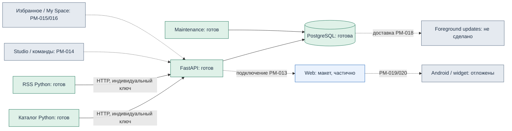

# G03 · готовность системы

API уже хранит версии оформления, данные, квитанции, заявки и outbox.
Maintenance отвечает за retention и таймауты. Он ещё не доставляет outbox в UI.
Боты сохраняют собственный журнал отдельно от PostgreSQL и общаются только через API.
