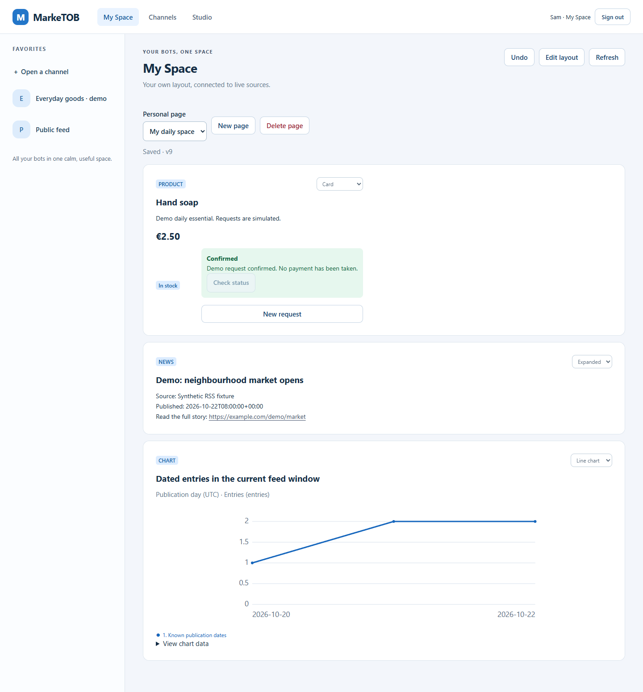
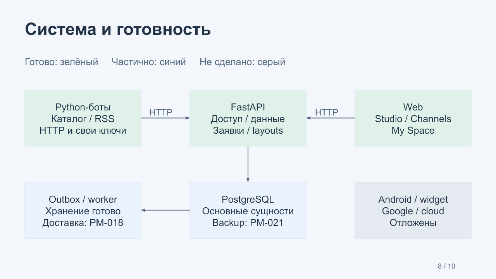

# G04 · Web, Studio и My Space

22 октября 2026. Блок PM-013–016 завершает первые **16 из 24** задач пилота.
Контрольная точка остаётся открытой до ответов владельца или явного указания
продолжить с допущениями. PM-017 не начата.

[Редактируемая презентация](MarkeTOB-G04.pptx) · [PDF для просмотра](MarkeTOB-G04.pdf) ·
[Вопросы](questions.md) · [Ответы](answers.md).
PDF содержит изображения слайдов; редактируемые текст, таблицы и схема находятся в PPTX.

## Результат для пользователя

| Задача | Что теперь можно делать | Доказательства |
|---|---|---|
| PM-013 | Войти в Web, читать каналы, переключать виды и отправлять заявки | [Отчёт](../../task-results/PM-013.md) |
| PM-014 | Подключать бота, управлять ключами и командой, публиковать и откатывать страницы | [Отчёт](../../task-results/PM-014.md) |
| PM-015 | Открыть ссылку, сохранить канал, задать порядок избранного и видеть New | [Отчёт](../../task-results/PM-015.md) |
| PM-016 | Собрать личную страницу из разных каналов; autosave, Undo, совместимые виды | [Отчёт](../../task-results/PM-016.md) |

В продукте английский интерфейс. Вход открывает My Space; данные доступны после
проверки текущих прав. Товары по умолчанию отображаются компактным списком, новости
развёрнутым текстом. Request purchase сначала показывает подтверждение одной единицы
и отсутствие списания денег. Неопределённый результат называется Awaiting confirmation;
Check status проверяет прежнюю заявку. Создание новой заявки требует отдельного действия.

My Space хранит своё оформление; новость, товар и график остаются данными каналов.
В примере используются два независимых Python-бота. Изменение вида блока не изменяет
B2B шаблон. После отзыва доступа соответствующие блоки и название в выборе источников
скрываются, остальные продолжают работать. Два браузерных клиента восстанавливают
сохранённую страницу; конфликт правок требует Reload saved и не перезаписывает их молча.

## Studio и роли

| Возможность | Owner | Admin | Editor |
|---|---|---|---|
| Читать и редактировать блоки | Да | Да | Да |
| Публиковать и откатывать | Да | Да | Да |
| Регистрировать ботов, выпускать/менять/отзывать ключи | Да | Да | Нет |
| Менять audience/grants и удалять канал | Да | Да | Нет |
| Добавлять участников и менять роли | Да | Нет | Нет |

Три роли, право Editor публиковать/откатывать и ключи Owner/Admin подтверждены G03.
Один неизменяемый Owner и управление командой только им — объявленная инженерная
детализация пилота. Добавление по точному username зарегистрированного аккаунта.
Машинный ключ бота не равен участию пользователя: при необходимости его отзывают отдельно.
Selected users — режим нового канала по умолчанию. Studio напоминает о сроке ключа
за семь дней и после истечения; секрет показывается только при выпуске.

## Компоненты и ключевые участки кода

**Web runtime.** [app.js](../../../apps/api/src/marketob_api/web/app.js) связывает
маршруты с настоящими сессиями, скрывает приватные данные при уходе/offline и
восстанавливает исходную ссылку после входа. [render.js](../../../apps/api/src/marketob_api/web/render.js)
выбирает только поддерживаемые news/product/chart представления; исходный текст не
исполняется как HTML. Числовой график имеет доступную таблицу значений и мобильные оси.
[actions.js](../../../apps/api/src/marketob_api/web/actions.js) сохраняет идентификатор
заявки для безопасной проверки результата после потери ответа.

**Команда.** [teams.py](../../../apps/api/src/marketob_api/teams.py) изменяет membership;
[workspace_access.py](../../../apps/api/src/marketob_api/workspace_access.py) разрешает
операцию по текущей роли. Выбранный workspace в HTTP-заголовке не даёт полномочий сам
по себе. Сервер проверяет доступ заново, включая после удаления участника.

**Избранное.** [favorites.py](../../../apps/api/src/marketob_api/favorites.py)
сериализует изменения одного аккаунта. Перестановка должна содержать ровно текущий
набор каналов и ожидаемую revision. New сравнивает версии данных/оформления с реально
показанным snapshot; это не число непрочитанных статей.

**My Space.** [personal_pages.py](../../../apps/api/src/marketob_api/personal_pages.py)
разделяет `validate_references`, `resolve` и замену layout. Новая ссылка требует
читаемый опубликованный блок и живую запись. Сохранённую недоступную ссылку можно
переставить или удалить. `resolve` возвращает данные только после проверки источника.
`replace` принимает ожидаемую версию; точный повтор последнего сохранения допустим,
отличающаяся устаревшая правка получает 409. [space.js](../../../apps/api/src/marketob_api/web/space.js)
показывает состояние сохранения и хранит до 20 шагов Undo в памяти. Undo — новая версия,
не уменьшение счётчика. Неподтверждённые правки не переживают закрытие вкладки.

| Сущность | Назначение / инвариант |
|---|---|
| Workspace / Membership | Владелец, роли и текущие полномочия |
| Channel / ChannelVersion | Исходный канал и независимая публикация оформления |
| SourceRecord | Живые данные бота, revision и отметка удаления |
| Favorite / FavoriteState | Ссылка, ручной порядок и увиденные версии |
| PersonalPage / BlockReference | Личный layout и ссылки, без копирования данных/grants |
| ActionRequest / Result | Заявка исходному боту, стабильная доставка и итог |
| Outbox | События уже сохраняются; доставка клиенту ещё PM-018 |

Миграции 006–008 добавили роли, избранное и личные страницы. Контракт 1.0.6 содержит
86 схем и 62 описанных операции, включая будущие; runtime OpenAPI показывает
реализованные endpoints. Bot wire version остаётся 1.0. Backend, SDK и боты — Python;
Web — HTML/CSS/JS по [ADR-0001](../../adr/0001-client-stack.md).

## Проверки и границы доказательств

| Приёмка | Python/contract/PostgreSQL | Edge локально / Chromium CI |
|---|---|---|
| PM-013 | 118 | 14 сценариев |
| PM-014 | 125 | 24 сценария |
| PM-015 | 130 | 29 сценариев |
| PM-016 | 137 | 36 сценариев |

Это накопительные наборы: их нельзя складывать. Последний локальный Python-прогон:
137 PASS за 248,01 с; Ruff и mypy Windows/Linux PASS. Есть одно предупреждение upstream
Pydantic об alias при конкурентной инициализации схемы; тест и обработка данных прошли.
Браузер проверяет реальный HTTP API, PostgreSQL и отдельные процессы ботов. Повтор
с потерянным ответом не удваивает заявку; четыре итоговые заявки подтверждены SQL.
Пять экранов My Space и предыдущие экраны Studio/Channels просмотрены визуально.

[CI PM-013](https://github.com/Villentretermert/ProjectMarket/actions/runs/39846617703),
[CI PM-014](https://github.com/Villentretermert/ProjectMarket/actions/runs/39853394634),
[CI PM-015](https://github.com/Villentretermert/ProjectMarket/actions/runs/39854053654),
[CI PM-016](https://github.com/Villentretermert/ProjectMarket/actions/runs/39858054474).
Во всех четырёх заданиях итогового CI PM-016 — PASS на f2dcde7; 70 unit/contract + 67 PostgreSQL и 36 Chromium scenarios. Контрольная точка G04 ожидает ответы, код блока принят.

На компьютере Docker не установлен; сборка/перезапуски проверяются в Linux CI.
360px — браузерный размер окна, не проверка физического Android. Google/Firebase,
облако, APK/AAB и настоящий виджет остаются отложенными. Нагрузочные цифры PM-012
характеризуют API baseline; полный пользовательский L2/SLO остаётся PM-022.

## Система и следующий этап

[Редактируемая Mermaid-схема и пояснения](system-design.md). Работают Web, права,
публикация, данные, заявки, SDK/боты, избранное и My Space. Пока нет обмена шаблонами
и автоматических обновлений неподвижного открытого клиента. Refresh и возврат во
вкладку уже перечитывают разрешённые данные. Это проверенная граница текущей версии.

1. **PM-017:** immutable шаблон, ссылка/код, preview и импорт новой личной страницы.
   Это завершит согласованный сценарий «отправить оформление другу».
2. **PM-018:** доставка изменений открытому клиенту, повторное соединение и выбранные
   события. Это устранит необходимость Refresh для новых данных.
3. **PM-019:** Android-клиент и APK/AAB после возобновления владельцем отложенной
   сборки, принятия лицензии и подключения устройства.
4. **PM-020:** настоящий домашний виджет новостей после проверки Android-клиента.

Затем PM-021–024: локальная Docker-поставка, backup/restore, мониторинг/нагрузка,
приватность и сквозная приёмка. iOS/Windows запланированы после пилота. Никакой
облачный сервис или магазин приложений не подключён и не опубликован.

Вопросы G04 уточняют правила обмена и обновлений. Они задаются отдельно после
презентации. 23 октября получено явное указание «Продолжай»; [рабочие допущения](answers.md) сохранены. PM-017 завершена, PM-018 выполняется. Содержимое презентации отражает состояние на момент G04.
