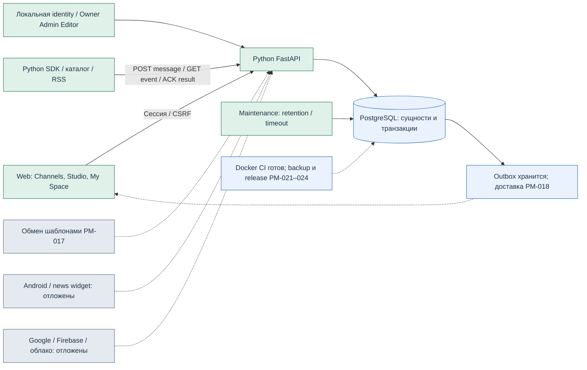

# Система после PM-016

Зелёный — реализовано и проверено. Синий — часть работает, остаётся указанная задача.
Серый — не реализовано либо отложено владельцем. Схема описывает локальный пилот.

PostgreSQL работает как источник истины; синий цвет обозначает отсутствие завершённой
проверки backup/restore, а не отсутствие базы. FastAPI и Web уже реализуют права,
публикацию, заявки, избранное и личные страницы. Обмен и доставка обновлений —
следующие модули, не новые обязательные микросервисы.

Bot → API → SourceRecord/receipt/outbox — одна транзакция. Браузер получает текущий
разрешённый snapshot. PersonalPage хранит layout с BlockReference; доступ к каждому
источнику проверяется при разрешении snapshot. Request purchase идёт через исходный
канал и независимо перепроверяет права, товар и revision. Боты не имеют доступа к БД.

Web не хранит приватные данные источников на диске. На Refresh, возврате во вкладку
и навигации данные проверяются заново; автоматическое обновление без действий
пользователя пока относится к PM-018. Это существенная граница готовности.
