# MarkeTOB: полный обзор проекта

24 ноября 2026. Три аудитории: клиент, продуктовая команда, технический директор.

Срез репозитория: `11653f0a81f5911076ddedc473bbc60e63909d70`. Web в видео: закреплённая поставка schema-20261109, app commit `896449bde9cdec4cea9f7ce29eba6910285da30e`.

68 слайдов. Пояснения ниже соответствуют заметкам докладчика. Принято 19/24 задач пилота. Этот дополнительный обзор не заменяет G05 и не меняет статус приёмки.

## 01. MarkeTOB

Аудитория: Обзор.

Полный обзор проекта

Срез на 24 ноября 2026. Дополнительный обзор по запросу владельца. Счётчик 19/24 относится к принятым задачам исходного плана, а не к проценту готовности.

Источники: [docs/STATUS.md](https://github.com/Villentretermert/ProjectMarket/blob/11653f0a81f5911076ddedc473bbc60e63909d70/docs/STATUS.md), [docs/ROADMAP.md](https://github.com/Villentretermert/ProjectMarket/blob/11653f0a81f5911076ddedc473bbc60e63909d70/docs/ROADMAP.md).

## 02. Три уровня обзора

Аудитория: Обзор.

Для клиента: сценарии и интерфейс

Для продукта: функции и этапы

Для CTO: архитектура и эксплуатация

Клиентская часть объясняет использование приложения. Продуктовая связывает функции с задачами аудитории и дорожной картой. Техническая раскрывает доверенные границы, сущности, транзакции, доставку событий и проверяемость поставки. Видеодемо показывает настоящую Web-версию на отдельных синтетических данных.

Источники: [docs/STATUS.md](https://github.com/Villentretermert/ProjectMarket/blob/11653f0a81f5911076ddedc473bbc60e63909d70/docs/STATUS.md).

## 03. Текущее состояние

Аудитория: Обзор.

**19 / 24**

Работает локальный Web, API и Python-боты

Docker-поставка schema-20261109 проверена

Android, облако и полный L2 отложены

PM-001–018 и PM-021 завершены. PM-019/020 отложены владельцем. PM-022 не завершила полный нагрузочный профиль. PM-023/024 имеют выполненные независимые части и открытые условия приёмки. 19/24 нельзя читать как процент продуктовой готовности. Последняя техническая подзадача подтвердила автономную пересборку Caddy/gosu.

Источники: [docs/STATUS.md](https://github.com/Villentretermert/ProjectMarket/blob/11653f0a81f5911076ddedc473bbc60e63909d70/docs/STATUS.md), [docs/ROADMAP.md](https://github.com/Villentretermert/ProjectMarket/blob/11653f0a81f5911076ddedc473bbc60e63909d70/docs/ROADMAP.md), [docs/setup/CURRENT_DELIVERY.md](https://github.com/Villentretermert/ProjectMarket/blob/11653f0a81f5911076ddedc473bbc60e63909d70/docs/setup/CURRENT_DELIVERY.md).

## 04. 01  Для клиента

Аудитория: Клиент.

Один интерфейс для разных ботов

Что можно сделать уже сейчас

Экраны получены из реального Web-приложения. Каталог и RSS в видео используют синтетические данные. Английский интерфейс соответствует требованию владельца.

Источники: [docs/requirements/LOCAL_MODE.md](https://github.com/Villentretermert/ProjectMarket/blob/11653f0a81f5911076ddedc473bbc60e63909d70/docs/requirements/LOCAL_MODE.md).

## 05. Задача MarkeTOB

Аудитория: Клиент.

Боты присылают разные данные

Пользователь получает понятные витрины

Собирает личную страницу из нужных блоков

Действия возвращаются исходному боту

MarkeTOB организует взаимодействие человека с множеством HTTP-сервисов. Канал отображает новости, товары или числовые ряды. Приложение приводит данные к заранее описанным блокам. Внешние интеграции и бизнес-логика остаются у владельца бота. Создание и управление самим ботом не являются обязательной функцией платформы.

Источники: [docs/tasks/PM-001.md](https://github.com/Villentretermert/ProjectMarket/blob/11653f0a81f5911076ddedc473bbc60e63909d70/docs/tasks/PM-001.md), [docs/api/PROTOCOL.md](https://github.com/Villentretermert/ProjectMarket/blob/11653f0a81f5911076ddedc473bbc60e63909d70/docs/api/PROTOCOL.md).

## 06. Путь пользователя

Аудитория: Клиент.

Ссылка приводит к каналу

Личный интерфейс сохраняется в аккаунте

Публичную опубликованную страницу можно предварительно просматривать без входа. Избранное, личные страницы и заявки привязаны к аккаунту. Для закрытого канала нужен доступ от владельца. В текущем локальном этапе вход использует username и пароль. Google остаётся будущим способом входа.

1. Ссылка на канал
2. Favorites
3. My Space
4. Действие боту

Источники: [docs/api/IDENTITY.md](https://github.com/Villentretermert/ProjectMarket/blob/11653f0a81f5911076ddedc473bbc60e63909d70/docs/api/IDENTITY.md), [docs/api/FAVORITES.md](https://github.com/Villentretermert/ProjectMarket/blob/11653f0a81f5911076ddedc473bbc60e63909d70/docs/api/FAVORITES.md).

## 07. Интерфейс приложения

Аудитория: Клиент.

Каналы слева

Личная страница в центре

Studio для публикации

В основе интерфейса двухколоночная навигация. Вместо диалогов пользователь открывает каналы и витрины. Индикатор Live показывает состояние соединения. Интерфейс построен на семантических HTML-элементах с доступными названиями кнопок и полей.

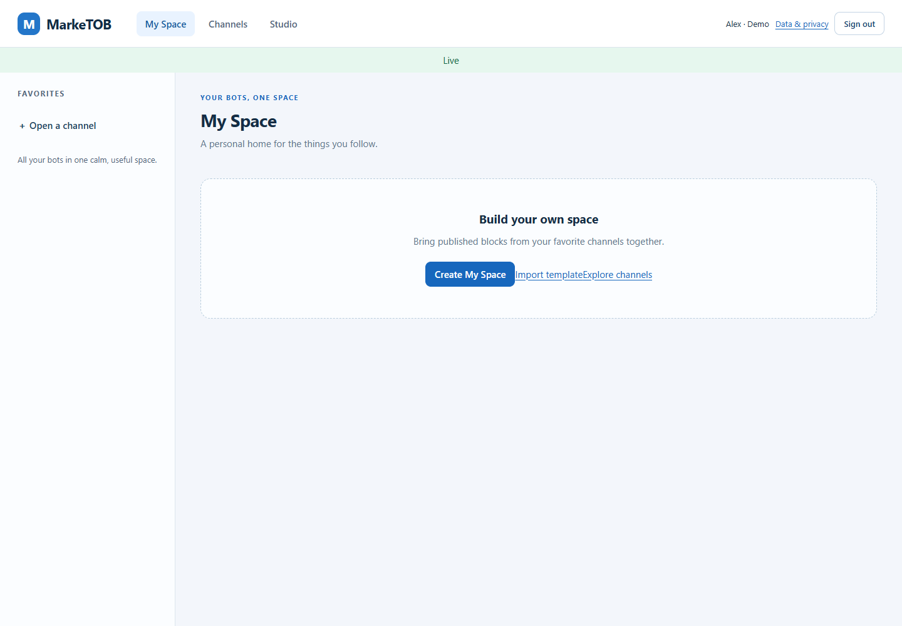

Источники: [apps/api/src/marketob_api/web/app.js](https://github.com/Villentretermert/ProjectMarket/blob/11653f0a81f5911076ddedc473bbc60e63909d70/apps/api/src/marketob_api/web/app.js).

## 08. Каталог товаров

Аудитория: Клиент.

Компактный список

Цена и наличие

Фотографии

Request purchase

Пилотный каталог содержит повседневные товары. Цена приходит в минимальных денежных единицах с кодом валюты. Для отсутствующего товара действие недоступно. Фотография необязательна. Изображение бутылки в демонстрации является оригинальной синтетической иллюстрацией, а не фото реального товара.

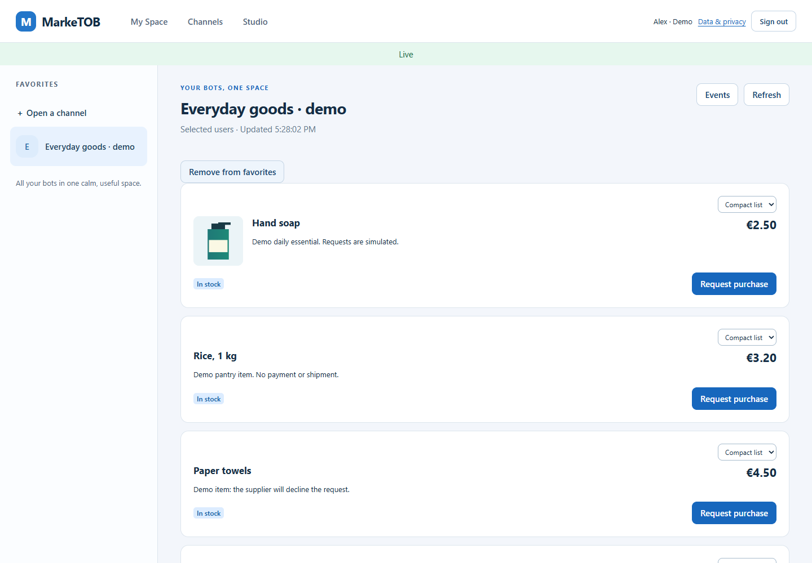

Источники: [bots/pilot/src/marketob_bots/catalog.py](https://github.com/Villentretermert/ProjectMarket/blob/11653f0a81f5911076ddedc473bbc60e63909d70/bots/pilot/src/marketob_bots/catalog.py), [docs/api/PRODUCT_IMAGES.md](https://github.com/Villentretermert/ProjectMarket/blob/11653f0a81f5911076ddedc473bbc60e63909d70/docs/api/PRODUCT_IMAGES.md).

## 09. Новости

Аудитория: Клиент.

Развёрнутые блоки

Заголовок и источник

Переход к публикации

Подключён настраиваемый RSS-бот. Для рабочего примера выбран Meduza RSS: заголовок, дата и ссылка без копирования полных статей и изображений. В свежем видео используется тестовая RSS-лента для воспроизводимости и отсутствия зависимости от внешней сети.

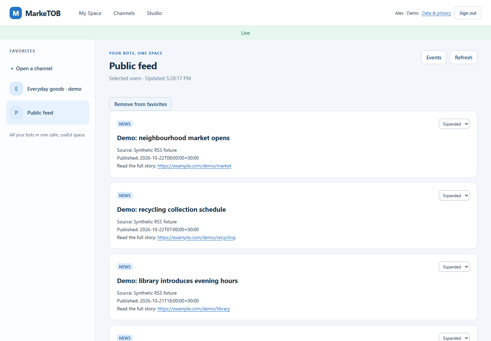

Источники: [docs/task-results/SR-meduza-20261109.md](https://github.com/Villentretermert/ProjectMarket/blob/11653f0a81f5911076ddedc473bbc60e63909d70/docs/task-results/SR-meduza-20261109.md), [bots/pilot/src/marketob_bots/news.py](https://github.com/Villentretermert/ProjectMarket/blob/11653f0a81f5911076ddedc473bbc60e63909d70/bots/pilot/src/marketob_bots/news.py).

## 10. Графики

Аудитория: Клиент.

Числовые серии

Совместимые представления

Доступный текст и таблица

График строится по структурированным данным. Визуализация выбирается среди совместимых с содержимым. Здесь показана активность тестовой ленты, а не реальные продажи. Приложение может получать другие числовые ряды от внешних ботов в пределах общего контракта.

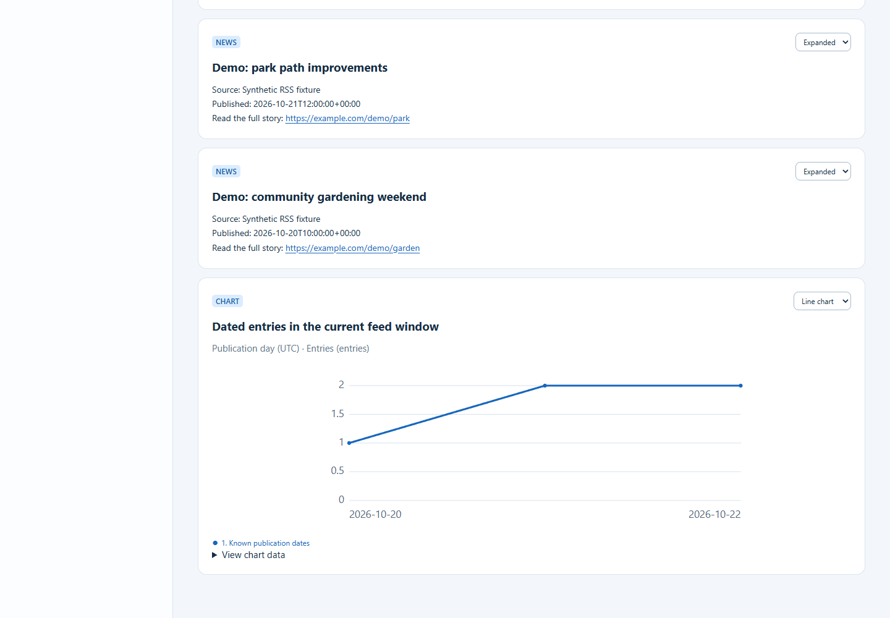

Источники: [apps/api/src/marketob_api/web/render.js](https://github.com/Villentretermert/ProjectMarket/blob/11653f0a81f5911076ddedc473bbc60e63909d70/apps/api/src/marketob_api/web/render.js), [packages/contracts/src/contracts/schemas.json](https://github.com/Villentretermert/ProjectMarket/blob/11653f0a81f5911076ddedc473bbc60e63909d70/packages/contracts/src/contracts/schemas.json).

## 11. Избранные каналы

Аудитория: Клиент.

Ручной порядок и поиск

Отметка новых данных

Синхронизация между сессиями

Удаление из Favorites сохраняет канал

Favorites является персональной коллекцией до 100 каналов. Сервер хранит позиции и просмотренные версии оформления и данных. Порядок защищён revision при одновременном редактировании. Отзыв доступа убирает частное содержимое и название источника. Удаление из коллекции не удаляет страницу издателя.

Источники: [docs/api/FAVORITES.md](https://github.com/Villentretermert/ProjectMarket/blob/11653f0a81f5911076ddedc473bbc60e63909d70/docs/api/FAVORITES.md), [apps/api/src/marketob_api/favorites.py](https://github.com/Villentretermert/ProjectMarket/blob/11653f0a81f5911076ddedc473bbc60e63909d70/apps/api/src/marketob_api/favorites.py).

## 12. Визуальный каталог блоков

Аудитория: Клиент.

Предпросмотр источника

Поиск и фильтр по типу

Добавление в My Space

Каталог позволяет выбирать блоки без технических ID. Он показывает только разрешённые источники и не позволяет выполнять покупки внутри миниатюры. Недоступный источник сопровождается объяснением и Check again. После восстановления соединения права проверяются повторно.

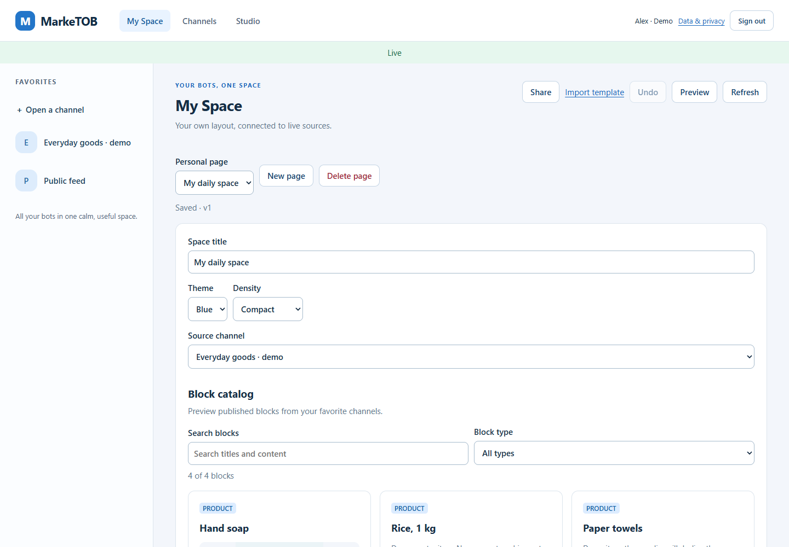

Источники: [docs/task-results/SR-block-catalog-20261108.md](https://github.com/Villentretermert/ProjectMarket/blob/11653f0a81f5911076ddedc473bbc60e63909d70/docs/task-results/SR-block-catalog-20261108.md), [apps/api/src/marketob_api/web/space.js](https://github.com/Villentretermert/ProjectMarket/blob/11653f0a81f5911076ddedc473bbc60e63909d70/apps/api/src/marketob_api/web/space.js).

## 13. Редактор My Space

Аудитория: Клиент.

Блоки разных каналов

Порядок и оформление

Выбор визуализации

Автосохранение и Undo

Личная страница хранит ссылки на источники. Перестановка и смена вида не копируют данные бота. Autosave использует версию страницы. Undo сохраняет новое состояние на сервере. При конфликте с другой сессией пользователь может загрузить сохранённый вариант, не теряя правки молча.

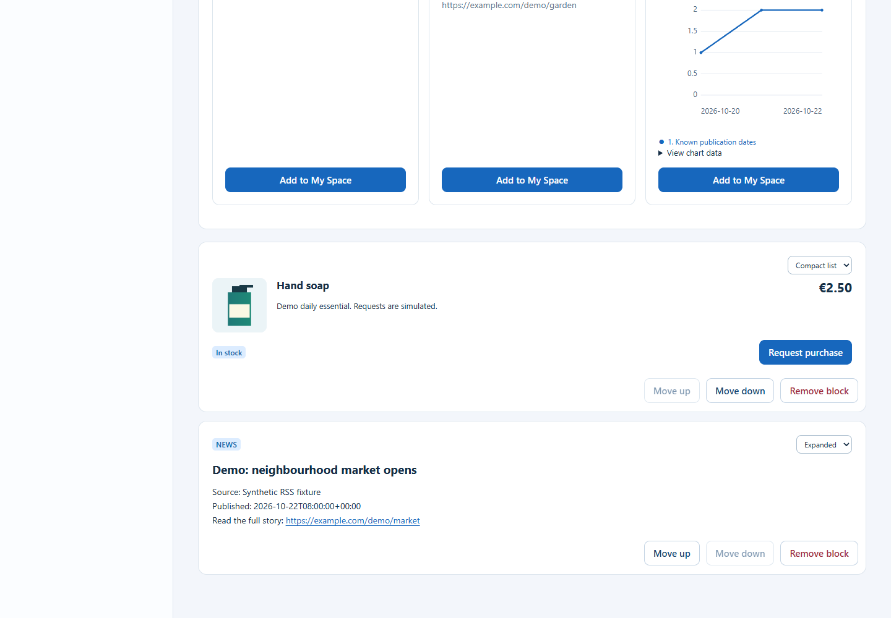

Источники: [docs/api/PERSONAL_PAGES.md](https://github.com/Villentretermert/ProjectMarket/blob/11653f0a81f5911076ddedc473bbc60e63909d70/docs/api/PERSONAL_PAGES.md), [apps/api/src/marketob_api/personal_pages.py](https://github.com/Villentretermert/ProjectMarket/blob/11653f0a81f5911076ddedc473bbc60e63909d70/apps/api/src/marketob_api/personal_pages.py).

## 14. Личная витрина

Аудитория: Клиент.

Товар и новость рядом

Живые данные источников

Отдельный режим Preview

My Space объединяет представления разных B2B-каналов. Каждый блок сохраняет channel_id и resource_id. Пользователь выбирает другой допустимый вид. Backend каждый раз проверяет права, поэтому владение личным layout само по себе не открывает закрытые данные.

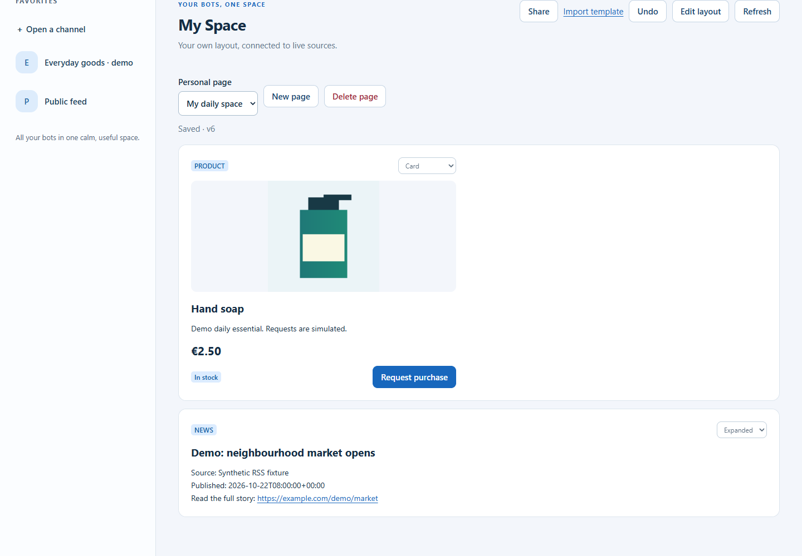

Источники: [docs/api/PERSONAL_PAGES.md](https://github.com/Villentretermert/ProjectMarket/blob/11653f0a81f5911076ddedc473bbc60e63909d70/docs/api/PERSONAL_PAGES.md).

## 15. Подтверждение заявки

Аудитория: Клиент.

Одна единица товара

Подтверждение перед отправкой

Без списания денег

Request purchase отправляет заявку. Пользователь видит товар и пояснение об отсутствии оплаты. Сервер проверяет актуальность источника, наличие и разрешённое действие. Цена, bot_id и user_id не принимаются как доверенные поля от браузера.

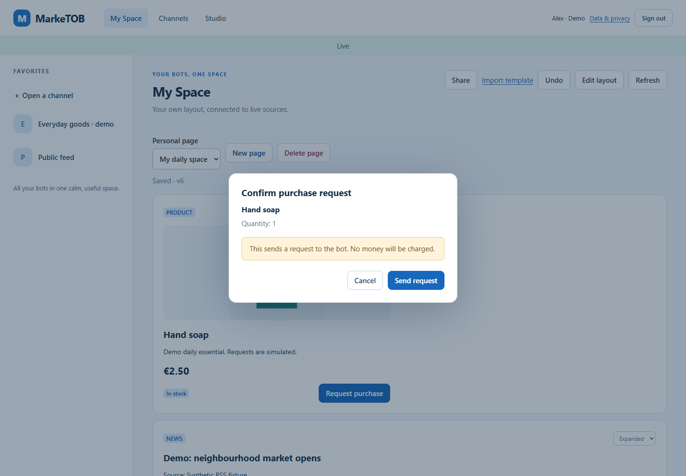

Источники: [docs/api/ACTIONS.md](https://github.com/Villentretermert/ProjectMarket/blob/11653f0a81f5911076ddedc473bbc60e63909d70/docs/api/ACTIONS.md).

## 16. Ответ бота

Аудитория: Клиент.

Confirmed или Failed

Check status проверяет ту же заявку

Неизвестный итог показан явно

Python-бот подтверждает Hand soap и Rice, отклоняет Paper towels. Повторная проверка статуса не создаёт новую операцию. Awaiting confirmation означает неизвестный окончательный результат. Пилот не содержит корзину, платёжную обработку и доставку.

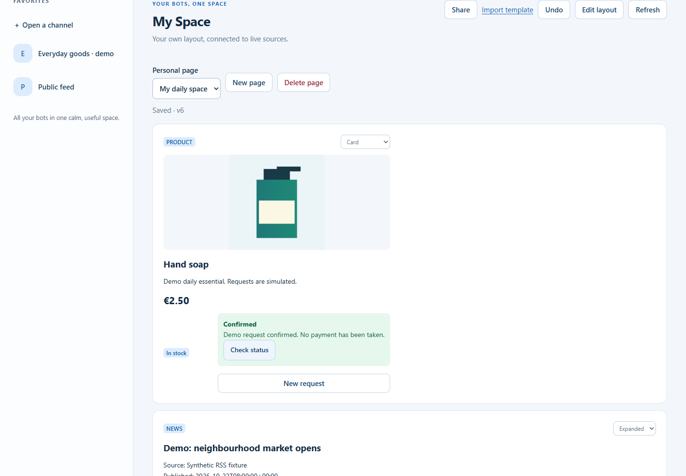

Источники: [bots/pilot/src/marketob_bots/catalog.py](https://github.com/Villentretermert/ProjectMarket/blob/11653f0a81f5911076ddedc473bbc60e63909d70/bots/pilot/src/marketob_bots/catalog.py), [docs/api/ACTIONS.md](https://github.com/Villentretermert/ProjectMarket/blob/11653f0a81f5911076ddedc473bbc60e63909d70/docs/api/ACTIONS.md).

## 17. Обмен личной страницей

Аудитория: Клиент.

Ссылка или код

Независимая копия оформления

Срок действия и отзыв ссылки

Текущий механизм хранит неизменяемый снимок layout на сервере, а код указывает на него. Это не автономный зашифрованный пакет всех данных. Получателю нужны аккаунт и доступ к тому же серверу. Импорт создаёт собственную страницу, а права на каждый источник проверяются отдельно.

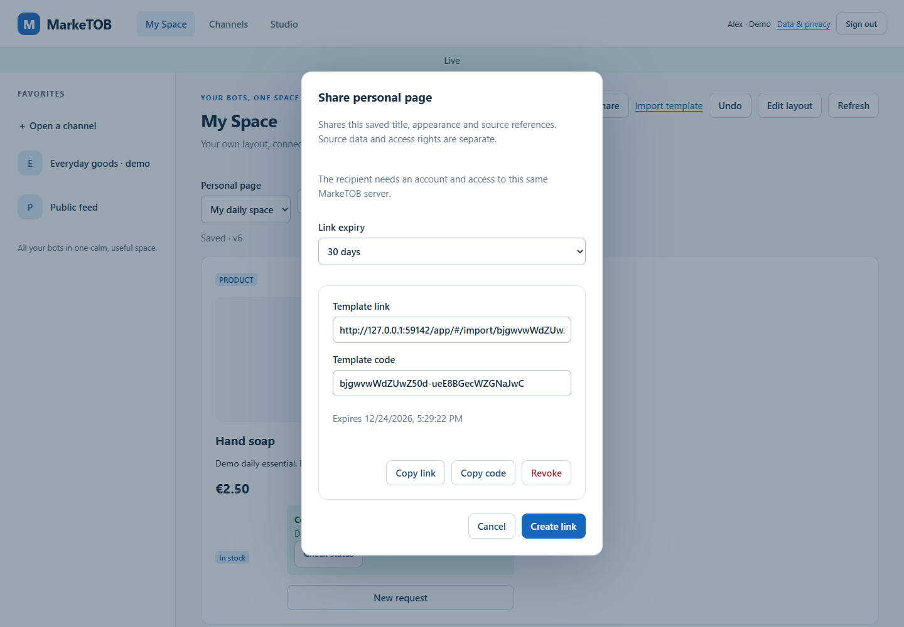

Источники: [docs/api/SHARING.md](https://github.com/Villentretermert/ProjectMarket/blob/11653f0a81f5911076ddedc473bbc60e63909d70/docs/api/SHARING.md), [apps/api/src/marketob_api/sharing.py](https://github.com/Villentretermert/ProjectMarket/blob/11653f0a81f5911076ddedc473bbc60e63909d70/apps/api/src/marketob_api/sharing.py).

## 18. События и обновления

Аудитория: Клиент.

Выбор событий по каналу

Ответы на мои заявки

Обновления каталога и новостей

Открытое онлайн-приложение получает foreground updates примерно каждые 2 секунды. Events показывает выбранные уведомления внутри интерфейса. Повторная доставка не должна повторять toast. Фоновый push на телефон и FCM ещё не подключены и не подтверждены устройством.

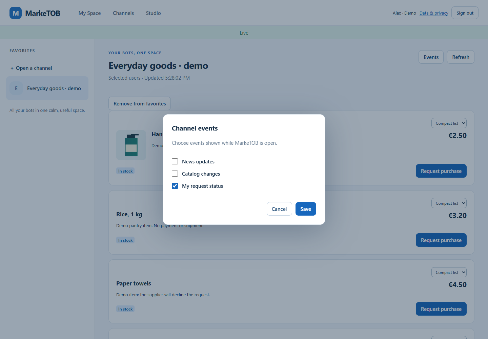

Источники: [docs/api/LIVE_UPDATES.md](https://github.com/Villentretermert/ProjectMarket/blob/11653f0a81f5911076ddedc473bbc60e63909d70/docs/api/LIVE_UPDATES.md), [apps/api/src/marketob_api/web/live.js](https://github.com/Villentretermert/ProjectMarket/blob/11653f0a81f5911076ddedc473bbc60e63909d70/apps/api/src/marketob_api/web/live.js).

## 19. Личные данные

Аудитория: Клиент.

JSON-экспорт

Удаление с паролем и DELETE

Передача workspace до удаления

Экспорт включает профиль, Favorites, My Space, собственные заявки и Events. Исключены bot keys, пароли, чужие данные и содержимое источников. Владелец сначала передаёт workspace активному Admin. Внешние копии, данные независимого бота и резервные копии оператора не исчезают по нажатию Delete.

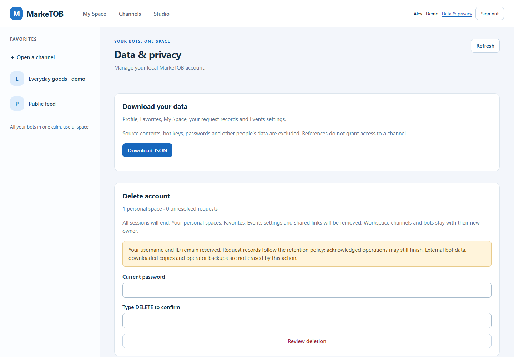

Источники: [docs/api/PRIVACY.md](https://github.com/Villentretermert/ProjectMarket/blob/11653f0a81f5911076ddedc473bbc60e63909d70/docs/api/PRIVACY.md), [apps/api/src/marketob_api/web/privacy.js](https://github.com/Villentretermert/ProjectMarket/blob/11653f0a81f5911076ddedc473bbc60e63909d70/apps/api/src/marketob_api/web/privacy.js).

## 20. Web на узком экране

Аудитория: Клиент.

Адаптивная вёрстка

Настоящие кнопки и подписи

Мобильный браузер

Автоматические сценарии проверяют ширину 360 px без горизонтального переполнения. Экран записан в viewport 390×844. Это адаптивный Web, а не установленный Android APK. Домашний виджет, ограничения фоновой работы и native cold start требуют отдельных проверок.

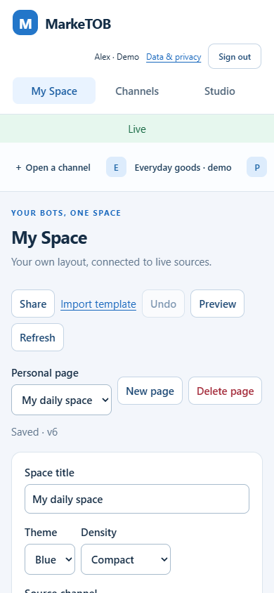

Источники: [apps/client/acceptance.mjs](https://github.com/Villentretermert/ProjectMarket/blob/11653f0a81f5911076ddedc473bbc60e63909d70/apps/client/acceptance.mjs), [docs/adr/0001-client-stack.md](https://github.com/Villentretermert/ProjectMarket/blob/11653f0a81f5911076ddedc473bbc60e63909d70/docs/adr/0001-client-stack.md).

## 21. B2B Studio

Аудитория: Клиент.

Рабочее пространство

Реестр ботов

Каналы и публикации

Один аккаунт может читать чужие витрины и владеть бизнес-пространством. В Studio B2B подключает собственный HTTP-сервис и публикует страницу. Создание и управление внутренней логикой самого бота остаются за пределами обязательного объёма MarkeTOB.

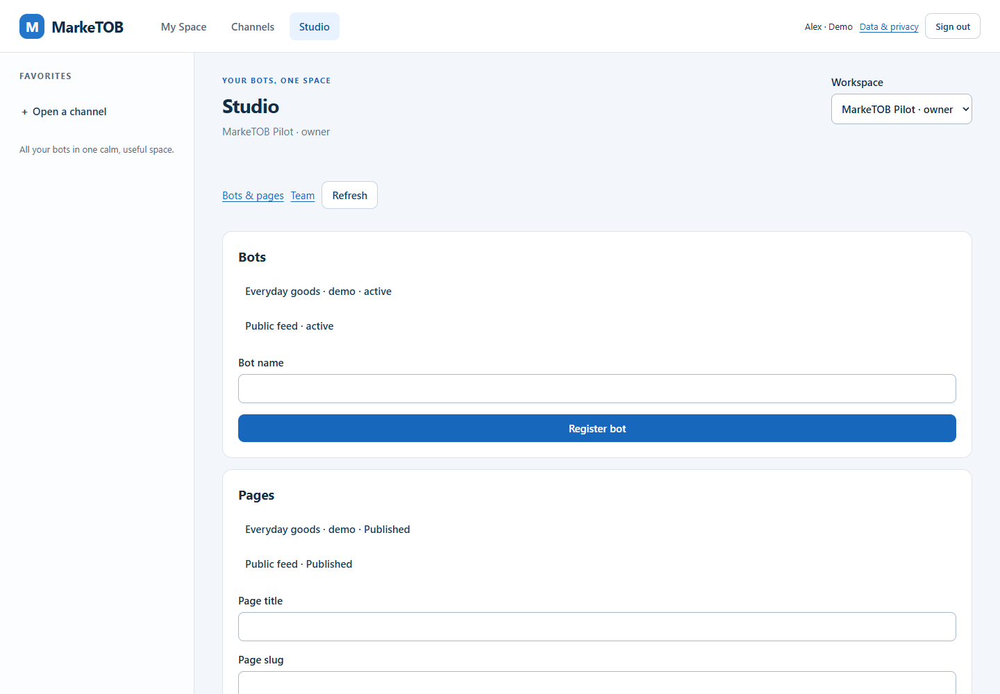

Источники: [apps/api/src/marketob_api/web/studio.js](https://github.com/Villentretermert/ProjectMarket/blob/11653f0a81f5911076ddedc473bbc60e63909d70/apps/api/src/marketob_api/web/studio.js), [docs/api/TEAMS.md](https://github.com/Villentretermert/ProjectMarket/blob/11653f0a81f5911076ddedc473bbc60e63909d70/docs/api/TEAMS.md).

## 22. Редактор B2B-страницы

Аудитория: Клиент.

Аудитория, блоки и действия

Черновик и публикация

История и откат оформления

Данные и оформление имеют разные версии. Новые данные бота после публикации появляются сразу. Изменения оформления публикуются отдельно. Откат создаёт новую версию на основе истории. Selected users остаётся режимом по умолчанию.

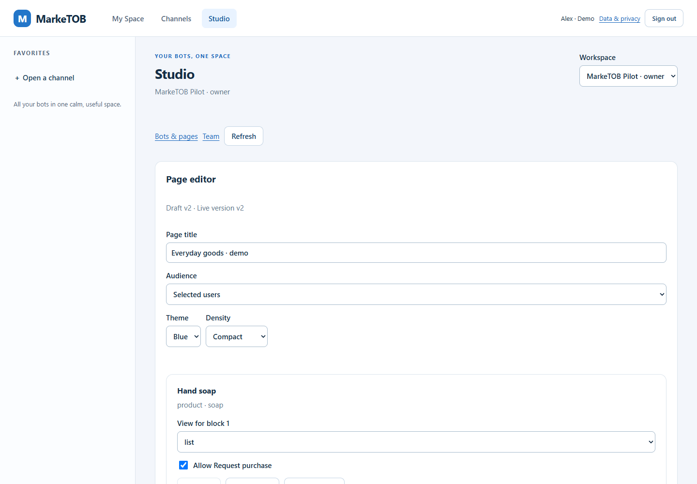

Источники: [docs/api/CHANNELS.md](https://github.com/Villentretermert/ProjectMarket/blob/11653f0a81f5911076ddedc473bbc60e63909d70/docs/api/CHANNELS.md), [apps/api/src/marketob_api/web/studio-editor.js](https://github.com/Villentretermert/ProjectMarket/blob/11653f0a81f5911076ddedc473bbc60e63909d70/apps/api/src/marketob_api/web/studio-editor.js).

## 23. Команда и права

Аудитория: Клиент.

Owner: управление командой

Admin: боты, ключи и доступ

Editor: оформление и публикация

У workspace один владелец. Участников добавляют по точному username зарегистрированного пользователя. Editor публикует и откатывает страницы, но не выпускает ключи и не расширяет аудиторию. Независимый read grant отделён от членства в команде.

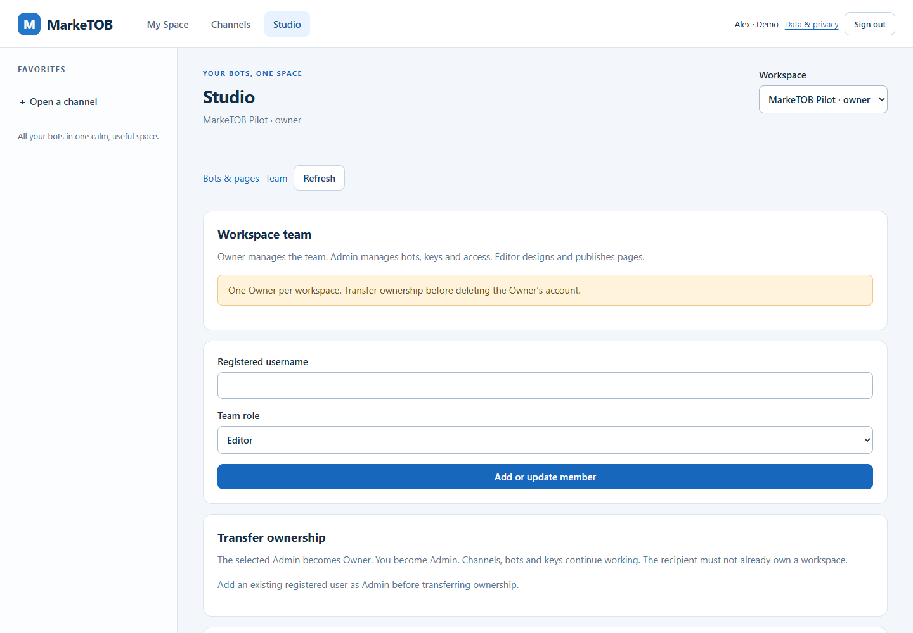

Источники: [docs/api/TEAMS.md](https://github.com/Villentretermert/ProjectMarket/blob/11653f0a81f5911076ddedc473bbc60e63909d70/docs/api/TEAMS.md), [docs/adr/0009-workspace-roles.md](https://github.com/Villentretermert/ProjectMarket/blob/11653f0a81f5911076ddedc473bbc60e63909d70/docs/adr/0009-workspace-roles.md).

## 24. Границы текущего пилота

Аудитория: Клиент.

Локальный username и пароль

Заявки без оплаты и корзины

Обновления в открытом Web

Обмен в пределах одного сервера

Уже можно лично проверить My Space с товарами и новостями. До внешнего пилота нужны приёмка, эксплуатационные решения и закрытие оставшихся задач. Android/виджет, Google, облако, фоновые push, iOS и Windows не должны звучать как готовые функции.

Источники: [docs/STATUS.md](https://github.com/Villentretermert/ProjectMarket/blob/11653f0a81f5911076ddedc473bbc60e63909d70/docs/STATUS.md), [docs/requirements/LOCAL_MODE.md](https://github.com/Villentretermert/ProjectMarket/blob/11653f0a81f5911076ddedc473bbc60e63909d70/docs/requirements/LOCAL_MODE.md).

## 25. 02  Для продуктовой команды

Аудитория: Продукт.

Возможности, последовательность

и условия следующего этапа

Функции связаны с принятыми решениями и критериями готовности. Числа нагрузки являются целями. Технические проверки не подменяют наблюдение за первыми B2C-пользователями.

Источники: [docs/DECISIONS.md](https://github.com/Villentretermert/ProjectMarket/blob/11653f0a81f5911076ddedc473bbc60e63909d70/docs/DECISIONS.md), [docs/ROADMAP.md](https://github.com/Villentretermert/ProjectMarket/blob/11653f0a81f5911076ddedc473bbc60e63909d70/docs/ROADMAP.md).

## 26. Аудитории и ответственность

Аудитория: Продукт.

B2C и B2B не являются взаимоисключающими видами аккаунта. Роль задаётся членством в конкретном workspace. Внешний сервис может работать на любом языке при соблюдении Bot API. Платформа отвечает за доступ, хранение и отображение принятых данных. Внешние бизнес-эффекты выполняет бот.

| Участник | Цель | Ответственность |
| --- | --- | --- |
| B2C | Личный интерфейс | Favorites, My Space, заявки |
| B2B Owner | Публикация сервиса | Команда и workspace |
| Admin / Editor | Поддержка витрины | Операции / оформление |
| Разработчик бота | Данные и действия | HTTP, retry, внешние эффекты |

Источники: [docs/api/TEAMS.md](https://github.com/Villentretermert/ProjectMarket/blob/11653f0a81f5911076ddedc473bbc60e63909d70/docs/api/TEAMS.md), [docs/api/PROTOCOL.md](https://github.com/Villentretermert/ProjectMarket/blob/11653f0a81f5911076ddedc473bbc60e63909d70/docs/api/PROTOCOL.md).

## 27. Модель продукта

Аудитория: Продукт.

Канал: опубликованная витрина источника

Блок: данные и допустимое представление

My Space: личная композиция ссылок

Действие: запрос исходному боту

Бот передаёт news/product/chart, а UI использует общий безопасный runtime. Layout не является исполняемым кодом. Разделение источника и представления позволяет менять вид без смены владельца данных. Произвольные формы, корзина и платежи не входят в обязательный текущий интерфейс.

Источники: [docs/api/PROTOCOL.md](https://github.com/Villentretermert/ProjectMarket/blob/11653f0a81f5911076ddedc473bbc60e63909d70/docs/api/PROTOCOL.md), [packages/contracts/src/contracts/schemas.json](https://github.com/Villentretermert/ProjectMarket/blob/11653f0a81f5911076ddedc473bbc60e63909d70/packages/contracts/src/contracts/schemas.json).

## 28. Жизненный цикл страницы

Аудитория: Продукт.

Данные обновляются независимо

Оформление публикуется отдельно

B2B получает данные бота, собирает черновик и публикует сохранённую версию. Читатель видит опубликованное оформление. Черновик не должен утекать через snapshot. source_revision и data_revision отделены от template_version. Откат касается оформления, не внешних операций бота.

1. Данные бота
2. Сохранённый draft
3. Publish
4. Snapshot читателя

Источники: [docs/api/CHANNELS.md](https://github.com/Villentretermert/ProjectMarket/blob/11653f0a81f5911076ddedc473bbc60e63909d70/docs/api/CHANNELS.md).

## 29. Публичность, доступ и обмен

Аудитория: Продукт.

Доступ на чтение не равен управлению каналом. Публичность применяется к опубликованной странице. Код шаблона не даёт права на закрытый источник. При импорте layout сохраняется даже при недоступных источниках. Частные данные заменяются безопасным placeholder.

| Операция | Public | Selected users |
| --- | --- | --- |
| Просмотр канала | Опубликованная страница | Требуется текущий grant |
| Favorites | Нужен аккаунт | Аккаунт и доступ |
| Заявка | Аккаунт, актуальные права | Аккаунт, актуальные права |
| Импорт layout | Независимая копия | Права на данные отдельно |

Источники: [docs/api/CHANNELS.md](https://github.com/Villentretermert/ProjectMarket/blob/11653f0a81f5911076ddedc473bbc60e63909d70/docs/api/CHANNELS.md), [docs/api/SHARING.md](https://github.com/Villentretermert/ProjectMarket/blob/11653f0a81f5911076ddedc473bbc60e63909d70/docs/api/SHARING.md).

## 30. Поведение при сбоях

Аудитория: Продукт.

Offline скрывает частное содержимое

Check again проверяет источник заново

Конфликт версии сохраняет локальную правку

Неопределённая заявка требует сверки

Recovery является частью сценария. Браузер закрывает частные диалоги при отзыве, очищает данные и получает разрешённый snapshot после восстановления. Потеря ответа POST требует того же idempotency key или чтения статуса. Бесконечный spinner не считается корректным завершением операции.

Источники: [apps/client/live-acceptance.mjs](https://github.com/Villentretermert/ProjectMarket/blob/11653f0a81f5911076ddedc473bbc60e63909d70/apps/client/live-acceptance.mjs), [apps/client/privacy-acceptance.mjs](https://github.com/Villentretermert/ProjectMarket/blob/11653f0a81f5911076ddedc473bbc60e63909d70/apps/client/privacy-acceptance.mjs), [apps/api/src/marketob_api/web/live.js](https://github.com/Villentretermert/ProjectMarket/blob/11653f0a81f5911076ddedc473bbc60e63909d70/apps/api/src/marketob_api/web/live.js).

## 31. Масштаб и критерии успеха

Аудитория: Продукт.

**1 000 / мин**

100 ботов как целевой масштаб

10 000 MAU как продуктовый ориентир

100 активных клиентов в профиле L2

Полный L2 ещё не принят

MAU не равно одновременным подключениям. L2 предполагает 30 минут нагрузки в зафиксированном окружении, затем burst. Цели live p95≤3с и read/ingest p95≤500мс относятся к измеряемому тесту, не к гарантии поставки. Активация, возвраты и успешность первого My Space являются предложенными метриками будущего пилота, пока без измерений.

Источники: [docs/requirements/PILOT_TARGETS.md](https://github.com/Villentretermert/ProjectMarket/blob/11653f0a81f5911076ddedc473bbc60e63909d70/docs/requirements/PILOT_TARGETS.md), [docs/task-results/PM-022.md](https://github.com/Villentretermert/ProjectMarket/blob/11653f0a81f5911076ddedc473bbc60e63909d70/docs/task-results/PM-022.md).

## 32. Этапы 1–2: фундамент

Аудитория: Продукт.

Первые восемь задач зафиксировали продукт, проверили стек, подготовили UX и машинный контракт. Затем появились локальная идентификация, независимые bot credentials и долговечный приём сообщений. G01/G02 содержат презентации и ответы, изменившие последующий план.

| Задачи | Результат | Статус |
| --- | --- | --- |
| PM-001–004 | Требования, стек, UX, Bot API | Приняты |
| PM-005 | Репозиторий, окружение и CI | Принята |
| PM-006 | Локальный вход и права | Принята |
| PM-007 | Боты и индивидуальные ключи | Принята |
| PM-008 | Данные, история и дедупликация | Принята |

Источники: [docs/ROADMAP.md](https://github.com/Villentretermert/ProjectMarket/blob/11653f0a81f5911076ddedc473bbc60e63909d70/docs/ROADMAP.md), [docs/reviews/G01.md](https://github.com/Villentretermert/ProjectMarket/blob/11653f0a81f5911076ddedc473bbc60e63909d70/docs/reviews/G01.md), [docs/reviews/G02.md](https://github.com/Villentretermert/ProjectMarket/blob/11653f0a81f5911076ddedc473bbc60e63909d70/docs/reviews/G02.md).

## 33. Этапы 3–4: рабочий продукт

Аудитория: Продукт.

Backend-цикл проверили до полноценного Web UI. Отдельно подтвердили публикацию, закрытый доступ, GET событий, ACK, результаты и восстановление после рестарта. Затем Web связали с API и добавили Studio, роли, избранное и личные страницы.

| Задачи | Результат | Статус |
| --- | --- | --- |
| PM-009–010 | Каналы, заявки и статусы | Приняты |
| PM-011–012 | SDK, два бота, backend-цикл | Приняты |
| PM-013–014 | Web и Studio с ролями | Приняты |
| PM-015 | Favorites и синхронизация | Принята |
| PM-016 | My Space, autosave и Undo | Принята |

Источники: [docs/ROADMAP.md](https://github.com/Villentretermert/ProjectMarket/blob/11653f0a81f5911076ddedc473bbc60e63909d70/docs/ROADMAP.md), [docs/reviews/G03.md](https://github.com/Villentretermert/ProjectMarket/blob/11653f0a81f5911076ddedc473bbc60e63909d70/docs/reviews/G03.md), [docs/reviews/G04.md](https://github.com/Villentretermert/ProjectMarket/blob/11653f0a81f5911076ddedc473bbc60e63909d70/docs/reviews/G04.md).

## 34. Этапы 5–6: поставка и приёмка

Аудитория: Продукт.

После G04 приняты PM-017, PM-018 и PM-021. Android отложен владельцем. PM-022 ожидает полный нагрузочный тест. PM-023/024 продвигаются независимыми частями, сохраняя общие критерии. После следующей полноценной принятой задачи требуется G05 и отдельные вопросы.

| Задачи | Результат / остаток | Статус |
| --- | --- | --- |
| PM-017–018 | Обмен и foreground updates | Приняты |
| PM-019–020 | APK/AAB и настоящий виджет | Отложены |
| PM-021 | Docker и backup/restore | Принята |
| PM-022 | Полный L2 на свободном ПК | Открыта |
| PM-023–024 | Релизные проверки и передача | Частично |

Источники: [docs/ROADMAP.md](https://github.com/Villentretermert/ProjectMarket/blob/11653f0a81f5911076ddedc473bbc60e63909d70/docs/ROADMAP.md), [docs/WORKING_AGREEMENT.md](https://github.com/Villentretermert/ProjectMarket/blob/11653f0a81f5911076ddedc473bbc60e63909d70/docs/WORKING_AGREEMENT.md).

## 35. Доработки после первого обзора

Аудитория: Продукт.

Визуальный каталог блоков и Check again

Фотографии товаров и Meduza RSS

Экспорт, передача владения и удаление

Docker-комплект и исходные материалы

После обзора 25 октября реализованы S03/S04, S05 и S06. Работа над зависимостями включила обновления runtime, проверку реальных образов и исправление конкурентного построения схем. Собственный код получил Apache-2.0. Notices и исходники связаны с конкретными images. Не все source/build gaps закрыты.

Источники: [docs/DECISIONS.md](https://github.com/Villentretermert/ProjectMarket/blob/11653f0a81f5911076ddedc473bbc60e63909d70/docs/DECISIONS.md), [docs/STATUS.md](https://github.com/Villentretermert/ProjectMarket/blob/11653f0a81f5911076ddedc473bbc60e63909d70/docs/STATUS.md), [docs/licensing/DISTRIBUTION.md](https://github.com/Villentretermert/ProjectMarket/blob/11653f0a81f5911076ddedc473bbc60e63909d70/docs/licensing/DISTRIBUTION.md).

## 36. Условия внешнего пилота

Аудитория: Продукт.

Личный сценарий с владельцем

Наблюдение за несколькими B2C-пользователями

Возобновление полного L2

Закрытие релизных ограничений

Предлагается сначала личный My Space с товарами, новостями и ответом бота, затем знакомые B2C-пользователи. После этого решается вопрос о помощнике Studio. Android и облако возвращаются отдельным решением владельца. Публичное распространение требует проверки фактического набора артефактов.

Источники: [docs/reviews/STATUS-2026-10-25/answers.md](https://github.com/Villentretermert/ProjectMarket/blob/11653f0a81f5911076ddedc473bbc60e63909d70/docs/reviews/STATUS-2026-10-25/answers.md), [docs/tasks/PM-022.md](https://github.com/Villentretermert/ProjectMarket/blob/11653f0a81f5911076ddedc473bbc60e63909d70/docs/tasks/PM-022.md), [docs/tasks/PM-023.md](https://github.com/Villentretermert/ProjectMarket/blob/11653f0a81f5911076ddedc473bbc60e63909d70/docs/tasks/PM-023.md), [docs/tasks/PM-024.md](https://github.com/Villentretermert/ProjectMarket/blob/11653f0a81f5911076ddedc473bbc60e63909d70/docs/tasks/PM-024.md).

## 37. 03  Для технического директора

Аудитория: Технологии.

Компоненты, сущности, потоки

и проверяемая эксплуатация

Описывается фактический modular backend, Web runtime и локальная Docker-поставка. Исторические ADR могут содержать первоначальные planned-состояния. Для текущих утверждений использованы реализация и позднейшие отчёты.

Источники: [docs/setup/CURRENT_DELIVERY.md](https://github.com/Villentretermert/ProjectMarket/blob/11653f0a81f5911076ddedc473bbc60e63909d70/docs/setup/CURRENT_DELIVERY.md).

## 38. Контекст системы

Аудитория: Технологии.

HTTP-сервисы используют общий шлюз

Боты не получают доступ к БД платформы

Пользователь работает с серверной сессией, бот с Bearer key и scopes. Внешние сервисы лежат за границей платформы: MarkeTOB не обещает транзакционность чужого заказа или платежа. Будущие приложения могут использовать тот же контракт после реализации и проверки клиента. Стрелки обозначают инициатора запроса. Бот отправляет данные POST и сам забирает события через GET. Backend не вызывает внешний бот по произвольному callback URL.

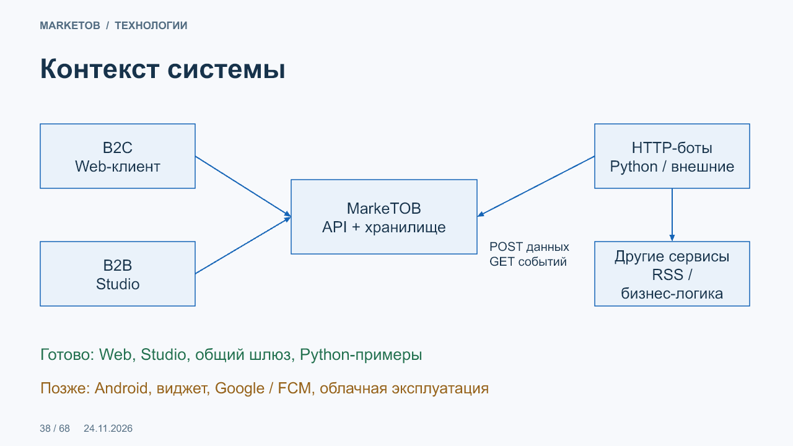

Источники: [docs/api/PROTOCOL.md](https://github.com/Villentretermert/ProjectMarket/blob/11653f0a81f5911076ddedc473bbc60e63909d70/docs/api/PROTOCOL.md), [docs/adr/0002-local-backend.md](https://github.com/Villentretermert/ProjectMarket/blob/11653f0a81f5911076ddedc473bbc60e63909d70/docs/adr/0002-local-backend.md).

## 39. Компоненты локальной поставки

Аудитория: Технологии.

Caddy завершает HTTPS

API и maintenance используют общий Python-код

PostgreSQL хранит авторитетное состояние

API, maintenance, proxy и db работают отдельными сервисами Docker Compose. Мигратор управляет схемой. Боты запускаются отдельно и общаются по HTTP. Порты по умолчанию слушают loopback. Для облака требуются отдельные domain/TLS и эксплуатационные решения. Maintenance обслуживает retention/outbox. Backup и restore запускаются оператором отдельными командами.

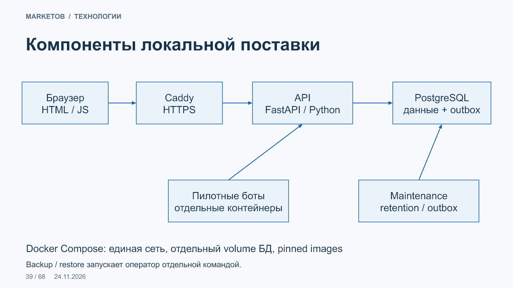

Источники: [compose.yaml](https://github.com/Villentretermert/ProjectMarket/blob/11653f0a81f5911076ddedc473bbc60e63909d70/compose.yaml), [deploy/compose.local.yaml](https://github.com/Villentretermert/ProjectMarket/blob/11653f0a81f5911076ddedc473bbc60e63909d70/deploy/compose.local.yaml), [docs/adr/0014-local-delivery.md](https://github.com/Villentretermert/ProjectMarket/blob/11653f0a81f5911076ddedc473bbc60e63909d70/docs/adr/0014-local-delivery.md).

## 40. Стек и карта кода

Аудитория: Технологии.

Python используется для backend, схем, SDK, ботов и большинства инструментов. HTML/JS выбран после сравнения с Flet ради доступности, компактности и независимого runtime. Это зафиксированное исключение из Python-first. Native Android мост подготовлен в spike, но устройством не принят.

| Каталог / модуль | Назначение |
| --- | --- |
| apps/api/src/marketob_api | FastAPI, права, транзакции, worker |
| marketob_api/web | HTML/CSS/JS UI runtime |
| packages/contracts | JSON Schema, OpenAPI, примеры |
| packages/sdk и bots/pilot | Python SDK и два бота |
| scripts и apps/client | Поставка, smoke, Playwright |

Источники: [apps/api/pyproject.toml](https://github.com/Villentretermert/ProjectMarket/blob/11653f0a81f5911076ddedc473bbc60e63909d70/apps/api/pyproject.toml), [docs/adr/0001-client-stack.md](https://github.com/Villentretermert/ProjectMarket/blob/11653f0a81f5911076ddedc473bbc60e63909d70/docs/adr/0001-client-stack.md).

## 41. Сущности: люди и доступ

Аудитория: Технологии.

organizations соответствует workspace в UI. User может иметь memberships и независимые read grants. Owner уникален в workspace. sessions хранит verifier токена. Отзыв membership не удаляет отдельный grant автоматически. Сервер проверяет авторизацию при каждом обращении.

| Таблица | Ключевые поля | Смысл |
| --- | --- | --- |
| users | user_id, username, deleted_at | Аккаунт |
| sessions | token_hash, expires_at, origin | Сессия |
| organizations | org_id, owner_user_id | Workspace |
| memberships | org_id, user_id, role | Роль в команде |
| grants | channel_id, user_id | Доступ на чтение |

Источники: [apps/api/src/marketob_api/migrations/001_identity.sql](https://github.com/Villentretermert/ProjectMarket/blob/11653f0a81f5911076ddedc473bbc60e63909d70/apps/api/src/marketob_api/migrations/001_identity.sql), [apps/api/src/marketob_api/migrations/006_teams.sql](https://github.com/Villentretermert/ProjectMarket/blob/11653f0a81f5911076ddedc473bbc60e63909d70/apps/api/src/marketob_api/migrations/006_teams.sql), [docs/api/TEAMS.md](https://github.com/Villentretermert/ProjectMarket/blob/11653f0a81f5911076ddedc473bbc60e63909d70/docs/api/TEAMS.md).

## 42. Сущности: боты и ключи

Аудитория: Технологии.

Bootstrap credential действует 15 минут и расходуется один раз. Рабочий ключ действует 90 дней, scopes ограничивают операции. Raw key возвращается только при выпуске. В БД сохраняются SHA-256 verifier и публичный prefix. Проверка bot/organization state блокирует использование после отзыва.

| Таблица | Ключевые поля | Смысл |
| --- | --- | --- |
| bots | bot_id, org_id, state, last_seen | Реестр сервисов |
| bot_registrations | token_hash, expires_at | Bootstrap |
| bot_keys | key_id, token_hash, scopes | Рабочий ключ |
| channel_access | channel_id, bot_id, org_id | Владелец и источник |

Источники: [apps/api/src/marketob_api/migrations/002_bots.sql](https://github.com/Villentretermert/ProjectMarket/blob/11653f0a81f5911076ddedc473bbc60e63909d70/apps/api/src/marketob_api/migrations/002_bots.sql), [docs/api/BOT_REGISTRATION.md](https://github.com/Villentretermert/ProjectMarket/blob/11653f0a81f5911076ddedc473bbc60e63909d70/docs/api/BOT_REGISTRATION.md).

## 43. Сущности: каналы и данные

Аудитория: Технологии.

channel_access задаёт права, channel_content хранит draft и data revision. channel_versions содержит неизменяемые definitions. source_records хранит актуальное содержимое либо tombstone. message_receipts защищает повторный message_id. ingest_history хранит принятые payload отдельно от текущего snapshot.

| Таблица | Ключ / версия | Назначение |
| --- | --- | --- |
| channel_content | channel_id, data_revision | Draft и metadata |
| channel_versions | channel_id, template_version | История оформления |
| source_records | channel_id, resource_id | Актуальные данные |
| message_receipts | bot_id, message_id | Receipt и body hash |
| ingest_history | receipt_id, received_at | История приёма |

Источники: [apps/api/src/marketob_api/migrations/003_ingestion.sql](https://github.com/Villentretermert/ProjectMarket/blob/11653f0a81f5911076ddedc473bbc60e63909d70/apps/api/src/marketob_api/migrations/003_ingestion.sql), [apps/api/src/marketob_api/migrations/004_channels.sql](https://github.com/Villentretermert/ProjectMarket/blob/11653f0a81f5911076ddedc473bbc60e63909d70/apps/api/src/marketob_api/migrations/004_channels.sql).

## 44. Сущности: заявки и результаты

Аудитория: Технологии.

action_requests связывает пользователя, товар, действие, бот, событие и idempotency key. quantity ограничена единицей. actor_ref является bot-scoped псевдонимом пользователя. action_results хранит result_id и body hash. external_reference помогает сверке и не выдаётся в пользовательском статусе.

| Сущность / поле | Назначение |
| --- | --- |
| action_requests | Долговечная заявка и state |
| event_id | Стабильное событие для GET бота |
| idempotency_key + body_hash | Повтор без новой операции |
| action_results | Дедупликация по bot/result |
| actor_ref / external_reference | Псевдоним / внешняя сверка |

Источники: [apps/api/src/marketob_api/migrations/005_actions.sql](https://github.com/Villentretermert/ProjectMarket/blob/11653f0a81f5911076ddedc473bbc60e63909d70/apps/api/src/marketob_api/migrations/005_actions.sql), [docs/api/ACTIONS.md](https://github.com/Villentretermert/ProjectMarket/blob/11653f0a81f5911076ddedc473bbc60e63909d70/docs/api/ACTIONS.md).

## 45. Сущности: личный интерфейс

Аудитория: Технологии.

favorite_state защищает список ревизией. favorites хранит позиции и просмотренные версии. personal_pages хранит layout в JSONB, владельца и ключ создания. shared_templates содержит immutable layout, code, expiry и revocation. Import создаёт самостоятельную страницу и восстанавливает повтор по тому же ключу.

| Таблица | Данные | Граница |
| --- | --- | --- |
| favorite_state | revision пользователя | Защита порядка |
| favorites | position, seen revisions | До 100 каналов |
| personal_pages | title, layout, user_id | 20 страниц / 50 блоков |
| shared_templates | code, layout, expires_at | 20 активных ссылок |

Источники: [apps/api/src/marketob_api/migrations/007_favorites.sql](https://github.com/Villentretermert/ProjectMarket/blob/11653f0a81f5911076ddedc473bbc60e63909d70/apps/api/src/marketob_api/migrations/007_favorites.sql), [apps/api/src/marketob_api/migrations/008_personal_pages.sql](https://github.com/Villentretermert/ProjectMarket/blob/11653f0a81f5911076ddedc473bbc60e63909d70/apps/api/src/marketob_api/migrations/008_personal_pages.sql), [apps/api/src/marketob_api/migrations/009_shares.sql](https://github.com/Villentretermert/ProjectMarket/blob/11653f0a81f5911076ddedc473bbc60e63909d70/apps/api/src/marketob_api/migrations/009_shares.sql).

## 46. Сущности: доставка и эксплуатация

Аудитория: Технологии.

change_outbox создаётся в транзакции с доменной записью. delivery_state задаёт watermark и retention_floor. event_preferences хранит opt-in. worker_state показывает успешный цикл обслуживания. history_usage поддерживает квоты. server_keys содержит серверный материал подписей и псевдонимов.

| Сущности | Назначение |
| --- | --- |
| change_outbox / delivery_state | Подсказки, watermark и floor |
| event_preferences | События, выбранные пользователем |
| worker_state / history_usage | Живость worker и учёт истории |
| rate_windows / rate_buckets | Durable лимиты |
| server_keys | Серверные подписи и HMAC |

Источники: [apps/api/src/marketob_api/migrations/010_updates.sql](https://github.com/Villentretermert/ProjectMarket/blob/11653f0a81f5911076ddedc473bbc60e63909d70/apps/api/src/marketob_api/migrations/010_updates.sql), [apps/api/src/marketob_api/migrations/011_operations.sql](https://github.com/Villentretermert/ProjectMarket/blob/11653f0a81f5911076ddedc473bbc60e63909d70/apps/api/src/marketob_api/migrations/011_operations.sql), [apps/api/src/marketob_api/maintenance.py](https://github.com/Villentretermert/ProjectMarket/blob/11653f0a81f5911076ddedc473bbc60e63909d70/apps/api/src/marketob_api/maintenance.py).

## 47. Основные связи данных

Аудитория: Технологии.

Workspace владеет ботами и каналами

Личный layout ссылается на источники

Схема показывает предметные связи, не все физические foreign keys. Layout JSONB содержит channel_id/resource_id. Доступ проверяется динамически. Удаление источника не превращает My Space во владельца содержимого. Заявка сохраняет связь с исходным ботом и пользователем.

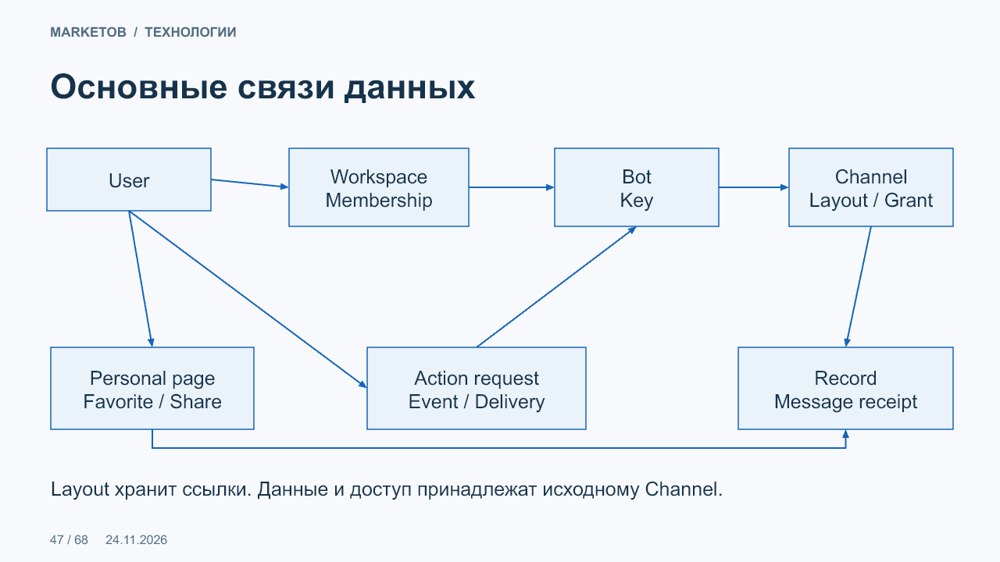

Источники: [apps/api/src/marketob_api/migrations](https://github.com/Villentretermert/ProjectMarket/blob/11653f0a81f5911076ddedc473bbc60e63909d70/apps/api/src/marketob_api/migrations), [docs/api/PERSONAL_PAGES.md](https://github.com/Villentretermert/ProjectMarket/blob/11653f0a81f5911076ddedc473bbc60e63909d70/docs/api/PERSONAL_PAGES.md).

## 48. Регистрация HTTP-бота

Аудитория: Технологии.

15 минут на одноразовый обмен

90 дней для рабочего ключа

Owner/Admin создаёт bot и передаёт registration credential сервису по приватному каналу. Бот меняет её на operational key. Потерянный ответ одноразового обмена не позволяет раскрыть старый ключ повторно. Владелец выпускает новую credential/key. Studio напоминает о сроке за 7 дней и при истечении.

1. POST /v1/bots
2. Credential боту
3. POST /v1/
bot-registrations/
exchange
4. Bearer key + scopes

Источники: [docs/api/BOT_REGISTRATION.md](https://github.com/Villentretermert/ProjectMarket/blob/11653f0a81f5911076ddedc473bbc60e63909d70/docs/api/BOT_REGISTRATION.md), [apps/api/src/marketob_api/web/studio.js](https://github.com/Villentretermert/ProjectMarket/blob/11653f0a81f5911076ddedc473bbc60e63909d70/apps/api/src/marketob_api/web/studio.js).

## 49. Приём сообщения

Аудитория: Технологии.

Валидация перед транзакцией

Snapshot, receipt и outbox фиксируются вместе

Message содержит schema version, message ID, channel и версию ресурса. Валидация отвергает неизвестные поля и неверные типы. Транзакция проверяет ключ и право бота, применяет source revision, пишет snapshot, receipt, историю и outbox. Тот же ID/body возвращает прежний результат. Изменённое body вызывает конфликт.

1. POST message
2. Schema + bot ACL
3. DB transaction
4. Receipt + revision

Источники: [docs/api/INGESTION.md](https://github.com/Villentretermert/ProjectMarket/blob/11653f0a81f5911076ddedc473bbc60e63909d70/docs/api/INGESTION.md), [apps/api/src/marketob_api/ingestion.py](https://github.com/Villentretermert/ProjectMarket/blob/11653f0a81f5911076ddedc473bbc60e63909d70/apps/api/src/marketob_api/ingestion.py).

## 50. Публикация и чтение

Аудитория: Технологии.

template_version отдельно от data_revision

Snapshot собирается после проверки доступа

Publisher сохраняет draft с optimistic version, затем переключает published pointer. Чтение связывает опубликованный layout с текущими source_records. ETag формируется после проверки прав. Недоступная страница не раскрывает частные metadata. Откат создаёт новую template_version.

1. Save draft
2. Publish version
3. ACL + snapshot
4. Web renderer

Источники: [apps/api/src/marketob_api/channels.py](https://github.com/Villentretermert/ProjectMarket/blob/11653f0a81f5911076ddedc473bbc60e63909d70/apps/api/src/marketob_api/channels.py), [docs/api/CHANNELS.md](https://github.com/Villentretermert/ProjectMarket/blob/11653f0a81f5911076ddedc473bbc60e63909d70/docs/api/CHANNELS.md).

## 51. Состояния заявки

Аудитория: Технологии.

ACK подтверждает приём ботом

Окончательный результат приходит отдельно

queued означает долговечную запись. processing появляется после подтверждения/прогресса. confirmed и failed являются терминальными результатами. unknown требует сверки. cancelled относится к отменённой недоставленной работе. Уже ACKed внешний эффект нельзя автоматически откатить отзывом доступа. Таймаут без ACK составляет 60 секунд, без прогресса после ACK 5 минут. Упрощённая схема показывает основной путь. Unknown также может вернуться в processing после позднего progress. Отмена до ACK возможна при потере эффективного доступа или деактивации аккаунта. Полный контракт переходов описан в ACTIONS.md.

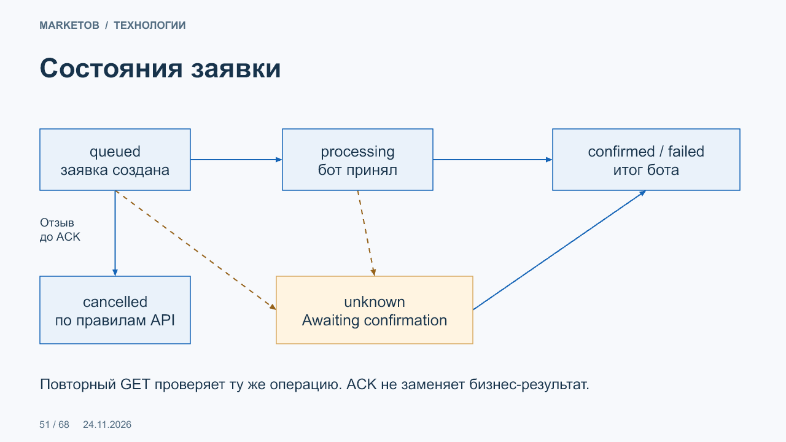

Источники: [docs/api/ACTIONS.md](https://github.com/Villentretermert/ProjectMarket/blob/11653f0a81f5911076ddedc473bbc60e63909d70/docs/api/ACTIONS.md), [apps/api/src/marketob_api/actions.py](https://github.com/Villentretermert/ProjectMarket/blob/11653f0a81f5911076ddedc473bbc60e63909d70/apps/api/src/marketob_api/actions.py).

## 52. Повторы и неоднозначный ответ

Аудитория: Технологии.

Повтор сохраняет идентичность операции и тело. Одинаковый ключ не разрешает переписать payload. Боту рекомендуется action_request_id как ключ внешнего эффекта. Exactly-once произвольного внешнего сервиса платформа не обещает. Очередь и результаты переживают рестарт, окончательная сверка остаётся обязанностью бота.

| Потерян ответ | Повтор | Результат |
| --- | --- | --- |
| POST message | Тот же message_id + body | Прежний receipt |
| POST action | Тот же ключ + body | Та же заявка |
| POST result | Тот же result_id + body | Текущий статус |
| Другое тело со старым ID | Не новая операция | 409 conflict |
| Внешний эффект неизвестен | Сначала сверка | Без слепого повтора |

Источники: [docs/api/ACTIONS.md](https://github.com/Villentretermert/ProjectMarket/blob/11653f0a81f5911076ddedc473bbc60e63909d70/docs/api/ACTIONS.md), [docs/api/INGESTION.md](https://github.com/Villentretermert/ProjectMarket/blob/11653f0a81f5911076ddedc473bbc60e63909d70/docs/api/INGESTION.md).

## 53. Foreground updates

Аудитория: Технологии.

Polling примерно раз в 2 секунды

Курсор связан с пользователем и сессией

Клиент получает watermark, затем snapshots и polling от начального cursor. Подсказки содержат revisions/invalidation, данные читает разрешённый snapshot. Cursor действует 10 минут. При history gap сервер возвращает 410 resync_required. Клиент заново получает watermark и snapshots. Последовательность доставки после commit защищает от пропусков из-за порядка транзакций.

1. Watermark
2. Snapshots
3. GET /updates
4. Refetch / resync

Источники: [docs/api/LIVE_UPDATES.md](https://github.com/Villentretermert/ProjectMarket/blob/11653f0a81f5911076ddedc473bbc60e63909d70/docs/api/LIVE_UPDATES.md), [apps/api/src/marketob_api/updates.py](https://github.com/Villentretermert/ProjectMarket/blob/11653f0a81f5911076ddedc473bbc60e63909d70/apps/api/src/marketob_api/updates.py), [apps/api/src/marketob_api/access_changes.py](https://github.com/Villentretermert/ProjectMarket/blob/11653f0a81f5911076ddedc473bbc60e63909d70/apps/api/src/marketob_api/access_changes.py).

## 54. Отзыв доступа и приватность

Аудитория: Технологии.

Права проверяет backend

UI очищает данные и открытые диалоги

Повтор старой заявки тоже проверяет доступ

Отзыв охватывает snapshots, My Space, каталог блоков, фотографии и request status. Replay проходит актуальную авторизацию. UI обрабатывает invalidation при каждом poll: повторный revoke не должен оставить ранее восстановленный блок. Удалённый аккаунт теряет сессии и личные связи. Сохранённые внешние копии не контролируются платформой.

Источники: [apps/api/src/marketob_api/access_changes.py](https://github.com/Villentretermert/ProjectMarket/blob/11653f0a81f5911076ddedc473bbc60e63909d70/apps/api/src/marketob_api/access_changes.py), [apps/api/src/marketob_api/web/live.js](https://github.com/Villentretermert/ProjectMarket/blob/11653f0a81f5911076ddedc473bbc60e63909d70/apps/api/src/marketob_api/web/live.js), [docs/api/PRIVACY.md](https://github.com/Villentretermert/ProjectMarket/blob/11653f0a81f5911076ddedc473bbc60e63909d70/docs/api/PRIVACY.md).

## 55. Обмен и границы доверия

Аудитория: Технологии.

Серверный код указывает на immutable layout

Внутри нет данных источников и bot keys

Получатель создаёт независимую страницу

Реализация использует 32-символьный непрозрачный code. Первоначальная идея интерфейса, зашитого в код, уточнена: layout хранится на сервере. Import требует тот же сервер и проверяет каждый source. Revoke блокирует новые preview/import, но не удаляет уже созданную независимую копию.

Источники: [docs/api/SHARING.md](https://github.com/Villentretermert/ProjectMarket/blob/11653f0a81f5911076ddedc473bbc60e63909d70/docs/api/SHARING.md), [apps/api/src/marketob_api/sharing.py](https://github.com/Villentretermert/ProjectMarket/blob/11653f0a81f5911076ddedc473bbc60e63909d70/apps/api/src/marketob_api/sharing.py).

## 56. Группы HTTP API

Аудитория: Технологии.

Полный контракт находится в docs/api/PROTOCOL.md и тематических документах. Боту доступны messages, identity, GET events/requests, ACK и result. Пользовательские endpoints используют session/Origin/CSRF. OpenAPI и JSON Schema предназначены для разработчика и ИИ. SDK закрывает типичные повторы и ошибки. Все перечисленные маршруты имеют общий префикс /v1.

| Область | Основные маршруты |
| --- | --- |
| Identity / teams | /auth, /account, /workspaces |
| Bot registry | /bots, /bot-registrations/exchange |
| Bot gateway | /bot/messages, /bot/events, /bot/requests |
| Channels / actions | /channels, /owner/channels, /action-requests |
| Personal UI | /favorites, /personal-pages, /template-imports |
| Live | /updates, /preferences |

Источники: [docs/api/PROTOCOL.md](https://github.com/Villentretermert/ProjectMarket/blob/11653f0a81f5911076ddedc473bbc60e63909d70/docs/api/PROTOCOL.md), [docs/api/QUICKSTART.md](https://github.com/Villentretermert/ProjectMarket/blob/11653f0a81f5911076ddedc473bbc60e63909d70/docs/api/QUICKSTART.md).

## 57. Типизированные данные

Аудитория: Технологии.

news: заголовок, текст, дата, ссылка

product: price, availability, optional image

chart: ось, серии и числовые значения

layout: source, content_type, view, action_ids

JSON Schema закрывает неизвестные поля. Максимальный request body 256 KiB. Изображение товара: ограниченный inline PNG до 96 KiB и 512 px на сторону. Бот не передаёт исполняемый HTML/JavaScript или произвольный image URL. Renderer выводит plain text и проверяет ссылки. Примеры сообщений приложены к контрактам.

Источники: [packages/contracts/src/contracts/schemas.json](https://github.com/Villentretermert/ProjectMarket/blob/11653f0a81f5911076ddedc473bbc60e63909d70/packages/contracts/src/contracts/schemas.json), [packages/contracts/src/contracts/examples/cases.json](https://github.com/Villentretermert/ProjectMarket/blob/11653f0a81f5911076ddedc473bbc60e63909d70/packages/contracts/src/contracts/examples/cases.json), [docs/api/PRODUCT_IMAGES.md](https://github.com/Villentretermert/ProjectMarket/blob/11653f0a81f5911076ddedc473bbc60e63909d70/docs/api/PRODUCT_IMAGES.md).

## 58. Хранение и очистка

Аудитория: Технологии.

Текущий snapshot живёт до явного удаления. История приёма не является вечным архивом. Неразрешённые действия и их защита от повторов не исчезают только по возрасту. Outbox очищается с сохранением монотонного floor, чтобы старый клиент выполнял resync. Ротация backup относится к эксплуатации.

| Данные | Политика |
| --- | --- |
| Текущий source record | До удаления / tombstone |
| Ingest history / message receipts | 30 дней |
| Terminal actions / results | 30 дней |
| Неразрешённые заявки | До разрешения / reconciliation |
| Live cursor | 10 минут, затем resync |
| Audit / daily backups | 90 дней / 7 дневных копий |

Источники: [docs/api/INGESTION.md](https://github.com/Villentretermert/ProjectMarket/blob/11653f0a81f5911076ddedc473bbc60e63909d70/docs/api/INGESTION.md), [docs/api/ACTIONS.md](https://github.com/Villentretermert/ProjectMarket/blob/11653f0a81f5911076ddedc473bbc60e63909d70/docs/api/ACTIONS.md), [docs/adr/0015-operations-capacity.md](https://github.com/Villentretermert/ProjectMarket/blob/11653f0a81f5911076ddedc473bbc60e63909d70/docs/adr/0015-operations-capacity.md).

## 59. Защитные механизмы

Аудитория: Технологии.

Origin и CSRF для браузера

HttpOnly, SameSite и Secure по HTTPS

Отдельные bot scopes и отзыв ключей

Plain text, payload limits и no-store

Backend является границей доверия. Сессии истекают через 24 часа. Runtime не содержит тестовую среду или глобальный build installer. Raw credential выдаётся один раз. Логи не содержат Authorization и raw payload. Проверки не являются утверждением об отсутствии всех будущих уязвимостей.

Источники: [docs/api/IDENTITY.md](https://github.com/Villentretermert/ProjectMarket/blob/11653f0a81f5911076ddedc473bbc60e63909d70/docs/api/IDENTITY.md), [docs/api/BOT_REGISTRATION.md](https://github.com/Villentretermert/ProjectMarket/blob/11653f0a81f5911076ddedc473bbc60e63909d70/docs/api/BOT_REGISTRATION.md), [apps/api/src/marketob_api/transport.py](https://github.com/Villentretermert/ProjectMarket/blob/11653f0a81f5911076ddedc473bbc60e63909d70/apps/api/src/marketob_api/transport.py), [docs/tasks/PM-023.md](https://github.com/Villentretermert/ProjectMarket/blob/11653f0a81f5911076ddedc473bbc60e63909d70/docs/tasks/PM-023.md).

## 60. Миграции, резервирование и запуск

Аудитория: Технологии.

11 последовательных SQL-миграций

Readiness и состояние worker

Backup с проверкой целостности

Restore в отдельную новую БД

Readiness требует корректной схемы и доступной БД. Backup содержит версии и контрольные суммы. Восстановление проверено отдельно с последующим Web/HTTPS сценарием. Тестовые Docker projects и volumes имеют свои имена и удаляются. Рабочие данные не используются как демонстрационный набор.

Источники: [apps/api/src/marketob_api/migrations](https://github.com/Villentretermert/ProjectMarket/blob/11653f0a81f5911076ddedc473bbc60e63909d70/apps/api/src/marketob_api/migrations), [scripts/backup.py](https://github.com/Villentretermert/ProjectMarket/blob/11653f0a81f5911076ddedc473bbc60e63909d70/scripts/backup.py), [docs/setup/CURRENT_DELIVERY.md](https://github.com/Villentretermert/ProjectMarket/blob/11653f0a81f5911076ddedc473bbc60e63909d70/docs/setup/CURRENT_DELIVERY.md), [docs/task-results/assets/PM-023/go-build-20261124/ci.json](https://github.com/Villentretermert/ProjectMarket/blob/11653f0a81f5911076ddedc473bbc60e63909d70/docs/task-results/assets/PM-023/go-build-20261124/ci.json).

## 61. Исходники и воспроизводимость

Аудитория: Технологии.

Apache-2.0 для собственного кода

Notices связаны с image IDs

Проверена замена C-драйвера

Caddy/gosu пересобраны без сети

Собраны source materials с manifests и offline checks: 95 Debian source versions, 30 runtime PyPI sdists, CPython и Go inputs. Два Go binaries совпали побайтово при чистой offline сборке. Это не полная воспроизводимость Docker и не bootstrap компилятора. Alpine attribution, native graph и другие gaps открыты.

Источники: [docs/licensing/DISTRIBUTION.md](https://github.com/Villentretermert/ProjectMarket/blob/11653f0a81f5911076ddedc473bbc60e63909d70/docs/licensing/DISTRIBUTION.md), [docs/licensing/GO_REBUILD.md](https://github.com/Villentretermert/ProjectMarket/blob/11653f0a81f5911076ddedc473bbc60e63909d70/docs/licensing/GO_REBUILD.md), [docs/setup/DOCKER_KIT.md](https://github.com/Villentretermert/ProjectMarket/blob/11653f0a81f5911076ddedc473bbc60e63909d70/docs/setup/DOCKER_KIT.md).

## 62. Доказательства проверок

Аудитория: Технологии.

**514 + 69**

514 различных Python-тестов

69 браузерных сценариев

Все четыре задания CI прошли

Docker, HTTPS/HTTP2, backup и restore

CI 45421327206 на ca8b195, 24 ноября 2026. 403 unit + 111 integration = 514. Windows отдельно 401 pass и 2 Linux-only skips, это не дополнительные уникальные тесты. 69 браузерных сценариев охватывают права, повторы, восстановление и реальный HTTP-бот. Проверки не заменяют полный L2 и личную приёмку.

Источники: [docs/task-results/assets/PM-023/go-build-20261124/ci.json](https://github.com/Villentretermert/ProjectMarket/blob/11653f0a81f5911076ddedc473bbc60e63909d70/docs/task-results/assets/PM-023/go-build-20261124/ci.json), [https://github.com/Villentretermert/ProjectMarket/actions/runs/45421327206](https://github.com/Villentretermert/ProjectMarket/actions/runs/45421327206).

## 63. Лимиты и масштабирование

Аудитория: Технологии.

1 000 ingest/min aggregate по умолчанию

60 ingest/min на бота

30 actions/min на пользователя

Полный L2 и аппаратный профиль открыты

Лимиты являются настройками защиты, а не измеренной пропускной способностью. 429 сообщает Retry-After. Бот использует backoff и прежнюю идентичность запроса. PostgreSQL/outbox выбран для пилота. Redis/Kafka не обязательны. Масштабирование следует начинать с измерений пулов, DB contention, backlog и UI latency.

Источники: [docs/api/PROTOCOL.md](https://github.com/Villentretermert/ProjectMarket/blob/11653f0a81f5911076ddedc473bbc60e63909d70/docs/api/PROTOCOL.md), [apps/api/src/marketob_api/config.py](https://github.com/Villentretermert/ProjectMarket/blob/11653f0a81f5911076ddedc473bbc60e63909d70/apps/api/src/marketob_api/config.py), [docs/adr/0015-operations-capacity.md](https://github.com/Villentretermert/ProjectMarket/blob/11653f0a81f5911076ddedc473bbc60e63909d70/docs/adr/0015-operations-capacity.md).

## 64. Android и дальнейшие клиенты

Аудитория: Технологии.

Web runtime можно использовать повторно

Capacitor и widget bridge подготовлены

APK/AAB и устройство не проверены

iOS и Windows следуют после пилота

Android требует SDK-лицензии, сборки, установки по USB и проверки настоящего launcher. Отдельно проверяются cold start, виджет, переход по ссылке, logout/revoke и очистка кеша. Java/XML исходники не считаются готовой функцией. Google/Firebase и push-provider требуют отдельной настройки.

Источники: [docs/adr/0001-client-stack.md](https://github.com/Villentretermert/ProjectMarket/blob/11653f0a81f5911076ddedc473bbc60e63909d70/docs/adr/0001-client-stack.md), [docs/tasks/PM-019.md](https://github.com/Villentretermert/ProjectMarket/blob/11653f0a81f5911076ddedc473bbc60e63909d70/docs/tasks/PM-019.md), [docs/tasks/PM-020.md](https://github.com/Villentretermert/ProjectMarket/blob/11653f0a81f5911076ddedc473bbc60e63909d70/docs/tasks/PM-020.md), [docs/tasks/PM-025.md](https://github.com/Villentretermert/ProjectMarket/blob/11653f0a81f5911076ddedc473bbc60e63909d70/docs/tasks/PM-025.md), [docs/tasks/PM-027.md](https://github.com/Villentretermert/ProjectMarket/blob/11653f0a81f5911076ddedc473bbc60e63909d70/docs/tasks/PM-027.md).

## 65. Открытые риски и зависимости

Аудитория: Технологии.

Список помогает принять следующий этап, не объявляя релиз готовым. Нагрузочная цель не закрывается smoke. Магазинам нужны настоящие сборки и материалы Data Safety. Облако требует решения региона, бюджета, домена, TLS и эксплуатации. Внешний бот отвечает за устойчивость своих бизнес-эффектов.

| Область | Что требуется |
| --- | --- |
| Продуктовая приёмка | Личный сценарий и первые B2C |
| Нагрузка | L2 на свободном компьютере |
| Мобильная платформа | Сборка, телефон, launcher widget |
| Облако / identity | Инфраструктура, Google, push |
| Исходная поставка | Attribution, native graph, rebuild |
| Релиз | Полная PM-023/024, контрольные точки |

Источники: [docs/STATUS.md](https://github.com/Villentretermert/ProjectMarket/blob/11653f0a81f5911076ddedc473bbc60e63909d70/docs/STATUS.md), [docs/tasks/PM-022.md](https://github.com/Villentretermert/ProjectMarket/blob/11653f0a81f5911076ddedc473bbc60e63909d70/docs/tasks/PM-022.md), [docs/tasks/PM-023.md](https://github.com/Villentretermert/ProjectMarket/blob/11653f0a81f5911076ddedc473bbc60e63909d70/docs/tasks/PM-023.md), [third_party/delivery-schema-20261109/GAPS.md](https://github.com/Villentretermert/ProjectMarket/blob/11653f0a81f5911076ddedc473bbc60e63909d70/third_party/delivery-schema-20261109/GAPS.md).

## 66. Видеодемонстрация

Аудитория: Передача.

Настоящие Web, API и Python-бот

Тестовые товары и RSS

Субтитры объясняют каждый шаг

Отдельная демонстрационная среда

Видео показывает каналы, Favorites, каталог блоков, My Space, Card, reorder, Undo, заявку и Confirmed. Затем Sharing, Events, privacy и Studio/команда/ключи без раскрытия секретов. Русские пояснения являются наложением видеоруководства, а не частью английского интерфейса.

Источники: [apps/client/record-demo.mjs](https://github.com/Villentretermert/ProjectMarket/blob/11653f0a81f5911076ddedc473bbc60e63909d70/apps/client/record-demo.mjs), [scripts/smoke_release.py](https://github.com/Villentretermert/ProjectMarket/blob/11653f0a81f5911076ddedc473bbc60e63909d70/scripts/smoke_release.py).

## 67. Рекомендуемый следующий порядок

Аудитория: Передача.

Пройти личный My Space

Получить обратную связь B2C

Вернуться к отложенному L2

Согласовать Android и внешний пилот

Это предложение порядка, а не новое решение владельца. Отсрочки сохраняются. Разбор четырёх Alpine attribution gaps начат и остановлен ради обзора. Презентация не прибавляет задачу к 19/24 и не заменяет G05.

Источники: [docs/DECISIONS.md](https://github.com/Villentretermert/ProjectMarket/blob/11653f0a81f5911076ddedc473bbc60e63909d70/docs/DECISIONS.md), [docs/follow-ups/ALPINE-ATTRIBUTION-2026-11-24.md](https://github.com/Villentretermert/ProjectMarket/blob/main/docs/follow-ups/ALPINE-ATTRIBUTION-2026-11-24.md).

## 68. Материалы проекта

Аудитория: Передача.

GitHub: ProjectMarket

План: ROADMAP и DECISIONS

API: docs/api и packages/contracts

Запуск: CURRENT_DELIVERY и PILOT_HANDOFF

Каждый слайд содержит заметки с источниками. Companion Markdown сохраняет текст, пояснения, ссылки на реализацию и ограничения. Для запуска используйте актуальную инструкцию вместо команд из старых ADR. Видео записано на синтетическом наборе. GitHub issue обзора: #38.

Источники: [https://github.com/Villentretermert/ProjectMarket](https://github.com/Villentretermert/ProjectMarket), [docs/ROADMAP.md](https://github.com/Villentretermert/ProjectMarket/blob/11653f0a81f5911076ddedc473bbc60e63909d70/docs/ROADMAP.md), [docs/DECISIONS.md](https://github.com/Villentretermert/ProjectMarket/blob/11653f0a81f5911076ddedc473bbc60e63909d70/docs/DECISIONS.md), [docs/setup/CURRENT_DELIVERY.md](https://github.com/Villentretermert/ProjectMarket/blob/11653f0a81f5911076ddedc473bbc60e63909d70/docs/setup/CURRENT_DELIVERY.md), [docs/setup/PILOT_HANDOFF.md](https://github.com/Villentretermert/ProjectMarket/blob/11653f0a81f5911076ddedc473bbc60e63909d70/docs/setup/PILOT_HANDOFF.md).
