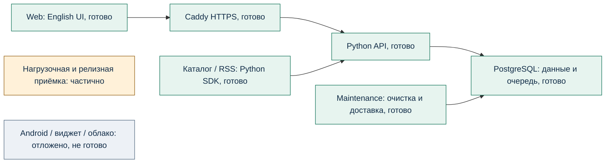

# MarkeTOB: текущий статус на 25 октября 2026

Дополнительная презентация по прямому запросу владельца. **19/24 задач пилота
принято, после G04 выполнено 3/4.** Обзор не закрывает G05 и не прибавляет PM-задачу.
Результаты CI, аудита и проверки установленной версии относятся к 24 октября.

[PowerPoint, 13 слайдов](MarkeTOB-status-2026-10-25.pptx) ·
[PDF для просмотра](MarkeTOB-status-2026-10-25.pdf) ·
[Вопросы](questions.md) · [Ответы](answers.md).

Текст, таблицы и схемы редактируются в PPTX. PDF содержит изображения тех же
слайдов, его текст не предназначен для редактирования или поиска. Источники
каждого слайда находятся в заметках докладчика и в пояснениях ниже. Экранные
примеры используют демонстрационные данные из ранее опубликованных проверок.

## Что уже работает

Локальный Web объединяет новости, товары и графики разных ботов. B2C пользователь
сохраняет каналы в Favorites, собирает My Space, меняет порядок и представление
блоков. Изменения сохраняются автоматически, Undo создаёт новую версию.
Request purchase передаёт заявку на одну единицу и показывает ответ бота.
Оплаты в пилоте нет.

B2B пользователь управляет ботами и страницами в Studio. Роли Owner, Admin,
Editor разграничивают команду, ключи, доступ, оформление и публикацию.
У каждого бота индивидуальные ключи. Каталог и RSS-бот используют общий Python SDK
и HTTP-контракт, который можно реализовать в стороннем сервисе.

Обмен передаёт оформление и ссылки на источники. Получатель импортирует
независимую копию, доступ к закрытым данным проверяется отдельно.
Открытый Web получает изменения через polling каждые 2 секунды. Events работает
внутри приложения. Фоновый push остаётся отложенным.

Последние изменения добавили JSON-экспорт личных данных, передачу владения
workspace и удаление аккаунта с паролем и `DELETE`. Владелец сначала передаёт
workspace активному Admin. Экспорт не содержит bot keys, чужие записи или
содержимое источников. Внешние копии и резервные копии оператора удаление
аккаунта не стирает.

## Пояснения к слайдам и доказательства

| Слайды | Содержание | Проверяемые источники |
| --- | --- | --- |
| 1–2 | Границы обзора и 19/24 | [STATUS](../../STATUS.md), [план](../../ROADMAP.md), [G05](../G05.md) |
| 3 | B2C, My Space и заявка | [PM-016](../../task-results/PM-016.md), [PM-010](../../task-results/PM-010.md), [фактический снимок](../../task-results/assets/PM-016/space-preview.png) |
| 4 | Studio, роли, боты | [PM-014](../../task-results/PM-014.md), [роли](../../adr/0009-workspace-roles.md), [передача владения](../../adr/0017-personal-data-and-transfer.md), [SDK и боты](../../setup/PILOT_BOTS.md) |
| 5 | Обмен и локальные обновления | [PM-017](../../task-results/PM-017.md), [PM-018](../../task-results/PM-018.md) |
| 6 | Экспорт и удаление | [результаты D46](../../task-results/PM-023-account-privacy.md), [снимок установленного Web](../../task-results/assets/PM-023/dependencies/deployed-privacy.png) |
| 7 | Компоненты локальной системы | [ADR поставки](../../adr/0014-local-delivery.md), [ADR обновлений](../../adr/0013-live-updates.md) |
| 8–9 | Компоненты, сущности, отзыв доступа | [backend](../../../apps/api/src/marketob_api), [access_changes.py](../../../apps/api/src/marketob_api/access_changes.py), [результат исправления](../../task-results/PM-023-queue-fix.md) |
| 10 | CI, установленная версия, restore | [CI](https://github.com/Villentretermert/ProjectMarket/actions/runs/40128462069), [итог CI](../../task-results/assets/PM-023/dependencies/ci-results.json), [поставка](../../task-results/assets/PM-023/dependencies/local-delivery.json), [Web](../../task-results/assets/PM-023/dependencies/deployed-browser.json) |
| 11 | Изменения зависимостей | [сравнение](../../task-results/assets/PM-023/dependencies/comparison.json), [отчёт](../../task-results/PM-023-dependencies.md) |
| 12–13 | Оставшиеся задачи и следующий порядок | [PM-019](../../tasks/PM-019.md), [PM-020](../../tasks/PM-020.md), [PM-022](../../tasks/PM-022.md), [PM-023](../../tasks/PM-023.md), [PM-024](../../tasks/PM-024.md), [передача пилота](../../setup/PILOT_HANDOFF.md) |

## Система и ключевой код

Backend, контракты, SDK и боты написаны на Python. Web runtime использует
JavaScript/CSS. `identity.py` и `teams.py` отвечают за пользователя, workspace и
роли. `ingestion.py` и `channels.py` принимают сообщения бота и строят snapshots.
`actions.py` и `request_state.py` хранят заявку, событие и результат.
`personal_pages.py` и `sharing.py` управляют личным оформлением и его копиями.

`access_changes.py::invalidate_access` меняет общий delivery marker в той же
транзакции, что и права. Клиенты перечитывают snapshots с актуальной проверкой
доступа. Отзыв больше не зависит от свободных мест очереди уведомлений.
Дополнительные чтения после общего resync остаются предметом полной L2-проверки.

## Что подтверждено проверками

- CI `40128462069` на runtime `9afe3ec`: **90 unit + 110 integration = 200 Python
  tests**, **54 Chromium scenarios**, все 4 jobs успешны. Повтор unit на двух ОС
  не увеличивает число уникальных тестов.
- Локальная поставка `9afe3ec`: Python 3.14.9, PostgreSQL 18.6, Caddy 2.11.7.
  Последняя проверка 24 октября подтвердила 4 healthy-сервиса, HTTPS и существующий
  demo Web: вход, My Space, Live, privacy, экспорт, выход.
- Перед обновлением проверено восстановление из PostgreSQL 18.4 в отдельную 18.6:
  **29 таблиц и 10 sequences совпали**. Исходная БД сохранена.
- Снимок Trivy от 24 октября: в трёх основных образах Critical-строки сократились
  с **28 до 6**, High с **280 до 163**. Отдельный bot image в эту сумму не входит.
  Строки относятся к сочетаниям package/version/advisory и могут повторять CVE.
  Это не число подтверждённых атак.
- В proxy/БД остаются **32 High/Critical с указанной исправленной версией**.
  Требуются разбор применимости и проверяемое обновление. Отсутствие известных
  advisory у 57 Python и 3 Node pins не означает готовность всех образов.

## Что остаётся

| Задача | Фактическое состояние | Оставшаяся приёмка |
| --- | --- | --- |
| PM-019 | deferred | APK/AAB, локальный вход и реальные Android-проверки |
| PM-020 | deferred | Новостной домашний виджет |
| PM-022 | in_progress | Полный 30-минутный L2 с 100 клиентами на свободном компьютере |
| PM-023 | in_progress | Остаточные риски зависимостей, notices, native/полная релизная проверка |
| PM-024 | in_progress | Сквозная приёмка Web/Android и передача владельцу |

Цели 100 ботов, 10 000 MAU и до 1 000 сообщений/минуту сохраняются как плановый
масштаб. Они не объявляются подтверждённой производительностью полной системы.
Google/Firebase, облако и полный L2 остаются отложенными решениями владельца.
iOS и Windows входят в последующий этап развития.

Ближайший технический приоритет: оставшиеся зависимости, затем проверка
локального сценария владельцем. Android и полный L2 возобновляются отдельно.
После следующей полноценной приёмки PM-задачи наступит формальная G05.

## Продолжение

После презентации задаются 12 отдельных [вопросов](questions.md) согласно пункту 7
[регламента](../../WORKING_AGREEMENT.md). Они уточняют дальнейшие приоритеты,
не отменяя уже согласованных решений. Следующая задача в рамках этого обзора
не начинается. Ответы или явное разрешение продолжить с допущениями фиксируются
в [answers.md](answers.md).

Для воспроизведения PPTX используется
[build_status_20261025.mjs](../../../scripts/build_status_20261025.mjs) с bundled
Node/Python и `@oai/artifact-tool`. Проверены все 13 финальных слайдов и PDF-страниц.
Проверка внутри Microsoft PowerPoint не проводилась.
