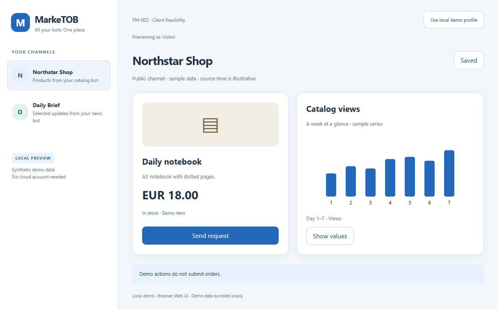
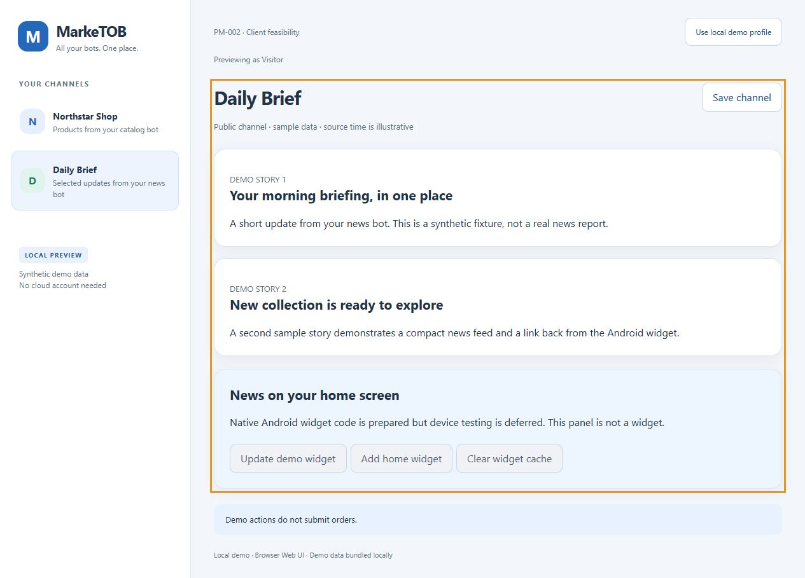
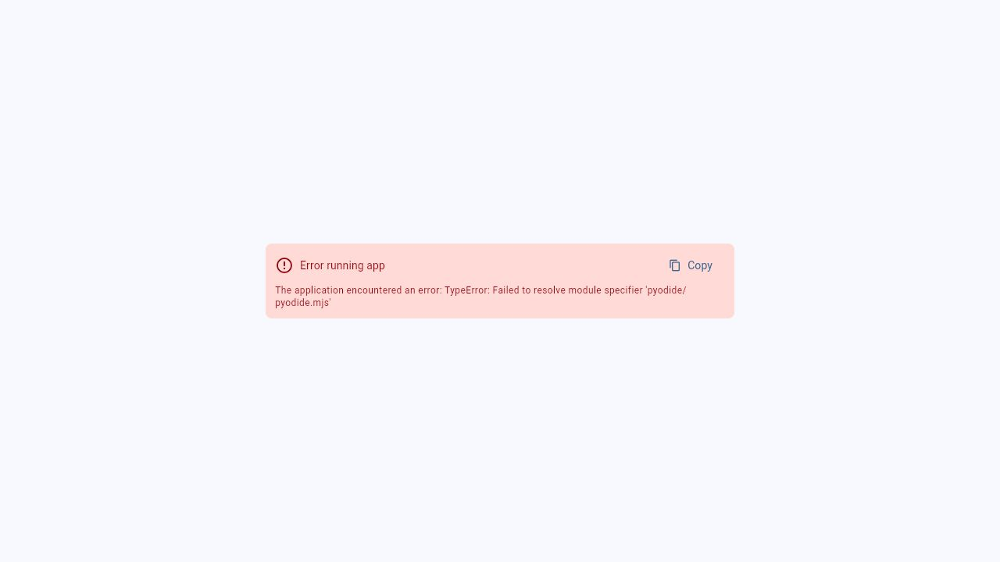

# PM-002 — Результат проверки Web-стека

21 октября 2026. **Завершена в уточнённом Web-объёме.** Android-сборка и телефон отложены прямыми ответами владельца; первоначальная native-проверка не пройдена и перенесена в PM-019/020. Счётчик: 2/4 до G01.

Код и материалы: [commit 1702ec4](https://github.com/Villentretermert/ProjectMarket/commit/1702ec401e6a74e730902aaa4b3cb00d614a0118).

## Результат

Выбран семантический HTML/CSS/JavaScript Web runtime; Python — backend, схемы, SDK, боты и проверки. Подготовлены [ADR клиента](../adr/0001-client-stack.md), [ADR backend](../adr/0002-local-backend.md), два воспроизводимых spike и инструкция отложенной Android-проверки. Основное приложение/API пока не реализованы.

Компоненты:

- `spikes/client-flet/src/demo_model.py`: публичные fixtures, allowlist маршрутов и ограниченный формат настроек.
- `spikes/client-flet/src/main.py`: Python UI, маршруты, избранное, переключение графика; динамический Web transport.
- `spikes/client-web-native/web/app.js`: семантические карточки, SVG/таблица, навигация, сохранение предпочтений, demo-профиль.
- `web/sw.js`: кеш только публичной оболочки, offline fallback; без кеширования API/приватных данных.
- `android/…/NewsWidgetPlugin.java`, `NewsWidgetProvider.java`: подготовленный нативный мост и RemoteViews; **не компилировались и не проверялись**.

## Фактические проверки

| Проверка | Результат / граница доказательства |
|---|---|
| Traceability PM-001 после изменения scope | PASS: 30 требований, 16 историй, Q01–Q17 покрыты; не продуктовые тесты |
| `pytest spikes/client-flet/tests -q` | PASS: 14 тестов маршрутов, повреждённых/неподходящих настроек и roundtrip |
| `pip check` текущего spike-окружения | PASS; Flet закреплён с FastAPI 0.135.1 / Starlette 0.50.0 |
| `npm ci`, `npm run build` | PASS из package-lock, Node 24.20.0, npm 11.19.0; Capacitor 8.4.3, esbuild 0.28.2 |
| `npm audit` | 0 findings у выбранного lock на дату проверки; не полный security audit |
| Динамический Flet в браузере | Каталог/график, выбор values, Saved и восстановление после reload: PASS |
| Статический Flet build | FAIL: Dart hooks / package_config root; исправление путей SDK не устранило все ошибки |
| Статический `flet publish --no-cdn` | Артефакт создан; runtime FAIL: `Failed to resolve module specifier 'pyodide/pyodide.mjs'` |
| HTML/JS в браузере | Каталог, новости, demo Pending, demo profile, chart/table, Saved, reload: PASS |
| Web на ширине 360px | Проверен каталог/новости; горизонтального переполнения нет (document width и scrollWidth 345px при полосе прокрутки); сохранён снимок |
| Клавиатура / базовая семантика | Tab→Enter на Skip to channel переводит фокус в content без поломки hash route; AX видит headings/buttons/table. Полный screen-reader audit не выполнен |
| Offline-проверка | Тестовый HTTP-сервер остановлен; reload восстановил оболочку, Saved и график; переход в news с актуальным текстом PASS. Проверено повторно после изменения кеша |
| Android APK/AAB, настоящий widget | DEFERRED владельцем; SDK-лицензии не приняты, APK не существует |
| Google/FCM | DEFERRED: текущий пилот без облачных сервисов |

`flet publish` дал 86 файлов / 76 291 446 байт на диске; HTML/JS spike — 4 файла, примерно 21 KB. Это размеры артефактов, не network transfer/APK и не benchmark времени старта. У Flet generated worker также устанавливает Python requirements через micropip: no-CDN флаг сам по себе не доказывает полностью локальные зависимости.

## Визуальные доказательства

Это технический spike, не финальный дизайн PM-003. Данные синтетические; кнопка Send request не вызывает бота и не оплачивает товар. Demo profile не является авторизацией. Private cache/TTL и бизнес-цикл ещё не реализованы.

## Дальнейший порядок

PM-003 — полный адаптивный UX/состояния, PM-004 — Bot API и UI schema. После них G01. Android evidence gate возвращается перед PM-019/020; завершение этого Web-этапа не снимает его. Docker/БД/реальный backend не запущены.
