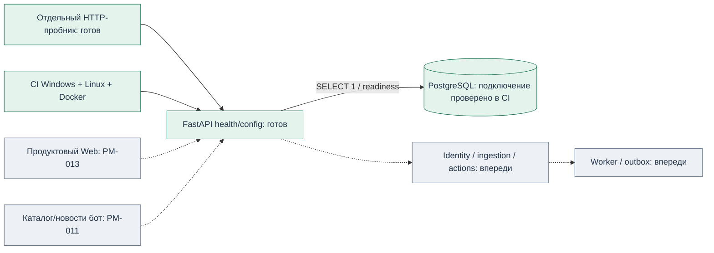

# PM-005 — результат каркаса, окружения и CI

22 октября 2026 · **done** · 5/24 задач пилота; 1/4 до G02.

## Что изменено

Создан Python workspace с API factory, CLI, типизированной конфигурацией и двумя
health endpoints. `/health/live` проверяет процесс, `/health/ready` выполняет
`SELECT 1` в PostgreSQL; без конфигурации или при отказе базы возвращает 503.
Результаты не содержат DSN или пароль. Обычный запуск и unit-тесты не требуют
секретов. Runtime OpenAPI не объявляет проектные v1-маршруты готовыми.

Контракт PM-004 перенесён в `packages/contracts`, namespace `contracts` сохранён;
25 сценариев и JSON-артефакты неизменны. `apps/client`, `packages/bot-sdk`,
`bots/examples` разделяют будущие процессы. Connectivity probe проверяет HTTP,
но не выдаётся за реализованный бот.

Dockerfile собирает только API из lockfile; контейнер непривилегированный.
Compose содержит API + PostgreSQL с volume и loopback-портом API, без порта БД
на хосте. Генератор `.env` не печатает пароль и не перезаписывает существующий файл.
В CI есть Windows/Linux проверки Python и отдельный Linux Compose startup,
проверка недоступности/возврата БД, restart API и минимального runtime.

Компоненты и команды: [LOCAL_DEVELOPMENT](../setup/LOCAL_DEVELOPMENT.md).
Причины решений: [ADR-0004](../adr/0004-workspace-and-ci.md).

## Проверки

- Windows / Python 3.14.7: 39 passed, 1 skipped (не задана отдельная PostgreSQL
  для необязательного integration-теста), без предупреждений.
- Ruff lint/format — PASS; mypy strict — PASS, 12 файлов.
- Startup установленного пакета из пустой директории и отдельный HTTP-пробник — PASS;
  live=200, ready=503/not_configured. Остановка Windows process tree проверена.
- uv pip check для .venv-dev — PASS: 49 установленных пакетов совместимы.
- Чистый git archive коммита 19a906b без .env/venv: uv sync --locked, настоящий
  HTTP startup и проверка зависимостей — PASS.
- Первый Docker CI — PASS, включая отказ/возврат PostgreSQL и restart API.
  Python CI выявил импорт scripts при console-entrypoint pytest; исправлен
  явным pythonpath в pytest configuration, 39 тестов этой командой локально
  прошли. Повторный [полный CI](https://github.com/Villentretermert/ProjectMarket/actions/runs/39788405723)
  завершился успешно: Windows, Linux, Docker/PostgreSQL. На обеих ОС —
  39 passed / 1 deselected, lint/format/mypy и HTTP smoke PASS.
- [Машинный отчёт](assets/PM-005/verification.json) и [выдержки CI](assets/PM-005/ci-excerpts.txt).
  Реализация: [19a906b](https://github.com/Villentretermert/ProjectMarket/commit/19a906b99f492e29400812b43c5442f46cfb29ec),
  финальное исправление: [d4a24d8](https://github.com/Villentretermert/ProjectMarket/commit/d4a24d8c7c65be1d1422577c45ec62fc8b7c7030).

## Границы результата

Docker на компьютере владельца отсутствует. Linux CI и прямой локальный Python
имеют разные доказательства; контейнерный прогон не означает, что Docker здесь
установлен. Нет миграций/таблиц продукта, auth, ingestion, очереди/worker,
продуктового клиента, APK или замеров нагрузки. Это последующие PM-задачи.
Макет PM-003 не изменён и не подключён к API.

G01 завершена по явному указанию владельца «Отлично, приступай к следующей задаче».
Допущения сохранены отдельно от ответов. По новому указанию владельца «отлично, приступай к следующим задачам»
далее последовательно выполняются PM-006–008. После них обязательна G02.

## Системная схема текущего шага

Зелёный означает выполненный **указанный** объём, а не готовность продукта или
проверку бизнес-транзакций. Существующий UX-прототип остаётся отдельным demo.
