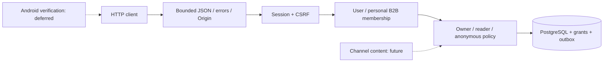

# PM-006 — локальные аккаунты и доступ

22 октября 2026 · **in_progress: контейнерная/CI проверка**.

## Реализовано

- PostgreSQL миграции: users, sessions, organizations/memberships, channel_access,
  grants, rate windows, change outbox и сгенерированный ключ курсоров.
- Регистрация/вход Argon2id, 24-часовая opaque session, точный Origin/CSRF, logout,
  самостоятельный личный B2B-профиль, точный username lookup, grants и курсоры.
- Общие политики owner/read внутри транзакции; B2C/чужой B2B не получает управление
  объектом через подставленный ID или read grant. Логическая деактивация отзывает
  все сессии и доступ, убирает пароль/имя; username остаётся зарезервированным.
- Безопасный Error envelope/no-store, проверка JSON/размера/кодировки, CORS,
  PostgreSQL rate limits. Созданы реальные HTTP smoke и integration CI.
- Аддитивный контракт 1.0.1: 67 схем / 48 плановых операций. Bot API/контент пока
  не реализованы; runtime OpenAPI этого не обещает.

[Английское API-описание](../api/IDENTITY.md) · [ADR-0005](../adr/0005-local-identity.md).

## Доказательства

- Windows / Python 3.14.7 / PostgreSQL 18.6: **58 passed**, 12.03s, без skip.
  Включает 25 контрактных сценариев, 47 unit/contract и 11 PostgreSQL checks.
- Неверный пароль/несуществующий user, forged/expired/other-origin session,
  logout replay, CSRF/cookie flags, rate counters после нового API instance,
  подстановка роли/tenant, owner-reader-anonymous policies, grant revoke,
  подписанный cursor и account deactivation проверены.
- Отдельный API-процесс на 127.0.0.1:8001 с временной схемой: настоящий HTTP
  register → session → business profile → bad CSRF → logout → 401 → login →
  deactivation — PASS. После smoke процесс и только созданная схема убраны.
- Lint/format/strict typing и полный CI будут зафиксированы после финального прогона.

## Компоненты и ограничения

`database.py` открывает транзакцию; commit происходит до success-ответа.
`identity.py` обрабатывает verifier, CSRF, текущего пользователя и квоты.
`access.py` — единая политика owner/read; `auth_routes.py` связывает её с HTTP.
`migrate.py` фиксирует SQL атомарно и проверяет checksum; `cursors.py` проверяет
подпись, session binding и expiry. `transport.py` ограничивает и валидирует тело.

Доступ к контенту проверен на synthetic access records в реальной БД; создание
каналов/публикация/read snapshot HTTP остаются следующими задачами. Нет командных
организаций, email invitations/recovery или доказанного Android token storage.
Google/Firebase отложены. Удаление аккаунта логическое, не физическое стирание
всех исторических записей. Обработка pending actions при revoke добавляется в
PM-010 до включения этих actions. UI-прототип не изменён; продуктовый клиент позже.

Docker локально не установлен. Переносимая PostgreSQL находится только в `.local`,
без системной службы, на loopback:55432; credentials не публикуются. CI проверяет
отдельно PostgreSQL 18.4 в контейнере. Следующая задача — PM-007.
