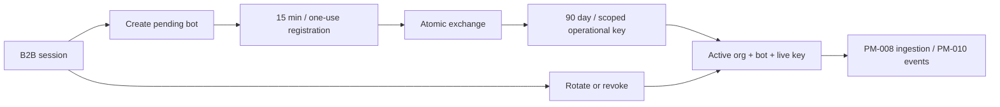

# PM-007 — индивидуальная регистрация ботов

22 октября 2026 · **done** · commit `ab48d25`.

Созданы bots, bot_registrations и bot_keys; channel_access получил связь с ботом.
Self-service B2B создаёт pending bot, одноразовый bootstrap активирует его и выдаёт
рабочий ключ. Регистрационный код 15 минут, ключ 90 дней; в БД только SHA-256
verifier и prefix. Ключи можно сужать по scopes, вращать без overlap и отзывать.
Состояние/last_seen доступны владельцу, секреты повторно не выдаются.

`bot_identity.py` проверяет organization → bot → key в едином порядке блокировок.
`bot_routes.py` реализует registry/обмен/inventory и выдачу ключей. Личный B2B
профиль PM-006 остаётся единственным источником ownership. [API guide](../api/BOT_REGISTRATION.md).
Контракт 1.0.2: 69 схем / 50 плановых операций; добавлены BotDetails/BotIdentity.

Локально Windows/Python 3.14.7/PostgreSQL 18.6: **64 passed**, 23.28s, без skip.
Из них 6 новых интеграционных сценариев: self-service/hash/no-secret-inventory,
чужие bot/channel/key, scopes/rotation, bootstrap expiry/renewal/type confusion,
двойной конкурентный обмен (ровно один успех), bot/account revoke, курсоры/квоты.
Strict mypy: 28 файлов PASS; lint/format PASS. [CI](https://github.com/Villentretermert/ProjectMarket/actions/runs/39797711564): все четыре jobs PASS, включая PostgreSQL и Docker HTTP smoke. Финальное уточнение validation проверено 31 связанным тестом. [Доказательства](assets/PM-007/verification.json).

API интерфейс есть, экран Studio пока прототип. Очередь actions и обработка
незавершённых действий после отзыва появятся PM-010, до включения таких действий.
Нагрузочную цель 1 000 сообщений/мин эта задача не подтверждает.
