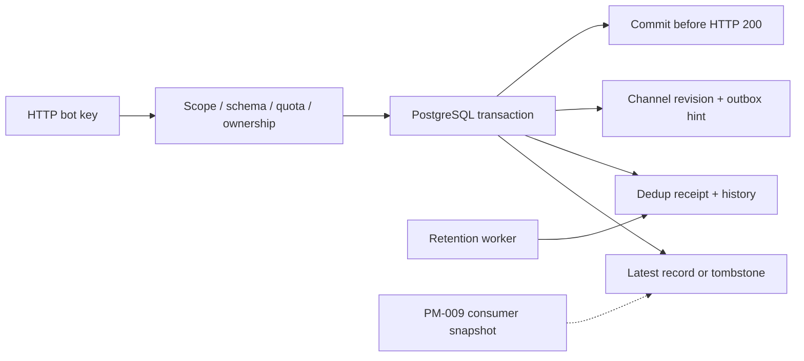

# PM-008 — приём и хранение сообщений

22 октября 2026 · **in_progress: CI приёмка**.

Работают POST /v1/channels для owned draft и POST /v1/bot/messages для text/data/
event/delete. News/product/chart проверяются канонической схемой; размеры, типы,
валюта и порядок точек ограничены. Реализованы bot-scoped idempotency, monotonic
source revisions, tombstones, server channel revisions и атомарный outbox.

В миграции: channel_content, source_records, message_receipts, ingest_history,
rate_buckets и дополнительные идентификаторы change_outbox. `ingestion.py` проводит
проверки и единую транзакцию; `payloads.py` использует пакет схем, `quotas.py` —
durable token buckets. `maintenance.py` удаляет raw history старше 7 дней и
квитанции старше 30 дней, сохраняя актуальные записи и tombstones.

[Английский API guide](../api/INGESTION.md) · [ADR-0006](../adr/0006-bot-ingestion.md).

## Проверки

- 9 новых PostgreSQL сценариев PASS (17.52s): дубли/key order/numeric conflict,
  новая API instance, stale/delete/recreate/event, типы/границы, другой бот того же
  владельца, scopes и revoke-before-replay, concurrent duplicate/upsert, rollback,
  retention, durable aggregate/per-bot quotas, draft ownership/slug conflict.
- Искусственный trigger failure при INSERT outbox откатил снимок, квитанцию,
  историю и channel revision. Повтор с прежним message_id после снятия сбоя принят.
- Первый полный прогон: 72 PASS + 1 устаревшее ожидание отсутствия нового route.
  Ожидание исправлено: POST messages реализован, GET events ещё нет. Повторная
  связанная проверка: 23 PASS. Итоговый CI подтверждает общий набор отдельно.
- Настоящий API-процесс на Windows: identity/bot lifecycle HTTP PASS; 100 сообщений
  от 4 ботов, 4 одновременных клиента, 3.384s, **29.55 req/s**, p95 **222.53ms**, 0 errors.
  [Замер](assets/PM-008/ingestion-burst.json). Тело новости 512 ASCII символов.
- После реального завершения процесса API и нового запуска: прежняя квитанция
  идентична, изменённое тело даёт 409, отозванный ключ — 401. Maintenance --once PASS.
- Ruff/format PASS; strict mypy 34 файла PASS. Docker/CI фиксируются после завершения.

## Границы

Замер короткий и синтетический; он не доказывает длительные 1 000 сообщений/мин,
10 000 MAU, клиентский live SLO или backup recovery. Docker на этом компьютере
не установлен; контейнеры проверяются CI. Portable PostgreSQL и временный HTTP API
используются локально, тестовая схема и API-процесс после проверки удалены.

UI не менялся: PM-003 остаётся визуальным прототипом. Публикация/чтение PM-009,
actions/GET/ACK/result PM-010, SDK/пилотные боты PM-011. Физическое удаление всех
данных аккаунта и backup retention пока не реализованы. Maintenance надо запускать
для физической очистки истории; Compose включает его автоматически.

После приёмки PM-008: обязательная G02 и отдельные вопросы до PM-009.
