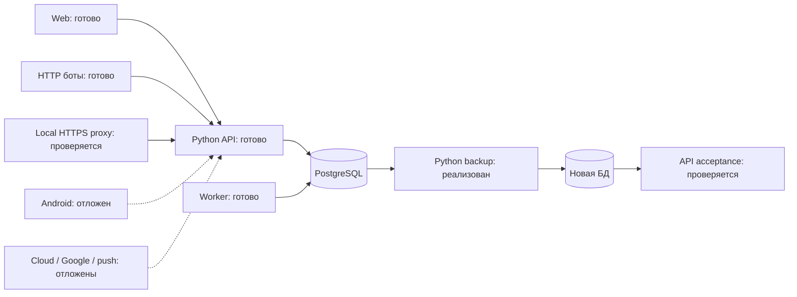

# PM-021 · Локальная поставка и восстановление

В работе, 23 октября 2026. Владелец разрешил локальную поставку при отложенном
Android. Завершённость задачи пока не заявляется.

Реализованы Python backup/verify/restore, Compose overlay с локальным HTTPS,
restart/resource bounds, image tags и сменой DB name. Readiness проверяет
миграции; старый release отказывается мигрировать более новую БД.

Компоненты: `scripts/backup.py`, `scripts/smoke_delivery.py`,
`deploy/compose.local.yaml`, `deploy/Dockerfile.proxy`, `deploy/Caddyfile`,
`marketob_api/health.py` и `migrate.py`. Runtime API/worker/ботов остаётся Python;
новый клиентский UI не добавляется. Схема операций показана владельцу перед кодом.

Промежуточно: 31 затронутый тест PASS; полный прогон 152 PASS/1 FAIL из-за
старого readiness-теста без миграций. Он переведён на изолированную мигрированную
схему. Финальные проверки и CI будут добавлены после завершения.

В Windows PATH Docker отсутствует, но обнаружен работающий Docker28.1.1 /
Compose2.35.1 в существующей Ubuntu WSL3.0.3. Запущена проверка отдельного проекта
`marketob-pm021`; существующие контейнеры других проектов не изменяются.

[Локальный runbook](../setup/LOCAL_DELIVERY.md) ·
[Backup/restore](../setup/BACKUP_RESTORE.md) · [ADR](../adr/0014-local-delivery.md).
