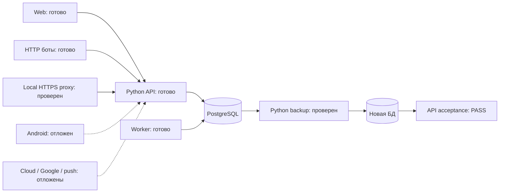
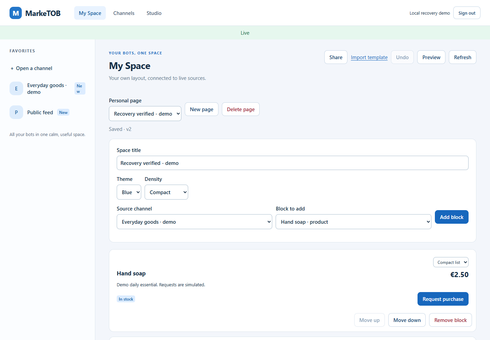

# PM-021 · Локальная поставка и восстановление

**Принята 23 октября 2026.** Код **c62c630**.
[GitHub CI](https://github.com/Villentretermert/ProjectMarket/actions/runs/39948316689):
все 4 jobs PASS, **153 теста** (72 unit + 81 integration), **47 Chromium сценариев**.
Локальный Docker внутри Ubuntu WSL проверен на компьютере владельца.
Всего завершено **19/24**, после G04 **3/4**. Android отложен; G05 ещё не требуется.

Реализованы Python backup/verify/restore, Compose overlay с локальным HTTPS,
restart/resource bounds, image tags и сменой DB name. Readiness проверяет
миграции; старый release отказывается мигрировать более новую БД.

Компоненты: `scripts/backup.py`, `scripts/smoke_delivery.py`,
`deploy/compose.local.yaml`, `deploy/Dockerfile.proxy`, `deploy/Caddyfile`,
`marketob_api/health.py` и `migrate.py`. Runtime API/worker/ботов остаётся Python;
новый клиентский UI не добавляется. Схема операций показана владельцу перед кодом.

## Доказательства

| Проверка | Фактический результат |
|---|---|
| Native PostgreSQL18.6 | 31 затронутый тест PASS; полный прогон 152 PASS/1 FAIL из-за старого readiness-теста без миграций; исправленный тест и связанная область: 16 PASS |
| Финальный CI | Ubuntu/Windows unit72, PostgreSQL integration81, Chromium47 — PASS |
| Новые tests/test_backup.py | 2 unit + 4 PostgreSQL: credentials вне argv, отказ до обращения к БД, полный API restore, overwrite/corruption/schema guards, atomic failed restore, failed migration/old-release rejection |
| Windows → Ubuntu WSL | WSL3.0.3, Docker28.1.1, Compose2.35.1, PostgreSQL18.4 image; проект marketob-pm021 |
| Чистая Docker сборка/запуск | API/DB/worker/proxy healthy, migrate exited0; существующие сторонние контейнеры не изменены |
| HTTP/HTTPS | Web assets, ready/live, цепочка CA, регистрация/session/Secure cookie и деактивация — PASS |
| Отдельные Python-боты | 4 catalog records, 6 news/chart records; confirmed/failed, restart, cross-bot denial, private-source denial — PASS |
| Backup/restore | 94 080-byte archive; SHA-256, новая marketob_recovered; исходная marketob сохранена |
| HTTP после переключения | Replay квитанции, конфликт, отозванный ключ, pending/ACKed заявки, confirmed/failed, dedup/status — PASS |
| Restart после restore | API/worker перезапущены, health/Web PASS; закреплён и запущен тот же image с тегом c62c630 |
| Дополнительный Edge preview | Вход, заполненная My Space, Live indicator, desktop1440/mobile390 — PASS |
| Статические проверки | Ruff check/format, mypy74 файлов, requirements validator и credential-pattern scan — PASS |

Source/restored совпали: **4 users, 7 bots, 15 records, 111 receipts,
4 requests, 122 outbox, 10 migrations**.
[Машиночитаемая сверка](assets/PM-021/restore-counts.json).
Native API test дополнительно сравнивает private grants, favorites/preferences,
My Space snapshot, share preview, bot key/receipt replay, confirmed request,
восстановленную сессию/cursor и возрастающий delivery ID после новой записи.

При первой сборке Caddy не запускался под `cap_drop: ALL`: upstream binary имел
file capability для привилегированного порта. Ненужная capability удалена при
сборке; порт8443 остаётся непривилегированным. Повтор и CI PASS.
Ошибки подготовительных fixture/preview-скриптов исправлены до приёмки;
они не обозначаются как продуктовые сбои.

В Windows PATH Docker отсутствует, но обнаружен работающий Docker28.1.1 /
Compose2.35.1 в существующей Ubuntu WSL3.0.3. Поставка проверена в отдельном проекте
`marketob-pm021`; существующие контейнеры других проектов не изменены.

## Фактический вид

Это работающий Web из Docker, подключённый к восстановленной БД. **Синтетические
demo-источники для снимка добавлены после restore**; сохранность прежнего My Space
доказана отдельным API test. Android-приложение по mobile viewport не заявляется.

[Полный desktop](assets/PM-021/docker-recovered-desktop.png) ·
[Mobile Web](assets/PM-021/docker-recovered-phone.png).

## Границы и продолжение

Стенд оставлен работающим на `http://127.0.0.1:19000/app/`; это отдельный пилот с
demo-данными. Свой аккаунт создаётся через Create account. Приватный env,
архив и bot state лежат только в `.local/pm021`; исходная БД/volumes сохранены.

Backup не зашифрован и содержит приватные данные. Он не копирует внешние bot state,
env, CA и роли кластера. Расписание/ротация, PITR и automatic disaster cutover не
реализованы. Возврат backup после новых записей потеряет их; runbook разрешает
planned rollback только до возобновления записи. Disaster recovery требует сверки
последующих отзывов доступа и уже выполненных внешних действий.

Docker сообщил, что в текущем WSL недоступен swap accounting: RAM limits работают,
лимит swap не доказан. L2/burst/noisy-tenant/monitoring остаются **PM-022**;
100-message smoke не считается нагрузочной приёмкой. После PM-022 будет 20
завершений, обязательная G05 и минимум10 отдельных вопросов.

[Локальный runbook](../setup/LOCAL_DELIVERY.md) ·
[Backup/restore](../setup/BACKUP_RESTORE.md) · [ADR](../adr/0014-local-delivery.md).
