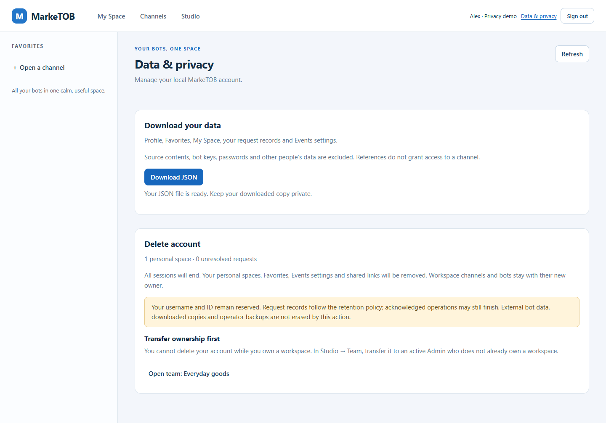

# PM-023 · Личные данные и передача workspace

24 октября 2026. Независимая Web/API-часть, ответы D46 выполнены в исходниках.
Полная PM-023 остаётся in_progress: Android/виджет, Google/Firebase, L2 и G05 не
подменяются этими проверками. Счётчик19/24.

## Поведение

- Data & privacy скачивает один JSON: профиль, Favorites, активные My Space,
  собственные request records и Events. Секреты, чужие записи, source payloads и
  bot summaries исключены; ссылки не дают доступа к каналу.
- Owner обязан передать workspace действующему Admin. Studio показывает
  получателя и последствия, требует пароль. Прежний Owner становится Admin,
  workspace/каналы/боты/ключи продолжают работать. Сохраняется один собственный
  workspace на аккаунт; получатель с другим workspace получает409.
- Удаление требует пароль и точное DELETE в Web и API. При наличии собственного
  workspace сервер отклоняет запрос409. После подтверждения удаляются личная
  настройка/ссылки/сессии; сохраняются username/ID tombstone и request records
  согласно прежним reconciliation/retention. Внешние данные/backups не стираются.

## Компоненты и контракт

`privacy.py` — явные проекции и deletion preview; `teams.py` — атомарная передача;
`auth_routes.py` — guarded deletion и очистка; `web/privacy.js` — выгрузка и
двойное подтверждение; `studio.js` — передача. Marker ADR-0016 остаётся в той же
транзакции. Миграции не менялись, уникальные ограничения существующей схемы
сохраняют одного Owner. [ADR-0017](../adr/0017-personal-data-and-transfer.md),
[API](../api/PRIVACY.md), [политика данных](../privacy/DATA_POLICY.md).

Контракт1.1.0:96 schemas,67 operations. Требование confirmation и owner409 —
явное изменение клиентского контракта; Bot API/wire1.0 сохраняется.
Export requests/Events постраничный с session-bound cursor и верхней sequence,
TTL10мин. Файл собирается только после всех страниц; Web до50MiB, большие выгрузки
через API. Это живые чтения, не point-in-time backup. Undo хранится в клиенте и
не заявляется серверной историей экспорта.

Тестовые владельцы больше не деактивируются для cleanup: scripts.smoke_* отзывают
их ботов и завершают сессию. Синтетические owner/workspace строки остаются до
удаления disposable схемы/CI volume. Worker по-прежнему проверяется на legacy
данных с выключенными workspace, созданных до D46.

## Проверки

- Полный локальный pytest:187 PASS,4 skipped,169.22с. Пропуски — backup/restore,
  требующие Docker; они обязательны в CI. Известное предупреждение Pydantic об
  alias в тестовой генерации схем сохранено, тесты проходят.
- Семь новых PostgreSQL-сценариев: экспорт без чужих данных, cursor binding и
  верхняя граница, неверное подтверждение/CSRF/password, физическая очистка,
  owner guard + transfer/delete при полной очереди, роли/неподходящий получатель,
  гонка transfer/delete и rollback marker. Ответы дополнительно валидируются
  canonical schemas:7 PASS после обновления контракта.
- Contract package:25 PASS. Ruff/format/mypy90 PASS.
- Целевой реальный Edge:5 новых privacy scenarios PASS. JSON реально скачан и
  разобран; прерванная выгрузка не скачивает частичный файл; передача, неверный
  пароль, DELETE, Cancel, удаление и доступ нового владельца проверены.
- Полный Edge Web/API/2 bots:54 scenarios PASS, page_errors=[];
  [browser JSON](assets/PM-023/account-privacy/browser-results.json).
- CI: результат добавляется после публикации commit.

Первый локальный запуск ошибочно пропустил БД из-за неверного имени поля private
connection file. Затем песочница блокировала loopback TCP; запуск с разрешённым
доступом к уже работающей тестовой БД решил это. Эти попытки не считаются PASS.
В новом rollback-тесте ожидание503 исправлено на фактический500 для искусственного
RAISE EXCEPTION. Contract check потребовал descriptions для новых полей — добавлены.
Browser выявил ожидания временного общего скрытия источников и слишком широкий
селектор роли; ожидания уточнены. Ошибочный h3-селектор товара заменён на h2.
Cancel проверяется после события close, когда поле пароля очищено. Эти ошибки
проверок сохранены в журнале, не выдаются за успешные прогоны.

## Дизайн и поставка

[Макет](../design/PM-023-privacy.md) показан до разработки. Реальный экран использует
существующие компоненты и плотность; owner guard вынесен в отдельный блок со ссылкой
на Team, финальное удаление — в dialog. Ширина360px проверена без горизонтального
overflow. Фактические снимки:

[Экран360px](assets/PM-023/account-privacy/privacy-owner-phone.png) ·
[Передача](assets/PM-023/account-privacy/privacy-transfer.png) ·
[Подтверждение удаления](assets/PM-023/account-privacy/privacy-delete.png).

Рабочий Docker6b3ffb5 пока не обновлялся. Полная приёмка приложения, Android,
облако, полный L2 и ручная приёмка владельцем этим результатом не выполнены.
