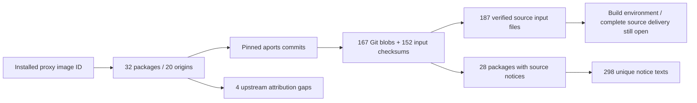

# PM-023 · исходники и лицензии Alpine

3 ноября 2026. Продолжение [первого сбора уведомлений](PM-023-licenses-20261103.md).
Задача PM-023 остаётся открытой, счётчик 19/24, после G04 3/4.

## Результат

Для 32 Alpine binary packages найдены точные 20 source origins. Коммиты aports
взяты из установленного proxy image 68958f1. Все 167 файлов каталогов aports
сверены с Git blob IDs, все 152 входа из checksum tables — с SHA-512 рецептов.
Версии `pkgver/pkgrel` сверены с package inventory. Скрипты APKBUILD не запускались.

Собраны уведомления для 28 пакетов. [Обновлённый набор](../../third_party/68958f1-alpine/README.md)
содержит 298 уникальных текстов вместо 259. Это 39 дополнительных уникальных
текстов из 42 отобранных файлов/заголовков и стандартного MIT template с учётом
дедупликации. Число компонентов и image IDs не изменились.

У musl-utils добавлены BSD-заголовки getconf/getent и GPL-заголовок iconv.
У ca-certificates сохранены MIT-заголовок c_rehash, MPL-заголовок certdata и
curl-заголовок mk-ca-bundle. Полные GPL/MPL terms уже есть в базовом архиве.
MIT template хранится отдельно от авторства, его placeholders не подставлялись.
Патчи сохранены в исходном виде; рецепт и header review учитывают их происхождение.
Это не аудит всех файлов на лицензии и не доказательство полной совместимости.

Четыре пробела сохраняются у alpine-baselayout, alpine-baselayout-data,
alpine-keys и alpine-release. В pinned directories нет отдельных уведомлений,
хотя декларации GPL/MIT в APKBUILD есть. Имя maintainer не подставлено как
правообладатель. Для этих записей требуется дополнительное подтверждение upstream.
Письма или обращения сопровождающим не отправлялись.

## Материалы исходников

[Манифест](../../third_party/alpine-68958f1/sources.json) позволяет повторно получить
186 файлов исходников/рецептов и стандартный MIT template. Локальный архив
`.local/pm023/alpine-notices/source-inputs-68958f1.tar.gz` содержит 187 файлов,
80 916 989 байт. SHA-256 указан в новом inventory и README. Все файлы после
упаковки повторно проверены по манифесту. Архив хранит исходные байты как данные
с mode 0644. Полное окружение сборки, executable modes и повторная сборка пакетов
ещё не проверены. Архив не опубликован как complete corresponding source.

## Проверки

- 20 targeted tests двух сборщиков прошли, включая 9 новых проверок source
  paths, cache tampering, обязательного input coverage, точных byte ranges,
  запрета archive links и связывания с установленной версией.
- Ruff/format и mypy по 99 файлам прошли.
- Offline сбор завершён. Все 187 членов локального source-input archive
  совпали с SHA-256 манифеста. Все notice references и хеши прошли проверку.
- Первый сбор остановился на пустом `zstd/build/LICENSE`. Каталог помечен
  INCOMPLETE и перенесён в локальные материалы. Пустой файл исключён явно,
  root LICENSE/COPYING сохранены. Неполный результат не опубликован.
- Проверка источников и notice associations добавлена в CI для Windows и Linux.
  Итог CI будет записан после выполнения.

Рабочие образы, БД и UI не изменялись. Следующая независимая часть — атрибуция
встроенных Rust/C-компонентов Python-библиотек. Четыре Alpine gaps, Debian sources
и полная готовность распространения остаются в реестре. Отсрочки Android, облака
и полного L2 сохранены.
