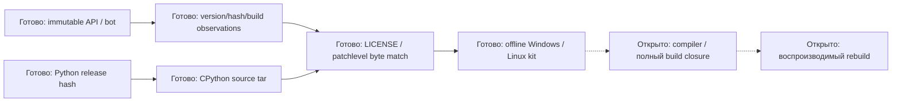

# PM-023-CPY · Исходники установленного CPython

24 ноября 2026 · P1 · issue #28.
[План](../follow-ups/CPYTHON-SOURCES-2026-11-24.md),
[инструкция получателю](../licensing/CPYTHON_SOURCES.md).

## Результат

Собран **CPython 3.14.9**, используемый immutable API/ботом schema-20261109.
Архив Python-3.14.9.tar.xz — **24 176 992 байта**, 5 571 записи,
117 744 029 байт несжатого содержимого. SHA-256
`e02d9ac21cebda6e46435369744a92c65cc7cd8669697694122cf97ffacd1e53`
совпал с [официальным release](https://www.python.org/downloads/release/python-3149/)
и `PYTHON_SHA256` обоих image configs.

LICENSE и Include/patchlevel.h совпали с установленными байтами; runtime
LICENSE также совпала с ранее собранным notice inventory. У API/бота одинаковы
хеши interpreter/libpython, компилятор GCC 12.2.0, configure args, pyconfig.h и
Makefile. Их хеши и точные наблюдаемые тексты сохранены в
[реестре](../../third_party/cpython-schema-20261109/runtime.json).

Комплект `.local/pm023/cpython-20261124/kit-02/` содержит **11 файлов,
24 883 534 байт**. SHA-256 manifest.json:
`e2afec94b1aef0e02ffbe783e20e03f373e5d2769c282ca5e4053023b6b7d325`.
Большой tar.xz остаётся локальным; [квитанция](assets/PM-023/cpython-20261124/receipt.json)
и build observations опубликованы. Старые kits сохранены.

## Реализация и проверки

`scripts/cpython_sources.py`:

- `probe` запускает только заданный Python probe в двух read-only/no-network
  контейнерах и сохраняет ограниченные сведения; прочие environment values
  не попадают в результат.
- `validate_plan` сверяет release/inventory, две роли, version/source hash,
  лицензию и одинаковые build observations.
- `verify_source` читает tar как данные: проверяет SHA-256, состав и границы
  архива, root version, LICENSE/patchlevel; ссылки не разыменовываются.
- `collect` собирает новый каталог; `verify` автономно проверяет внешний
  manifest hash и весь состав. Ошибочные сборки получают INCOMPLETE marker.

- **51 targeted tests PASS**, из них **22 новых**: неполные роли, image drift,
  version/source-env/license/flags mismatch, подмена URL/файлов, неверный SHA,
  лишние/отсутствующие файлы, повторные JSON keys, archive traversal/duplicates,
  ссылка вместо лицензии, неправильная версия внутри patchlevel, INCOMPLETE и
  запрет перезаписи, standalone subprocess.
- Ruff/format PASS; mypy **127 файлов PASS**.
- Новый `probe` повторно получил прежние значения для обеих ролей; все четыре
  runtime text files совпали с первичным наблюдением.
- Реальный комплект проверен Windows Python **3.14.7** с `-I` и Linux
  **3.14.9** в контейнере `--network none --read-only`, kit mount read-only.
  После исправления сортировки Linux заново собрал комплект без сети
  с единственным writable mount нового output. Манифест побайтово совпал
  с Windows-комплектом; JSON-результаты также совпали. Исходники не извлекались.
  [Результаты](assets/PM-023/cpython-20261124/verification.json).
- В CI добавлены Windows/Linux mapping check и повторный download/verify
  официального исходного архива на Linux с обязательным совпадением
  опубликованного manifest hash. Итог повторного CI будет записан отдельно.

Первый Linux CI успешно проверил файлы, но получил иной manifest hash: Windows
и POSIX по-разному сортируют объекты Path с заглавными/строчными именами.
Сортировка заменена на единую сортировку строк имён; повторные реальные сборки
Windows/Linux совпали. Первый kit/dce9641b… сохранён как диагностический;
для передачи используется kit-02/e2afec94…. 51 тест повторно прошёл.

## Ограничения и следующий шаг

Source/environment hash не заменяет криптографическую build attestation;
Sigstore не проверялся. Записанные compiler/configure values не означают
проверенной побайтовой пересборки. Дальше — Go module/toolchain inputs и
оставшиеся build dependencies/native link maps. Исторические GAPS отражают
их прежнюю дату; это дополнение отдельно покрывает CPython source archive.
Полная PM-023 открыта, **19/24**; Android/облако/полный L2 и личная приёмка
сохраняют прежний статус. Runtime и БД не переустанавливались.
