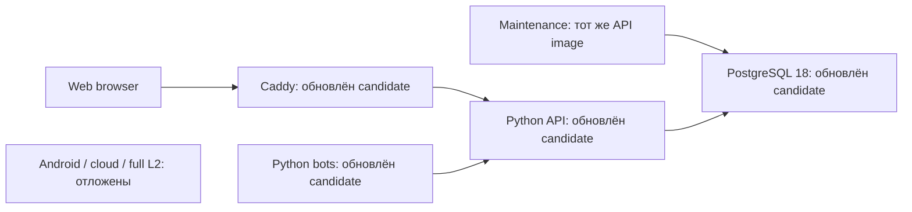

# PM-023 · зависимости и базовые образы

24 октября 2026 · самостоятельная проверяемая часть PM-023, **не приёмка внешнего релиза**.
Счётчик19/24, отсрочки Android/облака/L2 и G05 сохранены.

## Результат

Проверены все55 внешних Python entries из universal lock, два явных build pins
(uv/hatchling) и3 Node entries, включая dev/optional и другие ОС. Пропусков нет;
известных advisory для этих57 Python и3 Node версий не обнаружено.120 строк
в scanner locks — повторное представление requirements/uv, а не120 уникальных
внешних пакетов. Собственные5 workspace packages проверяются отдельно как код.

Однако установленные образы содержали устаревшие системные и vendored компоненты.
Подготовлены pinned Python3.14.9 / PostgreSQL18.6 / Caddy2.11.7. В конечных образах
API/бота удалён глобальный pip: зависимости уже установлены в build-stage и
поставляются в готовом virtualenv. CI использует Python3.14.9 и проверяет отсутствие
глобального installer. App lock, схемы/миграции и пользовательский интерфейс не меняются.

| Образ | Найденные строки до → candidate | Critical до → candidate | High до → candidate |
| --- | --- | --- | --- |
| API, также maintenance/migrate | 291 →255 | 6 →2 | 70 →61 |
| HTTPS proxy | 257 →22 | 6 →0 | 94 →6 |
| PostgreSQL | 550 →474 | 16 →4 | 116 →96 |
| Отдельный пилотный бот | новый снимок255 | 2 | 61 |

Это совпадения **package/version/advisory**, не число подтверждённых атак.
Один CVE может встречаться у нескольких пакетов/образов. Данные относятся к
linux/amd64 и базе Trivy от2026-10-24T13:07:23Z; suppressed/ignore-unfixed
фильтры не использовались. Обновление не устраняет все находки.

## Доказательства и повторение

- [Сравнение и immutable image IDs](assets/PM-023/dependencies/comparison.json).
- [Исходные образы](assets/PM-023/dependencies/before.json) и
  [candidate, компоненты/лицензии/advisories](assets/PM-023/dependencies/candidate.json).
- CycloneDX JSON с gzip: [API](assets/PM-023/dependencies/image-0.cdx.json.gz),
  [proxy](assets/PM-023/dependencies/image-1.cdx.json.gz),
  [бот](assets/PM-023/dependencies/image-2.cdx.json.gz),
  [PostgreSQL](assets/PM-023/dependencies/image-3.cdx.json.gz).
  SHA-256 распакованных файлов — в comparison.json.
- [Команды и границы проверки](../privacy/DEPENDENCY_AUDIT.md).

`scripts/audit_dependencies.py` копирует только allowlist manifest/lock файлов
в новый каталог; env, backups, пользовательские данные и исходники туда не попадают.
Образы разрешаются в immutable ID и читаются из локального Docker, не из контейнеров
или volumes. Формируется inventory, CVE/лицензионные metadata и SBOM. Изображения
приложения не нужны: UI не меняется. Схема поставки остаётся:

## Проверки

- 9 unit controls PASS: охват dev/optional/build packages, отсутствие private
  files в staging, запрет повторного output, missing coverage и metadata failure
  не дают успеха, unfixed/unknown advisory сохраняются, Go-компонент без версии
  остаётся видимым. Ruff/format/mypy92files PASS.
- Реальное сканирование завершено:57 Python metadata доступны,56 содержат declared
  license и1 unknown; missing_packages=[]; advisory status **1**, не0.
- Первая попытка остановилась на Go package без `Version`; сохранена как incomplete,
  исправлена без подстановки выдуманной версии, добавлен regression control.
- Первый sandbox pytest не смог создать стандартный tmpdir; targeted повтор с
  workspace basetemp прошёл. Общий sandbox unit запуск остановлен после зависания
  на22 tests; его нельзя считать успешным. Полные checks выполняет CI.
- Сборка трёх candidate images прошла; PostgreSQL получен по immutable digest.
  CI и проверка установки будут добавлены после фактического завершения.

## Оставшаяся работа и ограничения

1. **P0 перед внешним пилотом:** разобрать оставшиеся Critical/High по фактическим
   путям вызова и distro advisory. В Debian остались sqlite/zlib/libxml2 и другие
   системные пакеты без объявленного исправления для используемой ветки. В proxy
   есть6 High с fix version в Go/module/Alpine dependencies; upstream Caddy2.11.7
   пока последний stable. В PostgreSQL остаются26 fixable High/Critical, в том
   числе Go-зависимости helper gosu. Их наличие не доказывает удалённую эксплуатацию,
   но не позволяет объявить образ очищенным. Следующий шаг: отдельная проверка
   reachable paths, затем проверяемый вариант обновления helper/proxy/base с CI.
2. **P1 перед распространением:** лицензионные notices/source obligations для
   LGPL psycopg и системных компонентов; отсутствие license в metadata не означает
   отсутствие лицензии. Mypy-extensions1.1.0 имеет
   [upstream LICENSE](https://github.com/python/mypy_extensions/blob/1.1.0/LICENSE),
   но автоматический результат честно остаётся unknown. Собственную лицензию
   проекта владелец ещё не выбирал; эта работа её не назначает.
3. Инструмент не выполняет exploitability/legal verdict, Git history secret scan,
   полный license header scan, scan developer OS/browser binaries или transitives
   изолированного build backend. Полный source scan был отдельной предыдущей работой.
4. Текущий рабочий a7deaab и candidate различаются до отдельной проверенной установки.
   Новые Docker pins сами по себе не означают обновление работающего контейнера.

Источники обновления: [Python3.14.9 security release](https://www.python.org/downloads/release/python-3149/),
[PostgreSQL18.6 release notes](https://www.postgresql.org/docs/release/18.6/),
[Caddy2.11.7](https://github.com/caddyserver/caddy/releases/tag/v2.11.7).
Задача [#28](https://github.com/Villentretermert/ProjectMarket/issues/28) остаётся открытой.
