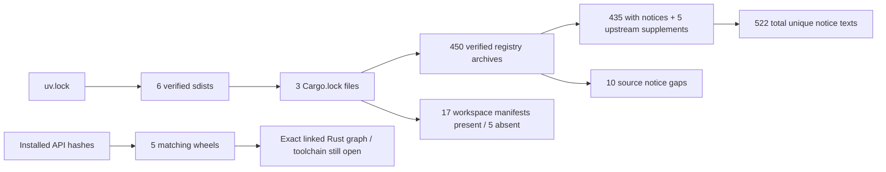

# PM-023 · встроенные Rust/C-зависимости Python

3 ноября 2026. Независимая часть PM-023; задача открыта, счётчик 19/24,
после G04 — 3/4. [Предыдущий этап](PM-023-alpine-licenses-20261103.md).

## Результат

[Новый набор уведомлений](../../third_party/68958f1-embedded/README.md) содержит
522 уникальных текста вместо 298. Добавлены 224 уникальных текста, сохранены
все прежние уведомления и четыре открытых Alpine gaps. Число установленных
компонентов — 584 записей / 377 уникальных — не изменено.

Проверены исходники шести Python-пакетов по SHA-256 из uv.lock. Пять wheel
совпали по полному набору нативных файлов с точным API image ID поставки 68958f1.
psycopg-c собирается локально; его повторная сборка в этот этап не входит.

| Источник | Проверенный охват |
| --- | --- |
| jsonschema-rs 0.57.1 | 373 registry entries; 20 local workspace entries |
| pydantic-core 2.50.1 | 99 registry entries; 1 local workspace entry |
| rpds-py 2026.9.1 | 18 registry entries; 1 local workspace entry |
| argon2-cffi-bindings 26.1.0 | sdist, wheel, полный vendored Argon2 LICENSE и CMake recipe |
| cffi 2.1.1 | sdist, wheel, setup.py и зависимости установленного расширения |
| psycopg-c 3.3.6 | sdist, лицензионный текст; системное связывание исследовано ранее |

490 registry occurrences дают 450 уникальных crate-архивов; все совпали с
checksum соответствующего Cargo.lock. В 435 архивах найдены файлы уведомлений.
Ещё для пяти пакетов получены шесть файлов из upstream-коммитов, указанных в
их .cargo_vcs_info.json. Проверены Git blobs, repository, commit и хеши текстов.

Cargo.lock включает test/build и другие платформы. Эти 450 записей сохранены
как source inputs, отдельно от установленных компонентов. Состав фактически
связанного Rust-кода в wheel пока не установлен. Такое различие следует
назначению [Cargo.lock](https://doc.rust-lang.org/cargo/guide/cargo-toml-vs-cargo-lock.html)
и отдельным разделам dependencies/dev-dependencies/build-dependencies
в [Cargo manifest](https://doc.rust-lang.org/cargo/reference/manifest.html).

## Оставшиеся вопросы

- 10 записей source-lock inventory пока без найденного notice; точный список
  приведён в README набора. Это не утверждение о десяти зависимостях Linux runtime.
- Из 22 local workspace entries 17 Cargo manifests найдены и сверены в sdists.
  У jsonschema отсутствуют пять manifests: benchmark-suite, jsonschema-cli,
  jsonschema-macros-standalone, jsonschema-rb и jsonschema-wasm. Их участие в
  Python/Linux wheel не установлено.
- cffi Linux wheel не показывает отдельную libffi в динамических зависимостях.
  Точная версия её build/source inputs требует подтверждения. Windows libffi
  headers из sdist не использованы как доказательство для Linux.
- Полный Argon2 LICENSE найден; точное окружение сборки wheel и соответствие
  исходников бинарнику не воспроизводились.
- Rust toolchain/runtime, nested vendor headers, Debian sources, материалы
  замены/перелинковки и полная source delivery остаются открытыми.

## Код и проверяемость

`scripts/embedded_notices.py` использует проверку SHA-256/Git blob и безопасное
чтение выбранных архивных членов из предыдущего сборщика. Он не распаковывает
источники на диск и не исполняет Cargo/build scripts. Проверяются:

1. Совпадение родительских Python-пакетов с установленным inventory и uv.lock.
2. Полнота registry и local workspace entries относительно трёх Cargo.lock.
3. Cargo metadata, исходные manifests и привязка дополнительных upstream notices.
4. Полный набор нативных файлов каждого из пяти wheel.
5. Неизменность прежнего inventory/gaps и целостность нового notice archive.

Локальный архив содержит 462 source/notice inputs без пяти binary wheel:
78 704 698 байт, SHA-256
`d2a0b53738e4cc472229a3fdb3cbf97b4a737e0213d3d8586123e31ca1e8f297`.
Все 462 члена повторно сверены после упаковки. Архив не опубликован; полная
corresponding-source delivery не заявлена.

## Проверки и продолжение

35 targeted tests трёх сборщиков прошли, включая 15 новых проверок полноты,
подмены происхождения, сохранения gaps, native-file mismatch и archive links.
Ruff/format и mypy по 101 файлу прошли. Источники, Cargo locks и notices проверены.
Результаты полного CI будут записаны после выполнения.

Следующий подэтап — установить точный Rust build graph/toolchain и происхождение
libffi в Linux wheel, затем разобрать оставшиеся пробелы и подготовку Debian
source materials. Рабочая поставка, БД и UI не обновлялись. Android, облако и
полный L2 остаются отложенными.
