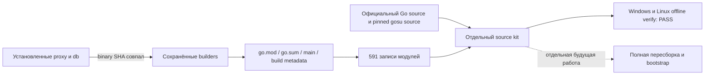

# PM-023-GO · исходники Go для установленной поставки

24 ноября 2026. Подзадача P1 выполнена по
[плану](../follow-ups/GO-SOURCES-2026-11-24.md), код `96f275d`.
Все четыре задания [CI 45412698032](https://github.com/Villentretermert/ProjectMarket/actions/runs/45412698032) PASS.
Полная PM-023 открыта, 19/24. Android/облако/L2 и личная приёмка отложены как ранее.

## Результат

Собран отдельный комплект для Go-части schema-20261109: 591 запись из двух
go.sum (221 ZIP, 370 go.mod), исходники Go 1.26.10 и gosu 1.19, 23 файла
evidence, standalone verifier и инструкция. Из них 557 уникальных input files;
584 файла всего, 246 872 827 байт. Большие архивы остаются локальными.

Комплект `.local/pm023/go-20261124/kit-03/` и
[квитанция](assets/PM-023/go-20261124/receipt.json). Manifest SHA-256:
`1219282099550462950ae09cbf9a78a095d601be746f3a73607d03d5e8caf43e`.
[Инструкция](../licensing/GO_SOURCES.md).

| Программа | Проверенная связь |
| --- | --- |
| Caddy 2.11.7 | proxy `031c3f1f…` → builder `9dae3a92…` → бинарник `838befb8…`, 160 dependency records |
| gosu 1.19 | db `07aa878e…` → builder `31c34b80…` → бинарник `7a3526e4…`, 2 dependency records |
| Go 1.26.10 | оба build-info/env → VERSION/LICENSE/PATENTS → официальный source tar |

Полные идентификаторы в [runtime.json](../../third_party/go-schema-20261109/runtime.json).
Все 162 dependency records бинарников сопоставлены go.sum. Дополнительные
модули из go.sum могут относиться к test/build/transitive graph; их присутствие
не означает включения в исполняемую программу.

## Код и проверки

`scripts/go_sources.py` использует только Python stdlib. `--probe` повторяет
ограниченные публичные наблюдения в read-only offline контейнерах; `--collect`
собирает точные входы из локального каталога или HTTPS; `--verify` читает архивы
без распаковки/исполнения. Проверка h1 учитывает отсортированные имена и SHA-256
содержимого, а SHA-256 каждого архива отдельно связывает его транспортные байты.

- 40 новых тестов: потеря/подмена входов/ролей, версия/identity, Go checksum,
  неожиданные URL, лицензия, дубли JSON/go.sum/ZIP, пути, symlink вместо файла,
  лимиты, повреждение manifest, лишние файлы и незавершённая сборка.
- 91 targeted tests вместе с CPython/PyPI collectors PASS; Ruff/format/mypy129 PASS.
- Полный локальный Windows прогон: 374 PASS, 2 Linux-only skips, 111 integration
  deselected, 51,47 с. Первый запуск остановлен в sandbox на asyncio socketpair
  accept; faulthandler подтвердил место ожидания. После разрешения loopback
  тесты прошли без изменений кода. Исходные диагностические логи локальны.
- Все исходные inputs заново скачаны по публичным URL: размеры/SHA-256 и h1
  совпали с сохранённым builder cache.
- Повторные наблюдения builders/runtime совпали по 19 файлам. Первый probe
  обнаружил CRLF в нашем JSON, созданном одноразовым Windows helper; канонический
  runtime.json записан в LF, upstream bytes не изменены.
- Standalone Windows Python 3.14.7 и Linux Python 3.14.9 без сети PASS.
- Реальный повторный сбор на Linux без сети дал тот же manifest, что Windows.
- В CI добавлены проверка plan на обеих ОС и полный сетевой пересбор на Linux
  с отдельным standalone вызовом и опубликованным manifest SHA. Повторный
  CI-сбор подтвердил тот же `12192820…` manifest.
- CI: 376 unit + 111 integration = 487 различных Python-тестов; Windows
  374 PASS/2 Linux-only skips; Web/API/bot, Docker/HTTPS/HTTP2 и backup/restore PASS.
  [Машинная квитанция](assets/PM-023/go-20261124/ci.json).
- После проверок рабочие четыре сервиса healthy, API ready/database=ok.

[Квитанция проверок](assets/PM-023/go-20261124/verification.json).
Первый `kit` оставлен INCOMPLETE: upstream gosu содержит `.dockerignore` symlink.
Исправленный verifier хранит такие ссылки как непрозрачные данные и не следует
им; наблюдаемые исходные файлы по-прежнему обязаны быть regular files.
`kit-02`/`fetched-kit` диагностические, до нормализации нашего JSON; получателю
передаётся только `kit-03` с указанным выше manifest.

## Осталось

Полная пересборка Go/compiler bootstrap и образов, точный native build graph,
прочие attribution/source gaps, отложенные платформы и release acceptance.
Совпадение исходных хешей и build observations не является подписанной build
attestation или доказательством reproducible binary build. Никакие исторические
GAPS.md, source/Docker archives или рабочие images не заменялись.

Следующий независимый пункт — проверить автономную пересборку Caddy/gosu
из сохранённых go.mod/go.sum и входных архивов; bootstrap компилятора
и полная воспроизводимость остаются отдельными проверками.
