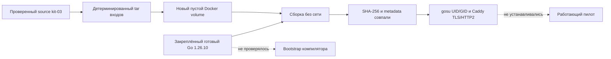

# PM-023-GOBUILD · пересборка Caddy/gosu без сети

24 ноября 2026 · подзадача P1 по [плану](../follow-ups/GO-REBUILD-2026-11-24.md).
Подзадача выполнена: локальный recipe и все четыре jobs CI PASS.
Полная PM-023 открыта, 19/24.
Отсрочки Android/облака/L2 и личная приёмка сохраняются.

## Результат

Обе программы пересобраны из source kit-03 в чистом Go image, без интернета.
SHA-256 совпали с бинарниками установленной schema-20261109:

| Программа | Байты | SHA-256 |
| --- | ---: | --- |
| gosu 1.19 | 2 777 966 | `7a3526e4111a4a07283fecd0f359ec65c194778d92b585fb96a3e292a590b0aa` |
| Caddy 2.11.7 | 81 974 344 | `838befb8dc94a98b18cf54e881c69f78806b20ce7bbc0494647b4897c9cfaad6` |

Совпали build metadata, все 162 dependency records и сохранённые go.mod/go.sum.
Go 1.26.10 из закреплённого image; SHA-256 `/usr/local/go/bin/go`:
`9c2a37ae5b21ba1d5a004bb9ab4d0c64de6fc5778e9d30487adccea62678b8b5`.

Финальная локальная поставка проверки: `.local/pm023/go-build-20261124/run-04/`.
Повтор на коде ca8b195, включая Linux permissions fix, дал тот же result.json
и тот же набор наблюдений, что принятый run-03.
[Квитанция](assets/PM-023/go-build-20261124/result.json) фиксирует 823 tar members,
212 623 360 байт входов; SHA-256 tar:
`0f55c59cd6b247ed649545e3d619dbc89883ea0e3f9e2eda380acdef57a0e0de`.
Три контейнера завершены, созданный том удалён. Наблюдался только интерфейс `lo`;
исходные кеши отсутствовали, Go offline environment сохранён.

## Компоненты и проверки

- `scripts/go_rebuild.py`: проверка source kit, подготовка только download cache
  и исходных файлов, создание/удаление собственных контейнеров/volume, сравнение
  результатов и runtime smoke. В recipe нет сетевого fetch или установки в пилот.
- `deploy/go-rebuild/tls_probe.go`: наш disposable stdlib клиент HTTP/2.
  Дополнительные библиотеки/пакеты не устанавливаются.
- 27 новых tests и 40 тестов source verifier: 67 PASS; Ruff/format/mypy131 PASS.
  Проверены подмена bytes/build metadata/lock files/toolchain/env, непустой
  network evidence, небезопасные пути, дубли tar, испорченная квитанция до Docker,
  неполные smoke claims и cleanup при неуспехе/timeout.
- Gosu: nobody, явные UID=12345/GID=12346 и точная версия PASS.
- Caddy: доверенная новая CA/HTTPS/HTTP2, отказ неизвестному CA и конкретный
  `x509.HostnameError` для IP вместо localhost PASS.
- В CI добавлен повторный независимый offline build после сетевой подготовки;
  exact binary/compiler/input hashes и runtime checks сравниваются с квитанцией.
  Linux job 138541333063 на ca8b195 PASS: исходный manifest, входной tar,
  compiler/binary SHA и runtime checks совпали.
  [Наблюдения CI](assets/PM-023/go-build-20261124/ci-rebuild.json).

Первый диагностический запуск исчерпал 256 MiB tmpfs при компиляции Caddy;
gosu уже совпал. `GOTMPDIR` перенесён на отдельный временный дисковый volume.
В run-01 обе сборки совпали, но первоначальная negative TLS проверка ожидала
ошибку SAN, а Caddy отвергал handshake без SNI ещё раньше. В тестовый Caddyfile
добавлен `default_sni localhost`; повторная проверка получила требуемый отказ
проверки имени. Рабочая конфигурация Caddy не менялась. Эти диагностические
запуски не выдаются за итоговую приёмку. Run-02 также сохранил обе совпавшие
сборки: исправлена наша проверка `go env GOENV`, который при `GOENV=off`
возвращает пустой путь файла конфигурации, а не слово `off`.

Дополнительно для CI: Python-shell script запускается из внешнего временного
каталога; pin читается из проверенного Dockerfile вместо прямого импорта.
После ранней остановки Linux build воспроизведён Permission denied для
root/cap_drop=ALL в output bind mount владельца 1001:1001 с mode 0755.
Mode 0775 и группа владельца дали успешную запись в отдельном Linux volume.
Добавлен вывод диагностических логов CI; root capabilities не расширялись.

CI 45419353243 дважды отверг ZIP timberjack v1.4.8 по размеру/SHA-256
ещё до rebuild. Отдельные HTTP downloads на Windows и Linux вернули 69 474
байта и исходный SHA-256; Windows также проверил h1
([квитанция](assets/PM-023/go-build-20261124/module-refetch.json)).
Неудачные bytes первых runners не сохранены, точная причина не доказана.
Запрос повтора одного job фактически создал новый attempt с четырьмя jobs;
второй Docker job получил отдельный HTTP/2 INTERNAL_ERROR от sum.golang.org.
В первом attempt Docker/HTTPS/HTTP2/backup/restore и оба остальных jobs прошли.
Добавлен диагностический вывод размера/SHA отвергнутых downloads и отдельного
refetch; он не заменяет входы и не ослабляет проверки. Новый CI 45421327206
на ca8b195 уже подтвердил исходный manifest и автономную пересборку.

Значение `toolchain.image_id` из Docker inspect в CI совпало с закреплённым
image digest; локально оно отличается. Reference pin одинаков; фактические
bytes Go compiler, входов и обоих binaries совпали. Наблюдения обеих сред
сохранены без подмены ID.

## Итоговая приёмка

Код c3791dc, исправления 9581fd7/48dbca9 и диагностический ca8b195.
Все четыре jobs [CI 45421327206](https://github.com/Villentretermert/ProjectMarket/actions/runs/45421327206)
на ca8b195 **PASS**: 403 unit + 111 integration = **514 различных Python-тестов**;
Windows 401 PASS / 2 Linux-only skips. Пройдены 69 браузерных сценариев,
Web/API/Python-боты, Docker, HTTPS/HTTP2, backup и изолированное restore.
Linux заново получил исходный kit с прежним manifest, выполнил автономную
пересборку и подтвердил exact compiler/input/binary hashes и runtime probes.
[Квитанция CI](assets/PM-023/go-build-20261124/ci.json),
[локальные проверки](assets/PM-023/go-build-20261124/verification.json).

Финальный локальный run-04 на том же коде повторил result и наблюдения run-03.
Четыре рабочих сервиса healthy, readiness=200/database=ok; временных Go volumes
не осталось. Работающий runtime не обновлялся. Следующий независимый пункт —
оставшаяся атрибуция четырёх Alpine packages; исторический GAPS.md сохранён.

## Границы

Подтверждена пересборка именно двух Go binaries из переданных входов с готовым
закреплённым компилятором. Bootstrap Go, полный Docker/image rebuild, оставшиеся
native/source/attribution gaps и release acceptance остаются открытыми.
Исходный kit-03 и исторические архивы сохранены. [Инструкция](../licensing/GO_REBUILD.md).
