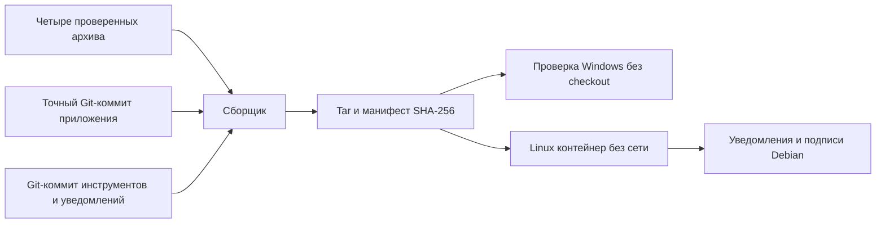

# PM-023 · единый комплект исходных материалов

8 ноября 2026. Подготовлен один tar с исходниками проекта, сохранёнными
Debian/Alpine/Python/Rust материалами, уведомлениями и инструкциями. Получатель
может проверить его на Python 3.14 без Git, Docker, сети и внешнего checkout.

[Инструкция](../licensing/SOURCE_HANDOVER.md) ·
[Квитанция и полный манифест](assets/PM-023/handover-20261108/receipt.json) ·
[Офлайн-проверка](assets/PM-023/handover-20261108/offline-check.json).

## Полученный файл

- Имя `marketob-sources-68958f1.tar`.
- Размер **750 786 560 байт**.
- SHA-256 `e80b6e63c1ac168f1062267dff42bc31912da49c777e768475a27b23524f37c7`.
- Локальный каталог `.local/pm023/handover-20261108-02/`.
- Исходники рабочей версии `68958f1bba16df49159d13fd9e99b47f7d924956`, 593 файла.
- Инструменты `b8e524244f068946351f7e75f022d14d75b40d90`, 681 файл.
- Четыре immutable image IDs связаны с ранее проверенным runtime inventory.
- В tar находятся манифест и 11 файлов, включая шесть вложенных архивов.

Снаружи подготовлены README.md, verify_bundle.py, SHA256SUMS и receipt.json.
Квитанция в Git позволяет отдельно сверить ожидаемый SHA-256 перед проверкой.
Размеры и хеши вложенных файлов также включены в манифест.

## Реализация и результат

`scripts/delivery_bundle.py` сначала связывает рецепт с inventory и уведомлениями,
проверяет четыре локальных исходных архива, затем создаёт Git-снимки. Для каждого
файла снимка проверяется совпадение с Git blob. Готовый tar проверяется до
публикации выходного имени. Уже существующий результат не перезаписывается.

Первый прогон обнаружил две особенности Windows. Git нормализует JSON в индексе,
поэтому сравнение рецепта выполняется по значениям. Кроме того, git archive
учитывает core.autocrlf. Экспорт теперь отключает это преобразование и проверяет
каждый файл по Git-объекту. Регрессионный тест включает core.autocrlf=true
и локальный .env, который должен остаться вне архива.

| Проверка | Фактический результат |
| --- | --- |
| Исходные архивы | Все четыре размера и SHA-256 совпали с рецептом |
| Git-снимки | 593 и 681 файл совпали с точными blob IDs |
| Windows | Самостоятельный скрипт в Python isolated mode проверил реальный tar |
| Linux без сети | Тот же tar и 11 членов проверены в одноразовом контейнере |
| Native notices | Сохранённая цепочка доказательств и хеши прошли |
| Crate supplement | Связь дополнения с исходным inventory прошла |
| Debian | Подписи APT, 95 исходных версий и 304 pool-файла прошли |
| Негативные тесты | 15 тестов прошли, включая дубли, ссылки, недостающие/повреждённые файлы и Git EOL |
| Статические проверки | Ruff/format/mypy по 111 файлам прошли |

На b8e5242 прошли все четыре задания [CI 42425558592](https://github.com/Villentretermert/ProjectMarket/actions/runs/42425558592): 310 различных Python-тестов,
54 сценария Chromium, Docker/HTTPS/HTTP2 и восстановление БД.

Ubuntu — 200 unit-тестов, Windows — 198 и 2 Linux-only skips, PostgreSQL —
110 интеграционных. 54 браузерных сценария прошли. На обеих ОС проверена
привязка рецепта к release evidence. Docker повторил сборку изменённого драйвера.
Предупреждение Pydantic из предыдущего прогона в этом запуске не повторилось;
его прежнее наблюдение остаётся отдельным пунктом разбора.

## Охват

Комплект содержит **собранные материалы**, его coverage_state равен partial.
Встроенный GAPS.md перечисляет семь открытых направлений, включая четыре
Alpine attribution gaps, точный native build graph, вложенные vendor-компоненты,
недостающие исходные входы остальных зависимостей, полный rebuild, другие
платформы и внешнюю приёмку. Проверка целостности не закрывает эти пункты.

В tooling находятся два набора с 546 различными уведомлениями и исторические
материалы для проверки их происхождения. Локальные .env, backups, данные БД
и пользовательские выгрузки не включаются в Git-снимки. Docker images и APK
в этот исходный комплект не входят. Рабочая поставка не переустанавливалась.

Следующая независимая работа PM-023 — разобрать зафиксированное ранее
предупреждение Pydantic при конкурентном построении схем, затем продолжить
оставшиеся пункты готовности внешней поставки. Готово 19/24 задач. Android,
облако и полный L2 отложены владельцем.
