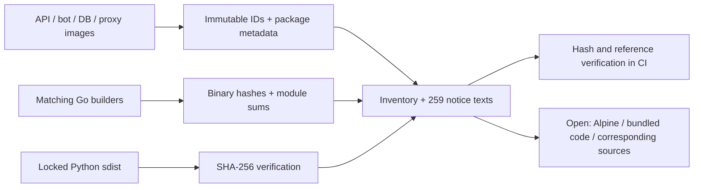

# PM-023 · лицензия проекта и уведомления зависимостей

3 ноября 2026. Выполнена самостоятельная часть PM-023. Счётчик 19/24,
после G04 3/4. Полная приёмка задачи остаётся открытой.

## Результат

Владелец выбрал разрешительную модель и затем Apache 2.0. Добавлены LICENSE,
NOTICE, SPDX metadata и оба файла в четыре wheel. Docker build contexts
включают только эти дополнительные лицензионные файлы для сборки пакетов.

Собран [реестр четырёх установленных образов](../../third_party/68958f1/inventory.json)
и [259 полных текстов](../../third_party/68958f1/texts.tar.gz). В нём 584 записи
по образам, 377 уникальных компонентов. Скрипт `scripts/collect_notices.py`
разрешает теги в immutable IDs, читает только allowlisted metadata/notices
в одноразовых контейнерах без сети и подключения рабочих volumes.

| Образ | Записей | С найденными текстами |
| --- | --- | --- |
| API, общий для maintenance/migrate | 136 | 136 |
| Пилотный бот | 104 | 104 |
| PostgreSQL и gosu | 151 | 151 |
| Caddy proxy | 193 | 161 |

Найденный текст означает доступное свидетельство лицензии. Полнота лицензирования
всего встроенного кода этим счётчиком не измеряется. 32 записи Alpine из 20 исходных пакетов оставлены
открытыми. Для jsonschema_rs добавлены MIT-тексты из sdist, проверенного по uv.lock.
У Go сверены бинарные SHA-256, module sums и caches. Системные библиотеки
сопоставлены с исходными пакетами. [План оставшихся материалов](../licensing/DISTRIBUTION.md).

## Проверка

- 11 focused tests прошли. Проверены отказы при подмене builder, изменении
  source archive и notice bundle, выходе архивного пути наружу, неверных ссылках
  и неучтённой замене Go-модуля. Отсутствующая лицензия остаётся в gaps.
- Ruff/format и mypy по всем 97 файлам прошли.
- Все четыре wheel собраны локально offline. В каждом проверены выражение
  Apache-2.0 и точные байты LICENSE/NOTICE по отношению к корневым файлам.
- `uv lock --check --offline` прошёл, версии зависимостей не изменены.
- Реальный сбор из четырёх образов завершён, проверка всех архивных ссылок и
  SHA-256 прошла. Проверка sidecar добавлена в Linux/Windows CI.

Первый сбор остановился на сломанных ссылках на постороннюю документацию
в базовом PostgreSQL-образе. Скрипт теперь читает только нужные существующие
license-файлы и отдельно проверяет ошибку поиска. Неудачный каталог помечен
INCOMPLETE и не включён в опубликованные результаты.

Рабочий пилот остаётся на ранее проверенных image IDs 68958f1.
[CI41680762892](https://github.com/Villentretermert/ProjectMarket/actions/runs/41680762892) на e813e77 прошёл все четыре задания.
108 unit tests на Ubuntu, 106 и 2 Linux-only skips на Windows, 110 integration
и 54 Chromium-сценария. Всего 218 уникальных Python-тестов. Сборка Docker,
проверки настоящего C-драйвера, ботов, HTTPS/HTTP2, backup/restore прошли.
Оба ОС проверили notice archive и полные LICENSE/NOTICE в четырёх wheel.
[Машиночитаемые результаты](assets/PM-023/licenses-20261103/ci-results.json).
В integration остаётся одно предупреждение Pydantic об alias `share_id`.
Новых миграций, обновления рабочей БД и установки образов в этой работе нет.
Android, облако и полный L2 отложены согласно решениям владельца.
