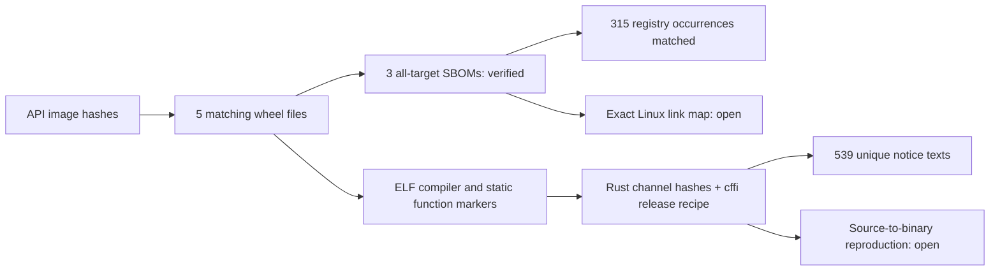

# PM-023 · SBOM wheel, Rust и libffi

4 ноября 2026. Независимый подэтап PM-023; задача открыта, 19/24, после G04 — 3/4.
[Предыдущий результат](PM-023-embedded-licenses-20261103.md).

## Что получено

[Новый набор](../../third_party/68958f1-native/README.md) содержит 539 уникальных
текстов: все 522 прежних и 17 новых. Сохранены library copyright reports Rust,
приложенные upstream license texts и LICENSE libffi. Из 33 выбранных файлов
повторяющиеся тексты объединены по SHA-256. Рабочая поставка 68958f1 не менялась.

Три wheel содержат CycloneDX SBOM от производителя. Все 315 registry occurrences
совпали по имени, версии и checksum с проверенными исходниками. Проверены
уникальность узлов, полнота рёбер, отсутствие ссылок на неизвестные узлы и
достижимость от корня. Шесть локальных зависимостей jsonschema и три корневых
проекта также привязаны к manifests из sdists.

| Wheel | Registry | Локальные зависимости без корня | Rust из ELF |
| --- | ---: | ---: | --- |
| jsonschema-rs 0.57.1 | 199 | 6 | 1.98.1, 48a229ceaefd4985c50990b14116b6d856af0985 |
| pydantic-core 2.50.1 | 99 | 0 | 1.99.0, b940084d7eb6a299eb4bfeb8e34901bc051e7ac4 |
| rpds-py 2026.9.1 | 17 | 0 | 1.99.0, b940084d7eb6a299eb4bfeb8e34901bc051e7ac4 |

Во всех SBOM явно указано `all_targets=true`. Это граф, заявленный производителем
для всех платформ, а не точный состав машинного кода Linux. Назначение встроенных
SBOM описано в [Maturin](https://www.maturin.rs/sbom.html).
Два из прежних пробелов уведомлений — r-efi 5.2.0 и wit-bindgen-rt 0.39.0 —
встречаются в SBOM pydantic-core; их присутствие в Linux-бинарнике не доказано.

Версии и полные commit IDs Rust прочитаны из совпадающих с API wheel.
Официальные channel manifests связывают эти версии с SHA-256 двух Linux rustc
archives. Из архивов прочитаны COPYRIGHT-library.html и тексты лицензий.
Компиляторы не устанавливались и не запускались. Это консервативный набор
атрибуции библиотек; все перечисленные в нём компоненты не объявляются
зависимостями приложения. Полная воспроизводимость окружения не установлена.

## libffi в cffi

[Workflow cffi 2.1.1](https://github.com/python-cffi/cffi/blob/fd33e7700f0ebafe6f30bd5053f13327221b77a2/.github/workflows/ci.yaml)
загружает libffi 3.4.6, собирает с `--enable-shared=no` и переименовывает
`ffi_call` в `cffistatic_ffi_call`. В соответствующем wheel последняя функция
определена, а не только импортирована. [LICENSE libffi](https://github.com/libffi/libffi/blob/3d0ce1e6fcf19f853894862abcbac0ae78a7be60/LICENSE)
сохранён из зафиксированного commit; проверены SHA-256 и Git blob ID.

Это подтверждение рецепта сборки несколькими согласующимися признаками.
Оно не доказывает воспроизведение бинарника из исходников и не заменяет
проверку подписанной build attestation.

## Проверка границ результата

Пробный Cargo-анализ использовал установленный Windows Cargo 1.99.0 и Linux
target, без компиляции/build scripts. pydantic-core и rpds-py разрешились с
неизменными lock-файлами. Для неполного workspace jsonschema понадобилось
удалить 58 недоступных/неиспользуемых записей только в отдельной локальной копии;
новые packages не добавлены, версии и checksum оставшихся не изменены.
Windows host добавил windows-link через build dependencies. Поэтому эти
выборки не используются как доказательство точного production Linux graph.
Исходные sdists, зафиксированные Cargo.lock и зависимости приложения не изменены.

PyPI вернул publisher-attestation metadata для двух wheel, но подписи
независимо не проверялись. В итоговую цепочку доверия эти ответы не включены.
[PyPI Integrity API](https://docs.pypi.org/api/integrity/) отличает получение
материалов от проверки attestations.

## Код, проверка и продолжение

`scripts/native_notices.py` выполняет offline-проверку сохранённых материалов
и полную повторную сборку notice sidecar из wheel/архивов. ELF читается как данные:
проверяются формат, границы секций/строк и определение функции. При полном
сборе снова сравниваются все native-файлы пяти wheel с recorded API hashes.

Семь byte-preserved upstream evidence files опубликованы в отдельном архиве.
Нормализованный граф не содержит локальных путей компьютера; оригинальные SBOM
сохраняют публичные CI-пути и авторов upstream. Полные compiler archives и
локальные диагностические Cargo-выборки не опубликованы.

Локально прошли 65 targeted tests четырёх сборщиков (30 новых), Ruff/format/mypy
по 103 файлам, offline native verification и requirements validator. Полный
повторный сбор проверил пять wheel и два compiler archives; архивы читаются
одним проходом. Сохранённый набор повторно прошёл проверку всех ссылок и хешей.
[CI 41737007937](https://github.com/Villentretermert/ProjectMarket/actions/runs/41737007937) на 60d440d: все 4 задания PASS, 272 различных Python-теста
и 54 Chromium-сценария; Docker/HTTPS/HTTP2/backup/restore прошли.

В Ubuntu: 162 unit tests; Windows: 160 и 2 Linux-only skips; PostgreSQL: 110.
Новый offline verifier и wheel LICENSE checks прошли на обеих ОС. Сохранилось
одно существующее Pydantic-предупреждение о field alias limit. Backend smoke,
TLS CA, восстановление БД и browser acceptance завершились успешно.

Следующая независимая работа —
оставшиеся source/header attribution gaps и материалы соответствующих исходников.
Четыре Alpine gaps, десять source-lock notice gaps и пять отсутствующих manifests
сохранены; полный релиз, Android, облако и L2 остаются открытыми.
