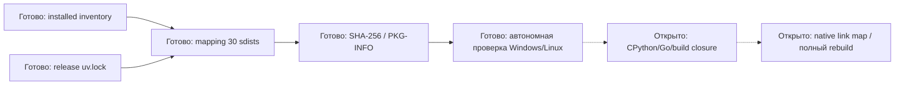

# PM-023-PY · Исходники Python runtime

24 ноября 2026. Независимая часть PM-023 после Docker-комплекта.
Приоритет P1, issue #28; [план](../follow-ups/PYTHON-SOURCES-2026-11-24.md).

## Результат

Собраны **30 sdists** для всех сторонних PyPI-пакетов установленных API/бота
schema-20261109: 29 API entries, 6 bot entries, 5 общих. **24 исходных пакета
добавлены впервые**, 6 совпадают с ранее собранной native-частью.
Манифест связывает installed name/version/image ID с URL/size/SHA-256
из `uv.lock` установленного commit 896449b. Все корневые PKG-INFO совпали.

Локальный `python-runtime-sources.tar` содержит 34 файла, 14 735 360 байт;
SHA-256 `102d3b95e5800c49bae69f3ea9f81411e58948af1cd66d59976a0cbf1ee9cd5f`.
Большой архив хранится в `.local/pm023/python-sources-20261124-02/`.
[Квитанция](assets/PM-023/python-sources-20261124/receipt.json) содержит
image IDs и SHA-256 проверенного PKG-INFO каждого пакета.
[Инструкция получателю](../licensing/PYTHON_RUNTIME_SOURCES.md).

## Код и проверка

`scripts/python_sources.py` использует только stdlib. `plan` требует полного
сопоставления installed inventory с release lock; `validate_sdist` проверяет
хеш, размер и единственный корневой PKG-INFO; `verify` проверяет внешний SHA-256
и точный состав дополнения. `collect` работает с новым output/cache, сохраняет
неизменённые sdists, не исполняет код. Ошибка оставляет INCOMPLETE marker.

- 29 новых тестов: неполный mapping, ошибочные version/image/URL/hash,
  подмена inventory/lock, лишние/пропавшие/повторные файлы, traversal,
  неправильный PKG-INFO, повторные headers, ссылка вместо metadata,
  повреждённый cache, запрет перезаписи и standalone subprocess.
- Вместе с delivery/binding/Docker-kit: **85 tests PASS**.
- Ruff check/format PASS; mypy **125 файлов PASS**.
- Настоящий архив проверен Windows Python **3.14.7** с `-I` вне импорта
  repository modules; Linux **3.14.9** — в одноразовом контейнере с
  `--network none --read-only`, каталог источников подключён read-only.
  [Результаты](assets/PM-023/python-sources-20261124/verification.json).
- CI: mapping на Windows/Linux и повторный download/hash/PKG-INFO на Linux
  добавлены в существующий workflow; итог запуска будет записан отдельно.

Первый сбор остановился на штатной symlink `referencing/CHANGELOG.rst`.
Исправлено чтение таких ссылок как непрозрачных данных без перехода по ним;
ссылка вместо PKG-INFO всё ещё отклоняется и покрыта тестом. Первый каталог
помечен INCOMPLETE, итоговый новый каталог прошёл полную повторную проверку.

Docker-служба на начало проверки была остановлена. В WSL обнаружен Python
3.8.10 без tomllib; для проверки Linux запущена существующая Docker-служба
и использован уже имеющийся API image по immutable ID. Образы не собирались,
миграции и пользовательские данные не изменялись.

## Ограничения и следующий шаг

Исторические source/Docker kits остаются неизменными; новый tar передаётся
отдельным дополнением. `remaining-source-inputs` теперь имеет проверенное
покрытие верхнеуровневых runtime sdists, но полное closure ещё отсутствует.
Далее доступны CPython/Go source inputs и native build evidence.
Сопоставление версий не доказывает воспроизводимость wheel. Полная PM-023
открыта, **19/24**, Android/облако/L2 и личная приёмка сохраняют прежний статус.
