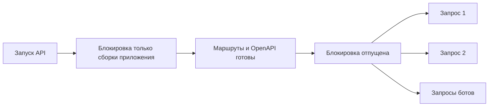

# PM-023 — инициализация схем API · 9 ноября 2026

Состояние: исправление реализовано, полный CI и локальная установка ожидают проверки.
Подэтап [issue #28](https://github.com/Villentretermert/ProjectMarket/issues/28),
следующий пункт из [комплекта исходников](PM-023-handover-20261108.md).
Полная PM-023 остаётся открытой; счётчик 19/24, Android/облако/L2 отложены.

## Причина и воспроизведение

В прошлых интеграционных запусках периодически появлялся
`UnsupportedFieldAttributeWarning` об alias `limit`/`share_id`. Само сообщение
не доказывало потерю параметра или ошибку обработки данных.

На FastAPI 0.159.1 / Pydantic 2.14.1 обычный повтор с 12 последовательными и
12 параллельными factory вызовами предупреждение не воспроизвёл. Также прошли
8 последовательных и 16 параллельных запусков с HTTP-запросом и OpenAPI.
Управляемое чередование потоков воспроизвело проблему:

1. Первый адаптер входит в `warnings.catch_warnings()` FastAPI.
2. Второй входит в свой контекст до завершения первого.
3. Первый выходит и восстанавливает прежние глобальные фильтры.
4. Второй строит поле уже с этим состоянием: появляется warning. После его
   выхода список фильтров отличается от состояния перед обоими вызовами.

В минимальном пробном сценарии обе проверки значения и alias работали,
но фильтры не восстановились. Затем регрессионный тест на двух настоящих
`create_app().openapi()` до изменения кода дал **1 FAIL / 1 PASS**:
`UnsupportedFieldAttributeWarning` для `cursor` стал исключением. Конкретное
имя поля зависит от чередования; тест задерживает только построение, не меняет
валидацию. Это подтверждает механизм гонки, но не доказывает потерю данных в
каждом историческом запуске.

[Документация Python](https://docs.python.org/3.14/library/warnings.html#concurrent-safety-of-context-managers)
описывает небезопасность пересекающихся `catch_warnings`, когда используются
глобальные фильтры. В проверенной локальной среде context-aware режим выключен.
FastAPI 0.159.1 использует такой контекст в `ModelField.__post_init__`; новые
фильтры ignore в MarkeTOB не добавлялись.

## Изменение и схема работы

`marketob_api.app.create_app` защищает сборку приложения процессной блокировкой,
затем вызывает публичный `application.openapi()` до возврата готового API.
Так ленивые схемы маршрутов строятся в той же защищённой фазе. Блокировка
отпускается и при исключении; обработчики HTTP её не используют.

В pytest предупреждения этого класса теперь являются ошибками. Регрессионный
тест проверяет восстановление фильтров, одинаковые OpenAPI и bounds query `limit`.
Отдельный тест требует одновременного присутствия четырёх обработчиков HTTP у
барьера: он упадёт, если исправление начнёт сериализовать запросы. Также проверяет
валидные границы 1/100 и отказ 422 для 0/101/нечислового значения.

В production нет monkeypatch FastAPI/Pydantic; инструментирование только в
регрессионном тесте. Маршруты по-прежнему регистрируются в factory. Изменений
Web-интерфейса, контракта, зависимостей и миграций нет. При запуске работа по
построению OpenAPI теперь выполняется заранее.

## Проверки и установка

- После исправления 17 focused tests PASS; Ruff/format/mypy117 PASS.
- Windows unit: 242 PASS/2 skip, 111 integration deselected.
- Новый Docker API `schema-20261109` собран. 31 версия Python-пакетов и все
  54 пути OpenAPI совпали с photos-20261108; канонический SHA-256 спецификации
  `801dacfd9aa868b760cf4ad0cac78b7cd2c0041244e37c2c2df5936ea93ad99c`.
  Восемь factory вызовов в четырёх потоках Linux дали одинаковые схемы и сохранили
  warning-фильтры. [Квитанция](assets/PM-023/schemas-20261109/images.json).
- PostgreSQL, CI и результаты установки будут добавлены по факту.

Это исправление ограничивает гонку в создании приложений MarkeTOB. Оно не
объявляет весь сторонний код Python потокобезопасным и не закрывает оставшиеся
пункты аудита зависимостей, лицензий или полной приёмки пилота.
