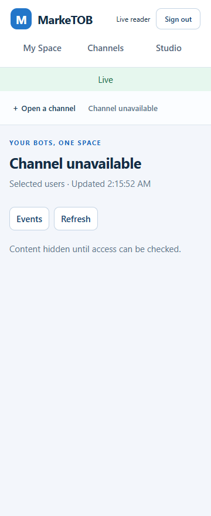

# PM-023 · независимая проверка Web/API

9 ноября: [R1 текущий binding](PM-023-release-binding-20261109.md) и [R2 исходный комплект](PM-023-source-kit-20261109.md) выполнены; 34 focused tests, Windows/Linux offline verification и CI 42662230365 PASS. Coverage partial, 19/24.

9 ноября. [Гонка при построении схем](PM-023-schemas-20261109.md) воспроизведена,
исправлена и установлена в schema-20261109. HTTP остаётся параллельным; OpenAPI
и 31 версия пакетов сохранены. Все четыре задания CI 42639942759 PASS:
355 Python/69 Chromium. Backup/restore 29 таблиц/10 sequences совпал;
My Space/фото/Meduza/Live/logout и HTTPS/HTTP2 PASS. PM-023 открыта, 19/24.

8 ноября. Собран комплект исходных материалов 750 786 560 байт с автономной
проверкой SHA-256. Git-снимки содержат точные 593/681 файла; внутри объединены
исходники Debian/Alpine/Python/Rust, уведомления и инструкция замены драйвера.
Реальный tar проверен на Windows и в Linux без сети, включая подписи и все
95 версий исходников Debian. 15 тестов и статический контроль прошли.
На b8e5242 прошли все четыре задания [CI 42425558592](https://github.com/Villentretermert/ProjectMarket/actions/runs/42425558592): 310 различных Python-тестов,
54 сценария Chromium, Docker/HTTPS/HTTP2 и восстановление БД.
[Квитанция и результат](PM-023-handover-20261108.md). Охват partial, PM-023 открыта, готово 19/24.

7 ноября. Проверена пересборка и замена psycopg-c получателем. Обе C-библиотеки
загрузили новую метку, остальные файлы Python-пакетов и реестр системных пакетов
совпали с baseline. Прошли 13 групп TLS/DB/pool-проверок и 11 тестов рецепта,
Ruff/format/mypy по 109 файлам. Добавлены инструкция и повторение в CI.
На коммите b347869 прошли все четыре задания [CI 42397251222](https://github.com/Villentretermert/ProjectMarket/actions/runs/42397251222), 295 различных Python-тестов,
54 сценария Chromium, повторная сборка изменённого драйвера и Docker/HTTPS/HTTP2/restore.
[Отчёт](PM-023-replacement-20261107.md). PM-023 открыта, готово 19/24 задач.

5 ноября. Собраны исходные пакеты Debian для всех 95 сочетаний имени и версии
в образах API, бота и БД. Подписи четырёх индексов и байты 304 файлов пакетов
прошли проверку. Все 95 пакетов распакованы, версии changelog совпали.
На коммите b810c17 прошли 4 задания CI, 284 различных Python-теста, 54 сценария Chromium и проверка Docker с HTTPS/HTTP2 и восстановлением БД. [CI 41933635979](https://github.com/Villentretermert/ProjectMarket/actions/runs/41933635979).
[Отчёт и инструкция](PM-023-debian-sources-20261105.md). PM-023 открыта, готово 19/24 задач.

4 ноября. Для всех 10 пропущенных записей Cargo собраны тексты из архивов
пакетов и сопоставленных коммитов. Два набора вместе содержат 546 различных
текстов. Локально подготовлены и проверены 482 файла исходников и материалов.
70 тестов сборщиков прошли.
Для fdebed8 прошли все четыре задания CI, 277 различных Python-тестов и 54 сценария Chromium. [Проверка в GitHub](https://github.com/Villentretermert/ProjectMarket/actions/runs/41749693035).
 PM-023 открыта, готово 19/24 задач. [Отчёт](PM-023-crate-gaps-20261104.md).

4 ноября, SBOM и native notices. [Проверены три встроенных SBOM](PM-023-native-provenance-20261104.md)
и 315 registry occurrences; записаны ELF-версии Rust и подтверждение рецепта
libffi 3.4.6. Новый набор содержит 539 уникальных текстов, все прежние gaps сохранены.
Добавлена offline CI-проверка и повторный сбор с проверкой wheel/архивов.
65 targeted tests, Ruff/format/mypy по 103 файлам и проверка хешей прошли.
[CI 41737007937](https://github.com/Villentretermert/ProjectMarket/actions/runs/41737007937) на 60d440d: все 4 задания PASS, 272 различных Python-теста
и 54 Chromium-сценария; Docker/HTTPS/HTTP2/backup/restore прошли.
Точный Linux link map и воспроизводимость сборок не заявлены. Поставка 68958f1,
19/24 и отсрочки сохранены; полная PM-023 открыта.

3 ноября, Rust/C source notices. [Проверены исходники шести Python-пакетов](PM-023-embedded-licenses-20261103.md)
и 450 уникальных Rust registry inputs. Пять wheel совпали с native hashes API.
В наборе 522 уникальных текста; 10 source notice gaps и 5 отсутствующих workspace
manifests отмечены отдельно от runtime inventory. 35 targeted tests, Ruff/mypy
по 101 файлу прошли. [CI 41690800155](https://github.com/Villentretermert/ProjectMarket/actions/runs/41690800155)
на b8a3203: все 4 задания PASS, 242 различных Python-теста и 54 Chromium-сценария;
Docker/HTTPS/backup/restore и новая проверка notices на обеих ОС прошли.
Точный Rust build graph/toolchain и libffi provenance — следующий подэтап. Поставка 68958f1, 19/24 и отсрочки сохранены.

3 ноября, продолжение. [Alpine source notices](PM-023-alpine-licenses-20261103.md)
добавлены для 28 из 32 пакетов. Проверены 20 origins, 167 Git blobs и все 152
checksum inputs. В наборе 298 уникальных текстов. Локальный архив исходников
содержит 187 проверенных файлов. Четыре пробела атрибуции остаются открытыми.
20 targeted tests и Ruff/mypy по 99 файлам прошли. [CI 41687143893](https://github.com/Villentretermert/ProjectMarket/actions/runs/41687143893)
на bf767d1 прошёл все 4 задания: 227 различных Python-тестов и 54 Chromium-сценария,
Docker/HTTPS/backup/restore. Привязка уведомлений проверена на Windows и Ubuntu.
Следующая независимая работа — встроенные Rust/C-компоненты Python-библиотек.
Рабочая поставка 68958f1 и счётчик 19/24 сохранены. Полная PM-023 открыта.

3 ноября. По решению владельца добавлена Apache-2.0 и LICENSE/NOTICE в четыре
Python wheel. Подготовлен [реестр уведомлений](PM-023-licenses-20261103.md)
для 377 уникальных компонентов поставки 68958f1, 259 полных текстов.
32 Alpine notices, встроенные зависимости и соответствующие исходники остаются
открытыми. 11 focused tests/Ruff/mypy97files, offline lock/wheels и hashes PASS.
[CI41680762892](https://github.com/Villentretermert/ProjectMarket/actions/runs/41680762892) на e813e77 прошёл все4jobs,
218 Python/54 Chromium, Docker/HTTPS/backup/restore. Notice bundle и четыре wheel
проверены на Windows и Ubuntu.
Полная PM-023 открыта, счётчик19/24, рабочие образы не переустанавливались.

2 ноября. Обе открытые записи OpenLDAP проверены через клиент PostgreSQL
и контрольные вызовы библиотеки. [Результаты 22 сценариев](PM-023-ldap-20261102.md).

Продолжение1ноября после C-драйвера: [Kerberos/OpenLDAP triage30 записей](PM-023-native-triage-20261101.md).

Продолжение1ноября: [Linux psycopg C, системные libpq/SSL и реальные TLS/pool проверки](PM-023-psycopg-c-20261101.md).

Следующий подэтап31октября: [проверка фактически загруженных SSL/libpq в psycopg](PM-023-psycopg-20261031.md).

Продолжение31октября: [Go-зависимости Caddy и остаточная ветка go-jose/v3](PM-023-dependencies-20261031.md).

Продолжение30октября: [curl/libcurl proxy и уточнение psycopg linkage](PM-023-dependencies-20261030.md).

Последний результат27октября: [остаточный triage и установленный OpenSSL backport](PM-023-dependencies-20261027.md).
Последующее дополнение: [dependency review, SBOM и обновление Docker pins](PM-023-dependencies.md).
Продолжение25октября: [Go proxy/gosu,32 устранённых совпадения версий и проверенная установка dac119f](PM-023-dependencies-20261025.md).
Это отдельный проверенный охват; полная приёмка PM-023 остаётся открытой.

24 октября 2026. **In progress, полная задача не принята.** Разрешение — D44;
Android/облако и полный L2 остаются отложенными. Счётчик 19/24, G05 ещё не наступила.

**Продолжение D45:** владелец разрешил общее исправление очереди. Оно реализовано
и локально проверено: [новый отчёт](PM-023-queue-fix.md), 76 tests +3 controls и49
Edge scenarios PASS; CI 40077334919:185 tests/49 Chromium, все 4 jobs PASS.

**Продолжение D46:** ответы получены; реализованы export, ownership transfer и
guarded deletion. [Актуальный отчёт](PM-023-account-privacy.md). Ниже сохранены
исторические результаты первого этапа, включая прежние открытые вопросы.

## Изменения

- `teams.py`: повторное сохранение той же роли не создаёт новых уведомлений.
  Проверено даже при 20 000 pending rows; реальные изменения ролей сохраняют
  прежний протокол доставки.
- `maintenance.py`: пакетная минимизация preferences и outbox metadata для
  деактивированных пользователей/источников/workspace. Минимальные общие hints
  отзыва остаются до обычной очистки; чужие события, заявки и receipts сохранены.
  `observability.py` разрешает только два новых агрегированных счётчика.
- `web/live.js`: при отзыве источника закрываются открытые dialogs, включая
  подтверждение покупки с прежним названием товара. Сама заявка не отправляется.
- Подготовлены [прототип Data & privacy](../design/PM-023-privacy.md),
  [описание данных](../privacy/DATA_POLICY.md) и
  [инвентаризация зависимостей](../privacy/DEPENDENCIES.md).
  Export/новый сценарий удаления пока не реализованы: нужны ответы о составе
  файла, судьбе workspace и подтверждении.

## Проверки текущих исправлений

| Проверка | Результат / граница |
| --- | --- |
| PostgreSQL: privacy, teams, updates, operations, worker health | 29 PASS, 29,03 с; временные схемы, отдельно от работающего пилота |
| Реальный Web/API + два Python-бота, Edge | 48 PASS, включая новый сценарий отзыва при открытом подтверждении |
| Ruff / format / mypy | PASS; mypy 86 файлов |
| Изолированный SQL-эксперимент предложения очереди | 3 PASS; **не** проверка интеграции неприменённого патча |
| CI `3d82143` | Все 4 jobs PASS: 81 unit + 90 integration = 171 Python tests; 48 Chromium browser scenarios; Docker/HTTPS/backup/restore |

Первый локальный запуск pytest не создал временный каталог: 6 setup errors,
23 PASS. После создания родительского каталога повтор всех выбранных тестов
дал 29 PASS. Это ошибка подготовки стенда, не скрытая неудачная проверка продукта.
Браузерные результаты: [JSON](assets/PM-023/browser-results.json).
Исходники: [commit 3d82143](https://github.com/Villentretermert/ProjectMarket/commit/3d82143d4127f43ed95a26565aec22ebf2342a4b).
[CI 40045091707](https://github.com/Villentretermert/ProjectMarket/actions/runs/40045091707),
[сохранённые статусы](assets/PM-023/ci-results.json). В CI дополнительно проверено,
что закрытие подтверждения при отзыве не отправляет POST actions.
Ссылки/трассировка 30 требований, 16 историй, 17 ответов PASS; проверка 486 файлов
на известные форматы GitHub tokens/private keys без совпадений. Это ограниченная
проверка форматов, не аудит истории Git или гарантия отсутствия любых секретов.

Фактический результат на узком экране: старое подтверждение закрыто, название и
данные источника убраны. Это существующий экран, а не реализованный privacy-прототип.

## Матрица границ

| Граница | Доказательство / оставшаяся работа |
| --- | --- |
| Tenant, Owner/Admin/Editor, grants | Статический просмотр + PostgreSQL teams/updates и реальные Studio browser cases |
| Bot credentials и изоляция | Статический просмотр маршрутов/хранилища, существующие bot tests в полном CI; browser rotation |
| Unsafe rendering / layout import | Browser plain text/unsafe links и import privacy; layout не исполняется как код |
| Cache / revoke | 48 browser cases, включая offline/hidden, live revoke, открытый dialog |
| Cleanup / delivery IDs | 3 новых privacy integration tests: deleted user/source/owner, batches, idempotence, retained events/receipts, floor/resync |
| Переполненная очередь при реальном отзыве | Открыто: no-op amplification исправлено, общий revoke-path ещё зависит от outbox capacity |
| Полный export / физическое удаление | Открыто: решения владельца и последующая реализация |
| Android / widget / Google / background push | Не проверено, отложено владельцем |
| Полный L2 / внешний release | Не принят; прежние ограничения PM-022 сохраняются |

## Статический Codex Security scan

Scan `358f6f14-3d8a-4ada-8482-046a4f86966f`, исходный snapshot
`f496ccdd451ee929921fa457f287678d045b5a93`, scope `apps/api/src`: просмотрены
все 56 исходных файлов. Один finding Low / confidence Medium / CWE-400:
`resource-exhaustion.membership-outbox-fanout`. При полной общей очереди INSERT
уведомления может откатить транзакцию отзыва прав другого workspace. Оценка
учитывает аутентифицированного владельца и локальную loopback-поставку; время
атаки/эксплуатация на работающем пилоте не измерялись.

На первом этапе была исправлена только no-op часть. Расширенный патч
механизма доставки тогда дважды отклонён автоматической проверкой и не применялся.
[Конкретное предложение](../proposals/PM-023-queue-safety.md) описывает изменения,
компромисс глобального resync и тесты до принятия. Явное разрешение
владельца на реализацию и интеграционные проверки этого механизма было получено
в последующем D45; результаты вынесены в новый отчёт выше.

Полный отчёт/SARIF сохранены каноническим плагином вне Git; ссылка на отчёт дана
в сообщении владельцу. Scan не покрывает историю Git, CVE зависимостей, native
код, приватные env и настройки ОС. Статическое отсутствие других находок не
доказывает отсутствие уязвимостей. Исходники исправлены после снимка scan;
тесты выше относятся к исправлениям, новый полный scan не выполнялся.

## Поставка и следующий шаг

Рабочий локальный Docker обновлён до a7deaab после CI: 191 Python tests / 54 browser scenarios и
проверенного backup/restore29 tables / 10 sequences. [Актуальный результат D46](PM-023-account-privacy.md)
содержит export/ownership/delete и фактические снимки. Миграции и Bot API не менялись.
Ответы о данных получены, исправление очереди проверено; остаются отложенные
Android/облако/полныйL2 и full acceptance. Независимая инструкция передачи
подготовлена в PM-024, выпуск RC этим не объявляется. GitHub
[#28](https://github.com/Villentretermert/ProjectMarket/issues/28) остаётся открытой.
