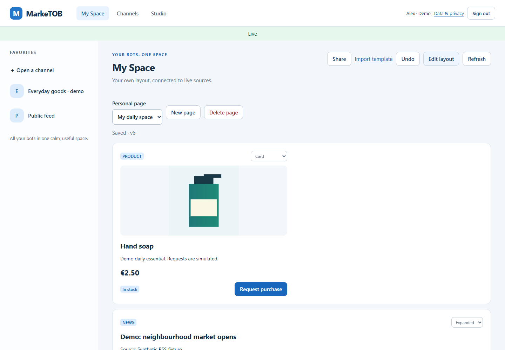
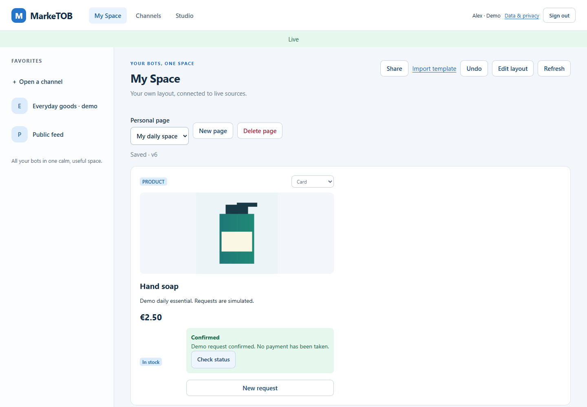
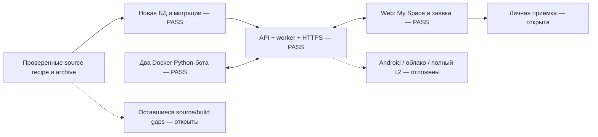

# PM-024-R1 · Чистый запуск schema-20261109

Третья из [трёх подзадач](../follow-ups/DELIVERY-2026-11-09.md) выполнена.
Текущие Linux images запущены на новой БД в отдельном Docker project. Рабочий
`marketob-pm021`, его данные, CA и фоновый news-бот не менялись.

## Результат

| Проверка | Факт |
| --- | --- |
| Пустая БД, миграции, API, maintenance | Запущены успешно |
| HTTPS | Собственная временная CA, Web и Secure cookie проверены |
| Image identity | API/maintenance/DB/proxy/catalog-bot совпали с четырьмя IDs recipe |
| Два Python-бота в Docker | HTTP-публикация 4 товаров и 6 news/chart records |
| Доступ | Анонимный читатель получил 404; выбранному читателю выдан grant |
| Web | 5 проверок Favorites/My Space/Card/autosave/Undo/purchase прошли |
| Обратный канал | Реальная заявка принята Docker-ботом, ровно 1 confirmed в БД |
| JavaScript | 0 page errors, Edge 157.0.4341.42 |
| Очистка | Только созданные тестовые контейнеры/volumes удалены в finally |

[Release receipt](assets/PM-024/delivery-schema-20261109/release.json),
[браузерный результат](assets/PM-024/delivery-schema-20261109/result.json).
Синтетический ролик длительностью 82 секунды остаётся локально:
`.local/pm024/delivery-schema-20261109-03/marketob-my-space.webm` (6 344 394 байт).

## Код и порядок

`scripts.smoke_release` сначала проверяет recipe и source binding. `DockerLab`
выделяет новую БД/порты/имя проекта. Приватный overlay закрепляет образы по IDs,
а не mutable tags. Создаются Owner и B2C reader; `pilot_bots` через HTTP выдаёт
каждому боту свой credential и закрытый канал. Данные публикуют именно текущие
Docker images, не локальная копия пакета. `record-demo.mjs` выполняет реальные
действия через UI; запрос после подтверждения проверяется в тестовой БД.

Ruff/format/mypy120 PASS. На исходном комплекте с исправленным binding прошли
34 focused tests и все четыре задания [CI 42662230365](https://github.com/Villentretermert/ProjectMarket/actions/runs/42662230365)
на `0e8c986`: Linux 263 unit, Windows 261 + 2 skips, PostgreSQL/backend/Web,
Docker/HTTPS/backup/restore. Новый smoke_release проверен отдельно реальным
чистым запуском выше; это уточнение отличает его от состава того CI commit.

Первые попытки выявили ошибки проверочной среды: GET session без Origin получил
ожидаемый 403; после исправления скрипта отсутствовал скачанный Playwright Chromium.
Повтор выполнен на установленном Edge. Каждая неуспешная попытка также удалила
свой временный стек. Код API и образы в этом блоке не менялись.

## Передача и границы

[Текущая поставка](../setup/CURRENT_DELIVERY.md) описывает точные артефакты,
команды повторения, зависимости и различие source archive / Docker images.
Обновлены PILOT_HANDOFF и устаревшее значение release в LOCAL_DELIVERY.
На новом компьютере образы нужно доставить отдельно; source tar их не содержит.

RSS в этом сценарии — bundled synthetic fixture; доступность Meduza повторно
не проверялась. Изображение товара — синтетическая иллюстрация. Полная PM-024
не закрывается: Android/личная приёмка/другие обязательные пункты не подменяются
Docker/Web smoke. Глобальный счётчик остаётся 19/24, G05 ещё не наступает.
