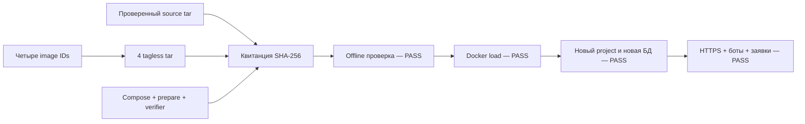

# PM-024-R2 · Переносимый локальный Docker-комплект

10 ноября 2026. [Подзадача](../follow-ups/DOCKER-KIT-2026-11-10.md) выполнена:
четыре проверенных Linux/amd64 images и соответствующие исходные материалы
собраны для переноса без повторной сборки. Рабочий пилот не менялся.

## Получить и проверить

Локальный каталог: `.local/pm024/docker-kit-schema-20261110/`.
Скопируйте **весь каталог**: 13 проверяемых файлов плюс receipt.json и SHA256SUMS,
**1 764 728 433 байта** суммарно. Большие tar не загружались в GitHub; квитанции опубликованы.

SHA-256 **receipt.json**:
`078418fbf1e6c2f28c2ac3bbf59f0f1ff7a89fbd56aca20edd98771a84712bca`.
Это хеш квитанции, которая содержит размеры/хеши всех файлов, а не хеш одного tar.

[Квитанция](assets/PM-024/docker-kit-20261110/receipt.json),
[инструкция запуска](../setup/DOCKER_KIT.md),
[результат получателя](assets/PM-024/docker-kit-20261110/recipient.json),
[Linux offline verification](assets/PM-024/docker-kit-20261110/linux-verification.json).

```text
python -I verify.py --verify . --sha256 078418fbf1e6c2f28c2ac3bbf59f0f1ff7a89fbd56aca20edd98771a84712bca
```

## Что изменилось

- `scripts/docker_kit.py` экспортирует отдельный tagless tar для каждого image
  по immutable ID; собирает исходный архив, Compose, README и проверяющий скрипт.
  Tooling commit — `6fab0e6c2b71f23115960af99823dc293f39893a`;
  исполняемый код — `896449bde9cdec4cea9f7ce29eba6910285da30e`.
- Standalone verifier связывает состав с внешним SHA-256 receipt, проверяет
  blobs, image config, платформу, порядок слоёв и согласованность Docker/OCI
  metadata. У single-image архивов нет tags/именованных OCI references.
  Слои не извлекаются и не исполняются при проверке.
- `scripts/prepare_delivery.py` создаёт новую приватную конфигурацию с уникальным
  именем Docker project и случайным паролем. Повторная инициализация существующего
  каталога отвергается. Compose закреплён по IDs, build/pull отключены,
  опубликованные порты привязаны к loopback. Старые volumes не подключаются.
- Исходный архив `1a3dd882…` включён побайтно вместе с его квитанцией и recipe.
  Семь групп source/build gaps сохранены, coverage — partial.

## Проверки

| Проверка | Результат |
| --- | --- |
| 22 unit tests | PASS: порча/пропуск/лишние файлы, чужие ID, tags, OCI mismatch, платформа, source binding, подготовка конфигурации |
| Ruff / format / mypy123 | PASS |
| Реальный комплект на Windows, standalone `-I` | PASS, Git/Docker для verifier не нужны |
| Реальный комплект в Linux, read-only mount, `--network none` | PASS |
| `docker image load` | Все 4 ID загружены, без переназначения тегов |
| Compose из доставленных файлов | Новая БД/миграции/API/worker/proxy, no-build/no-pull |
| HTTPS / сессия | CA проверена только тестовым клиентом, Secure cookie работает |
| Каталог и RSS через Docker-ботов | 4 товара, 6 news/chart records; закрытые каналы возвращают 404 анонимному читателю |
| Заявки | `confirmed` и `failed` получены от настоящего бота, без платежей |
| Stop → up | Прежняя сессия и опубликованный snapshot сохранились |
| Очистка | Удалены только новая тестовая копия и её bot-state volumes |
| Рабочий пилот | Container IDs и API tags совпали до/после |

В проверке бот использовал синтетическую RSS, не Meduza. Все четыре задания
[CI 42849734668](https://github.com/Villentretermert/ProjectMarket/actions/runs/42849734668)
для tooling commit 6fab0e6 прошли: Windows/Linux Python, PostgreSQL/backend/Web,
Docker/HTTPS/backup/restore. [Квитанция CI](assets/PM-024/docker-kit-20261110/ci.json).
После очистки тестового проекта все четыре сервиса рабочего пилота healthy,
API возвращает ready/database=ok.

## Как это работает



## Границы результата

Использован существующий локальный Docker engine; это проверка импорта и чистой
БД, а не опыт на втором физическом компьютере или пустом daemon. Наличие всех
ссылочных blobs/слоёв проверено отдельно verifier. ARM64, native Windows/Android,
облако и полная внешняя приёмка не проверялись. Docker/Compose и Python для
проверки получатель устанавливает отдельно. Архив не содержит пользовательскую
БД, bot keys, локальную CA или приватные env.

Стандартные операции основаны на [Docker save](https://docs.docker.com/reference/cli/docker/image/save/)
и [Docker load](https://docs.docker.com/reference/cli/docker/image/load/).
Для полного замещения портов требуется [Compose 2.24.4+](https://docs.docker.com/reference/compose-file/merge/#replace-value).
Цифровой подписи нет; источник ожидаемого SHA-256 должен быть доверенным.
Полная PM-024 остаётся открытой; счётчик 19/24, прежние отсрочки сохраняются.
