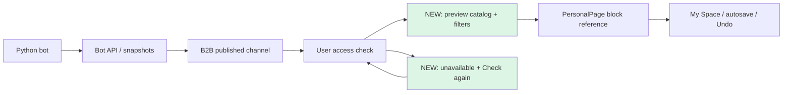

# S03/S04 · каталог блоков My Space

8 ноября 2026 · дополнение к PM-016, [issue #36](https://github.com/Villentretermert/ProjectMarket/issues/36).

Реализован визуальный выбор блоков выбранного избранного канала: предпросмотр,
поиск по названию/тексту, фильтр Products/News/Charts и Add to My Space.
Карточки используют авторизованные данные; кнопок покупки в каталоге нет.
Ссылки на источник сохраняются прежним PersonalPage API. Undo, конфликт версий,
автосохранение и право B2B на собственный шаблон сохраняются.

Недоступные блоки объясняют отсутствие данных и предлагают Check again. Повтор
перечитывает права и снимок, не сбрасывает layout и не отправляет заявку. Источник
каталога включён в live-наблюдение до добавления его первого блока. Поздний ответ
прежнего выбранного канала не восстанавливает превью. Offline/hidden/sign-out
используют существующий общий механизм очистки приватного интерфейса.

## Дизайн и фактический результат

[Макет и критерии](../design/BLOCK_CATALOG.md) показаны до реализации. Фактический
каталог встроен в прежний редактор под названием/Theme/Density; широкая сетка
содержит до трёх колонок, 360 px — одну. У графика доступны реальные значения
через View chart data. Макет показывал смешанный demo-канал; в проверке товары и
новости приходят от разных ботов. Фотографии в этот этап не включены.

[Экран 360 px](assets/SR-block-catalog-20261108/catalog-phone.png) ·
[Недоступный источник и повтор](assets/SR-block-catalog-20261108/catalog-source-unavailable.png).
Все данные синтетические. На снимках после смены grants может быть промежуточный
индикатор Reconnecting: уже показанные блоки прочитаны заново с проверкой доступа;
live-подписка заканчивает восстановление отдельно.

## Компоненты

- `web/block-catalog.js`: фильтры, карточки, предел 50, состояние сохранения и фокус клавиатуры.
- `web/render.js`: безопасный текстовый/числовой preview и Check again для отсутствующего источника.
- `web/space.js`: ссылки на опубликованные блоки, авторизованное перечитывание, защита от поздних ответов.
- `web_routes.py`: новый JS-модуль включён в явный список доступных ресурсов.
- `catalog-acceptance.mjs`: девять сценариев с реальными API/grants и отмеченными
  симуляциями сетевой ошибки, задержанного ответа и небезопасного текста.

## Проверки

[Локальный результат](assets/SR-block-catalog-20261108/browser-results.json): **63 PASS**,
Edge 157.0.4341.42, page errors — 0. Девять новых сценариев проверяют фильтры,
клавиатуру/Undo, отзыв доступа до добавления блока, 360 px и безопасный текст,
гонку переключения, retry после 503, revoke/restore без изменения layout,
offline/reconnect, пустой канал и лимит 50. Прежние 54 сценария также прошли.

15 проверок foundation/упаковки Web прошли; Ruff/format/mypy112 и JS syntax PASS.
Новый Docker-образ `marketob-api:catalog-20261108` собран. Полный CI и обновление
постоянного пилота ещё выполняются; до записи их результата локальная поставка
остаётся 68958f1. Новых миграций и изменений контрактов нет.

19/24, Android/облако/L2 и полная PM-023/024 остаются открытыми. Следующая
продуктовая доработка — фотографии товаров с предварительным контрактом источника.
