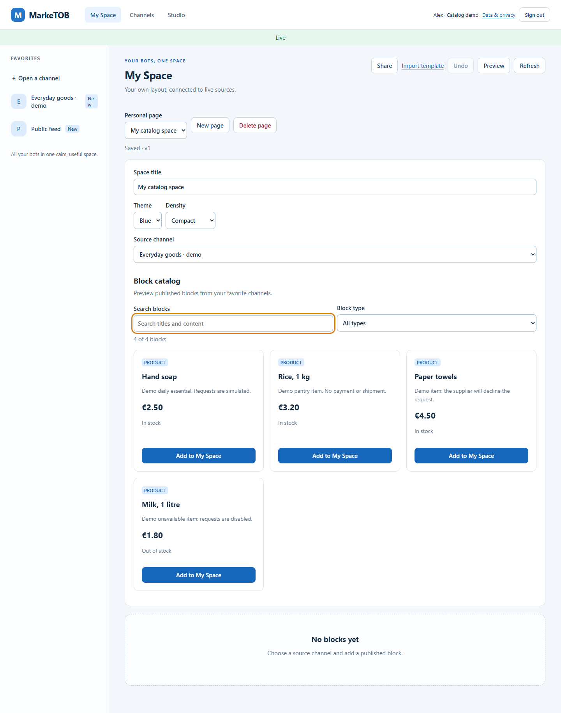
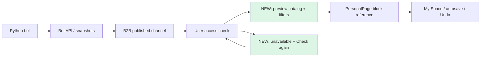
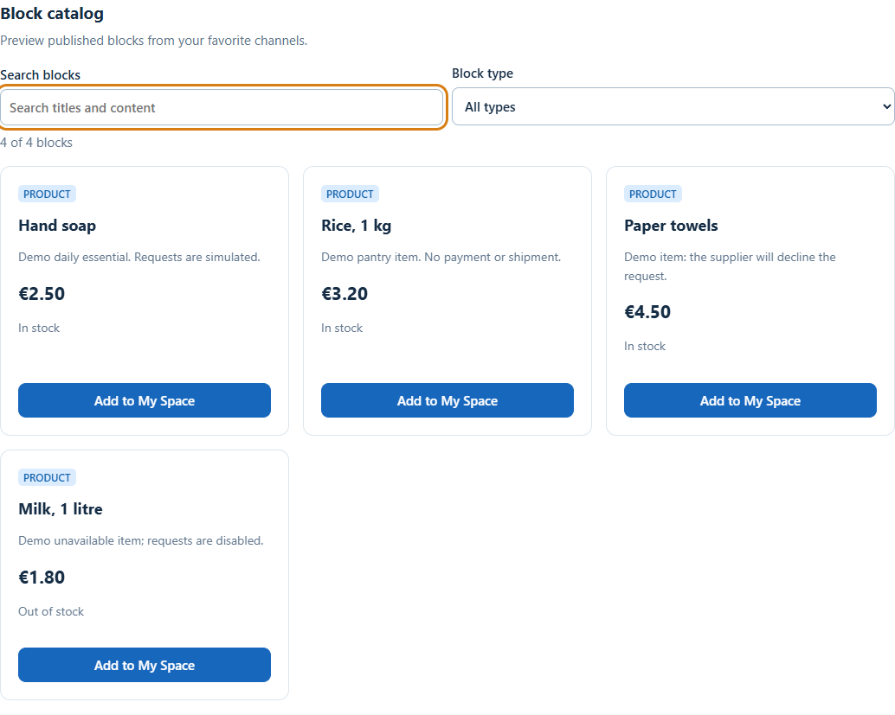

# S03/S04 · каталог блоков My Space

8 ноября 2026 · дополнение к PM-016, [issue #36](https://github.com/Villentretermert/ProjectMarket/issues/36).

Реализован визуальный выбор блоков выбранного избранного канала: предпросмотр,
поиск по названию/тексту, фильтр Products/News/Charts и Add to My Space.
Карточки используют авторизованные данные; кнопок покупки в каталоге нет.
Ссылки на источник сохраняются прежним PersonalPage API. Undo, конфликт версий,
автосохранение и право B2B на собственный шаблон сохраняются.

Недоступные блоки объясняют отсутствие данных и предлагают Check again. Повтор
перечитывает права и снимок, не сбрасывает layout и не отправляет заявку. Источник
каталога включён в live-наблюдение до добавления его первого блока. Поздний ответ
прежнего выбранного канала не восстанавливает превью. Offline/hidden/sign-out
используют существующий общий механизм очистки приватного интерфейса.

## Дизайн и фактический результат

[Макет и критерии](../design/BLOCK_CATALOG.md) показаны до реализации. Фактический
каталог встроен в прежний редактор под названием/Theme/Density; широкая сетка
содержит до трёх колонок, 360 px — одну. У графика доступны реальные значения
через View chart data. Макет показывал смешанный demo-канал; в проверке товары и
новости приходят от разных ботов. Фотографии в этот этап не включены.

[Экран 360 px](assets/SR-block-catalog-20261108/catalog-phone.png) ·
[Недоступный источник и повтор](assets/SR-block-catalog-20261108/catalog-source-unavailable.png).
Все данные синтетические. На снимках после смены grants может быть промежуточный
индикатор Reconnecting: уже показанные блоки прочитаны заново с проверкой доступа;
live-подписка заканчивает восстановление отдельно.

## Компоненты

- `web/block-catalog.js`: фильтры, карточки, предел 50, состояние сохранения и фокус клавиатуры.
- `web/render.js`: безопасный текстовый/числовой preview и Check again для отсутствующего источника.
- `web/space.js`: ссылки на опубликованные блоки, авторизованное перечитывание, защита от поздних ответов.
- `web_routes.py`: новый JS-модуль включён в явный список доступных ресурсов.
- `catalog-acceptance.mjs`: девять сценариев с реальными API/grants и отмеченными
  симуляциями сетевой ошибки, задержанного ответа и небезопасного текста.

## Проверки

[Локальный результат](assets/SR-block-catalog-20261108/browser-results.json): **63 PASS**,
Edge 157.0.4341.42, page errors — 0. Девять новых сценариев проверяют фильтры,
клавиатуру/Undo, отзыв доступа до добавления блока, 360 px и безопасный текст,
гонку переключения, retry после 503, revoke/restore без изменения layout,
offline/reconnect, пустой канал и лимит 50. Прежние 54 сценария также прошли.

15 проверок foundation/упаковки Web прошли; Ruff/format/mypy112 и JS syntax PASS.
Новый Docker-образ `marketob-api:catalog-20261108` собран. Его 31 runtime-версия
совпала с 68958f1; все 16 проверенных Web-файлов совпали с checkout.
[Сверка образа](assets/SR-block-catalog-20261108/image-check.json).

На fe66d3d прошли все четыре задания [CI 42499457148](https://github.com/Villentretermert/ProjectMarket/actions/runs/42499457148):
200 unit на Ubuntu, 198 + 2 Linux-only skips на Windows, 110 PostgreSQL integration
(310 различных Python-тестов), 63 Chromium-сценария, Docker/HTTPS/HTTP2 и restore.
[Квитанция CI](assets/SR-block-catalog-20261108/ci-results.json).
В PostgreSQL job остаются два предупреждения Pydantic о неиспользованном alias
`bot_id`; тесты прошли. Причина этого предупреждения в данном UI-подэтапе не исследовалась.
После этого уточнена синхронизация теста запоздавшего ответа и добавлен режим
`scripts.smoke_web --catalog-only`: [9 сценариев повторно прошли локально](assets/SR-block-catalog-20261108/catalog-focused.json).
Этот последующий commit меняет тестовый запуск и отчёты; код API/Web образа остаётся fe66d3d.

## Локальная установка выполнена

Ранее автоматическая проверка потребовала отдельного разрешения на остановку и
замену постоянных сервисов. После вопроса владелец ответил «Продолжай делать задачи»
(D50), и подготовленное обновление выполнено.

Установлены API/worker `catalog-20261108`, image
`sha256:088eddf68ef8d6ab096941590db283261c9ee4f28755790f17aa18d6b4287694`.
Перед заменой создан backup и выполнено настоящее восстановление в отдельную БД:
**29 таблиц и 10 sequences совпали**. Исходная БД сохранена; мигратор не запускался.
Контейнеры/образы DB и proxy, их тома и CA сохранены. Все четыре сервиса healthy.
[Квитанция установки](assets/SR-block-catalog-20261108/local-delivery.json).

Первая попытка автоматически откатилась: proxy ещё не успел обновить health после
паузы API. Подтверждены прежний image ID и доступность пилота. Во второй попытке
использованы новая резервная копия и ограниченное ожидание health до 90 секунд.
Сверка таблиц объединена в один SQL-снимок; её результат предварительно совпал
с сохранённым результатом первого восстановления. Повторная установка прошла.
Приватные материалы обеих попыток: `.local/catalog-delivery-20261108/` и
`.local/catalog-delivery-20261108-02/`; в Git они не публикуются.

На установленной версии прошли [браузерные проверки](assets/SR-block-catalog-20261108/deployed-browser.json):
прежний demo-аккаунт, сохранённая My Space, каталог/поиск, Live и выход; page errors — 0.
Проверены HTTPS с доверенным CA, локальный вход, Secure session, удаление отдельного
проверочного аккаунта и реальное согласование HTTP/2.

Последующий тестовый commit 9e2f464 также прошёл все четыре задания
[CI 42500168800](https://github.com/Villentretermert/ProjectMarket/actions/runs/42500168800);
[квитанция](assets/SR-block-catalog-20261108/ci-followup.json).
**S03/S04 завершены**, фотографии и Meduza RSS остаются отдельными пунктами.

19/24, Android/облако/L2 и полная PM-023/024 остаются открытыми. Следующая
продуктовая доработка — фотографии товаров с предварительным контрактом источника.
