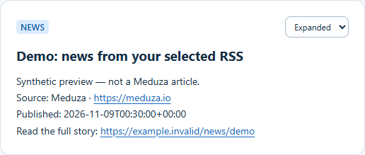

# S06 — Meduza RSS · 9 ноября 2026

Состояние: **S06 выполнена, подключена к локальному пилоту**.
Связи: [issue #36](https://github.com/Villentretermert/ProjectMarket/issues/36),
[PM-011](../tasks/PM-011.md), [дизайн](../design/MEDUZA_RSS.md).

## Изменение

`common.RSS_URL` задаёт русскую редакцию Meduza для новых конфигураций.
`news.SOURCES` связывает точный адрес с атрибуцией Meduza RU/EN или прежней BBC.
Произвольный URL получает общий label. Существующие env-файлы автоматически
не переписываются. Переключение не создаёт новые channel/resource IDs и не меняет
сохранённую My Space. Полные статьи и картинки из RSS не отправляются.
Первый URL выбран как рабочее допущение по ответу «медуза», язык UI не менялся.

## Проверки

- Оба настоящих адреса проверены 9 ноября в 02:22 UTC: Russian 343176 байт,
  English 330301 байт; в каждом 30 записей, все с датой и ссылкой, XML RSS 2.0.
  Raw XML хранится только в ignored `.local`, в публичном репозитории его нет.
- `tests/test_demo_bots.py` и `tests/test_news_source.py`: 16 PASS. Новый XML
  полностью синтетический. Проверены Unicode и HTML title, UTC-сдвиги, отсутствие
  подставных дат, небезопасные ссылки, игнорирование description/content/enclosure,
  все варианты атрибуции, стабильные slots, повтор после restart, сетевой/invalid/empty
  отказ без изменения журнала/публикации. Порядок ленты сохраняется.
- Полный Windows unit: 240 PASS, 2 skip, 111 integration deselected;
  Ruff/format/mypy116 PASS. `marketob-bot:meduza-20261109` собран из locked workspace,
  девять версий Python-пакетов сохранены; новых зависимостей и миграций нет.
- Все четыре задания [CI 42551266615](https://github.com/Villentretermert/ProjectMarket/actions/runs/42551266615)
  на [2cba029](https://github.com/Villentretermert/ProjectMarket/commit/2cba0294ffd672d7ad91cf271b00ba5b7cb95f16)
  PASS: Linux 242 unit + PostgreSQL 111 = **353 различных Python-теста**;
  Windows 240 PASS/2 skip; 69 Chromium-сценариев, Docker/HTTPS/HTTP2/restore.
  [Квитанция](assets/SR-meduza-20261109/ci-results.json).

## Локальное подключение

- Прежний news-бот получил реальную русскую RSS. До изменения сохранены private
  env и SQLite backup; ключ/канал/журнал сохранены. Приняты пять news-блоков и
  график по 30 датированным записям. Повтор после открытия журнала заново не меняет
  snapshot/revisions. Все прежние layouts My Space совпали; анонимное чтение
  закрытого канала возвращает 404. [API-проверка](assets/SR-meduza-20261109/connected.json).
- В Edge проверены прежний demo-вход, пять новостей в My Space и канале,
  кликабельные оригинальные ссылки, Live, ширина 390 px без горизонтальной
  прокрутки, очистка после выхода. Внешних запросов браузера и page errors — 0.
  [Браузерная квитанция](assets/SR-meduza-20261109/browser.json).
- Собран и проверен `marketob-bot:meduza-20261109`, image ID
  `sha256:a93b10c759b741ae247e8b6a2571ce7feeba32bbc1756e7fc8c1c5d9936db582`.
  Контейнер UID 10001 самостоятельно прочитал RSS; девять версий пакетов совпали
  с photos-20261108. [Docker-проверка](assets/SR-meduza-20261109/docker.json).
- В установленном пилоте работает один фоновый **Python** news-бот, интервал
  300 секунд; наблюдались два успешных цикла, stderr пуст на момент проверки.
  Приложение — `http://127.0.0.1:19000/app/#/space`.
  API/worker остаются photos-20261108, DB/proxy/CA не заменялись; четыре сервиса
  healthy. Миграций, остановки API и восстановления платформенной БД не было.
- Два локальных проверочных скрипта первоначально использовали неверную форму
  record (`resource_id` вместо `source.resource_id`) и hash-route (`channels/`
  вместо `channel/`). Исправлены только скрипты; итоговые проверки повторены.
  Уже продвинутый журнал не откатывался и новых повторных публикаций не возникло.

Ниже существующий news-компонент с синтетическим содержимым для публичной
иллюстрации. Это не снимок реальной публикации Meduza; реальные скриншоты и
raw RSS оставлены в ignored `.local`.



Управление текущим локальным процессом из корня ProjectMarket:

```powershell
& .local/meduza-20261109/stop-news.ps1
& .local/meduza-20261109/start-news.ps1
Get-Content .local/meduza-20261109/news.stdout.log -Tail 5
```

Эти скрипты и private README находятся только на текущем компьютере; для нового
клона используется [общая инструкция](../setup/PILOT_BOTS.md). Автозапуск после
перезагрузки компьютера не настроен. Для возврата к прежнему источнику меняют
только URL, сохраняя действующий journal с новыми source revisions.

## Ограничения

Источник зависит от доступности сети. Бот опрашивает его раз в 300 секунд; Live
передаёт принятые сообщения клиентам. При ошибке остаются прежние данные,
автоматический перевод и полный текст не предусмотрены. График показывает
текущее окно дат RSS, а не всю историческую активность редакции.

Официальные адреса: [русская RSS](https://meduza.io/rss/all),
[английская RSS](https://meduza.io/rss/en/all),
[инструкция Meduza со ссылкой RSS](https://meduza.io/amp/en/feature/2022/07/06/where-do-i-find-all-of-meduza-s-content).
PM-023/024 и issue #36 остаются открыты, 19/24; Android/облако/L2 отложены.
