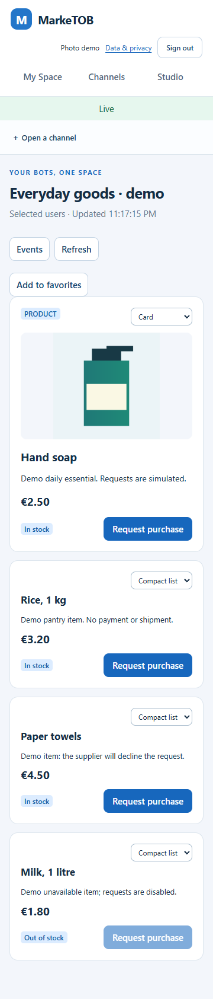

# S05 — Фотографии товаров

8 ноября 2026 · follow-up PM-004/013/016, [issue #36](https://github.com/Villentretermert/ProjectMarket/issues/36).
Состояние: реализовано, завершается проверка поставки; глобальный счётчик 19/24.

## Результат и компоненты

В Product добавлено необязательное `image`. Бот отправляет подготовленный PNG
внутри обычного сообщения. Сервер проверяет формат/CRC/лимиты/распаковку до записи;
байты остаются частью того же source record и истории. Миграций и новых зависимостей нет.
Старое сообщение без фото остаётся валидным; удаление фото — полная замена payload
без `image` с новой revision. Повтор и idempotency conflict сохраняют прежний смысл.

- `contracts/product_image.py`: ограниченный PNG-профиль и bot-side
  `prepare_product_image`, удаляющий необязательные метаданные.
- `payloads.py`: семантическая проверка в production; канонические schema/OpenAPI
  revision 1.1.1 и reference model обновлены вместе.
- `render.js`/`styles.css`: миниатюра списка, Card и каталог My Space; alt,
  contain, Photo unavailable. Цена/заявка доступны при ошибке фото.
- SDK экспортирует helper; пилотный бот отправляет оригинальную синтетическую
  иллюстрацию бутылки, другие товары показывают сценарий без фото.
- Docker API/bot включают helper и схемы; Web передаётся внутри API как прежде.

[Макет и ограничения](../design/PRODUCT_PHOTOS.md) показаны до реализации.
[Bot API и пример Python](../api/PRODUCT_IMAGES.md) описывают транспорт,
совместимость, подготовку и пределы. Первый формат: PNG 1–512 px, ≤96 KiB,
8-bit без palette/interlace/анимации. JPEG/WebP нужно преобразовать на стороне
бота. Это объявленные инженерные ограничения пилота, не ответы владельца.

## Проверки

- 77 targeted unit/contract/foundation PASS; полный Windows Python: **235 PASS,
  2 Linux-only skip**, mypy 115 и Ruff/format PASS.
- PostgreSQL: **107 PASS, 4 Linux-only skip**. Новый сценарий проверяет ingest,
  replay, изменённый body, private/public read boundary, grant/revoke, обновление
  alt и удаление фото. Предупреждение Pydantic об alias `limit` сохранено; в этой
  задаче не исправлялось и не скрывалось.
- Шесть focused Web-сценариев PASS: данные настоящего бота, list/card/360px,
  My Space/catalog, shared layout без байтов, некорректный PNG/URL/SVG, revoke.
  Внешних запросов изображений и page errors нет.
- На визуальной проверке выявлена обрезка картинки в CSS grid. Исправлены размеры
  grid track; добавлена проверка bounding box. В общей Web-регрессии старый
  селектор графика уточнён до SVG: фотографии также имеют доступную роль img.
- В первых unit-тестах длинный автоматически созданный ID файла переполнил
  Windows environment; заданы короткие идентификаторы. Сам validator прошёл.
- [Образы](assets/SR-product-photos-20261108/image-check.json): 31 версия API и
  9 версий бота совпадают с предыдущими; 17 API/Web и 3 contract файла совпадают
  с checkout. Проверен импорт helper и пример фото внутри готового bot image.

Последние focused проверки: [6 фото-сценариев](assets/SR-product-photos-20261108/browser-results.json)
и [9 каталог-сценариев](assets/SR-product-photos-20261108/catalog-results.json) PASS.
Два общих Web-прогона остановились на неоднозначных старых селекторах графика
и Source unavailable во время resync; селекторы уточнены, включая проверку,
что доступный товар сохраняется. Полный итог подтверждается последующим CI.

[My Space с фото](assets/SR-product-photos-20261108/photos-space.png),
[список](assets/SR-product-photos-20261108/photos-list.png).
В отличие от условного HTML-макета, это PNG из данных настоящего Python-бота.
Изображение полностью видно, цена и заявка сохраняются; demo не выдаётся за
фотографию реального товара. CI и установка фиксируются ниже после завершения.

## Доступ и ограничения

Нет отдельного медиасервиса или внешнего fetch. Фото передаётся только с разрешённым
source content; share содержит ссылку на источник. Новая CSP добавляет `data:`
только к img-src. API не принимает image URL, SVG или произвольные chunks.
Приватные bytes не записываются в layout, browser storage или публичный asset.
Отзыв доступа не способен отозвать уже сохранённую пользователем копию.

До 6.25 MiB base64 на 50-блочный snapshot — верхняя граница первого транспорта,
а не измеренная пропускная способность. Полный L2, Android, облако и полная
PM-023/024 остаются отложенными/открытыми. Следующий продуктовый пункт — Meduza RSS.
